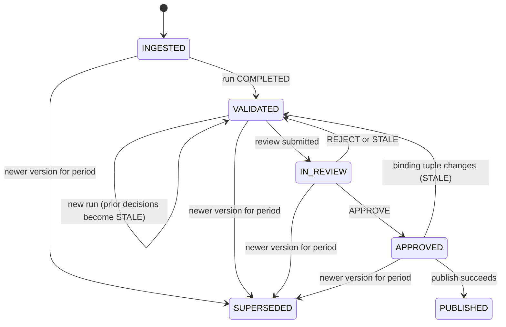

# Sentinel — Product Requirements Document (PRD)

| Field | Value |
|---|---|
| Document | 01 — Product Requirements |
| Product | Sentinel — AI-assisted Data Quality and Reporting Governance Platform |
| Version | 1.1 |
| Date | 2026-11-15 |
| Status | **Approved by product owner (v1.0 2026-11-15; v1.1 amendment 2026-11-15)** |
| Source brief | [`requirements/sentinel original brief.md`](../requirements/sentinel%20original%20brief.md) — preserved unchanged (see OQ-22) |
| Followed by | Architecture Review Document (not yet started) |

> **Status note.** This document specifies intended behaviour. **No part of Sentinel has been implemented.**

### Revision history

| Version | Date | Change |
|---|---|---|
| 0.1 | 2026-11-13 | First full PRD: 140 requirements. |
| 0.2 | 2026-11-13 | Scope reduced for a solo portfolio MVP. The 140 requirements were consolidated into 55: 47 MVP and 8 Post-MVP. External PostgreSQL ingestion moved to Post-MVP. Roles reduced to three. Publication policy fixed rather than configurable. Strict rejection of unverified AI output. Publication artefacts and independent verification defined exactly. All IDs renumbered; [Appendix B](#appendix-b--disposition-of-v01-requirements) maps every v0.1 ID to its outcome. |
| 1.0 | 2026-11-15 | Approved by the product owner with no content changes to v0.2. Requirement IDs are now baselined. Later changes must be recorded here and must not reuse IDs. |
| 1.1 | 2026-11-15 | Amendment approved by the product owner. It applies Architecture Review change requests CR-01 to CR-05 (`docs/02-architecture-review.md` §13):<br>CR-01, AI-006: configurable, runtime-validated AI settings.<br>CR-02, AI-004/AI-005: refusal, truncation and input-budget outcomes; actual-model provenance.<br>CR-03, DEP-02: Pandas removed; Alembic and psycopg 3 added.<br>CR-04, NFR-008: module list completed.<br>CR-05, FR-004: unexpected columns included in the content hash.<br>No requirement ID is added, removed or renumbered. Approving this amendment does **not** authorise live AI calls or evaluation spending. |

### Reading guide

- **Requirement IDs:**
  - `FR` — functional requirement
  - `NFR` — non-functional requirement
  - `BR` — business rule
  - `AI` — AI requirement
  - `PUB` — publication requirement
- **Release** is one of:
  - **MVP**: required for the first complete working release.
  - **Post-MVP**: a planned enhancement, specified so that MVP design does not block it.
  - Requirements that v0.1 contained but this version **Removes** appear only in Appendix B.
- **Priority** applies to MVP requirements:
  - **Must Have**: without it, the end-to-end workflow or a non-negotiable principle fails.
  - **Should Have**: in the MVP, but can slip without breaking the workflow or a principle.
  - Post-MVP requirements are **Could Have**.
- **Acceptance criteria** are numbered `<ID>.<n>`, for example `FR-003.2`. Each criterion can be tested on its own.

---

## Table of Contents

0. [Glossary](#0-glossary)
1. [Executive Summary](#1-executive-summary)
2. [Problem Statement](#2-problem-statement)
3. [Product Vision and Objectives](#3-product-vision-and-objectives)
4. [Target Users and User Personas](#4-target-users-and-user-personas)
5. [User Problems and Use Cases](#5-user-problems-and-use-cases)
6. [Product Scope](#6-product-scope)
7. [Functional Requirements](#7-functional-requirements)
8. [Non-Functional Requirements](#8-non-functional-requirements)
9. [User Journeys and End-to-End Workflows](#9-user-journeys-and-end-to-end-workflows)
10. [Business Rules and Constraints](#10-business-rules-and-constraints)
11. [User Roles and Permissions](#11-user-roles-and-permissions)
12. [Data Requirements](#12-data-requirements)
13. [AI Capabilities and Limitations](#13-ai-capabilities-and-limitations)
14. [Publication Governance Requirements](#14-publication-governance-requirements)
15. [Success Metrics and KPIs](#15-success-metrics-and-kpis)
16. [Assumptions and Dependencies](#16-assumptions-and-dependencies)
17. [Risks and Constraints](#17-risks-and-constraints)
18. [Acceptance Criteria (Release Level)](#18-acceptance-criteria-release-level)
19. [Future Product Opportunities](#19-future-product-opportunities)
20. [Open Questions and Decisions](#20-open-questions-and-decisions)
- [Appendix A — Brief-to-Requirement Traceability](#appendix-a--brief-to-requirement-traceability)
- [Appendix B — Disposition of v0.1 Requirements](#appendix-b--disposition-of-v01-requirements)

---

## 0. Glossary

| Term | Definition |
|---|---|
| **Dataset** | A recurring reporting dataset. The MVP has exactly one: *Supplier Invoices* (`SUPINV`). It contains a `suppliers` table and an `invoices` table. |
| **Reporting period** | The calendar month a delivery represents, written `YYYY-MM`. |
| **Dataset contract** | A version-controlled configuration file that declares tables, columns, types, required columns, keys and relationships. |
| **Rule set version** | An immutable, content-hashed set of configured validation rules. The most recently loaded version is the *active* one. |
| **Dataset version** | An immutable, content-hashed snapshot of both tables for one period, created by one successful CSV ingestion. |
| **Content hash** | The SHA-256 digest of a dataset version's canonical raw content (FR-004). |
| **Validation run** | The execution of one rule set version against one dataset version. |
| **Finding** | The deterministic result of one rule failing within a run. It records the affected record keys and the failing values. |
| **Issue** | The workflow object created for each `BLOCKING` or `WARNING` finding. |
| **Waiver** | An approver's justified decision to accept a specific waivable `BLOCKING` issue for publication. |
| **Review request / approval** | An analyst's submission of a version for decision, and an approver's `APPROVE` or `REJECT` decision on it. |
| **Binding tuple** | (`dataset_version_id`, `content_hash`, `validation_run_id`, `rule_set_version_id`). Every waiver, review request and approval records this tuple. It is only valid while the tuple matches the current state (PUB-003). |
| **Stale** | Describes a waiver, review request or approval whose binding tuple no longer matches the current state. |
| **Confirmed discrepancy** | An amount the dataset itself proves to be misstated, with an exact value. It is **not** a confirmed financial loss (BR-007). |
| **Potential financial exposure** | The value of records whose correct reporting treatment the dataset cannot establish. The records are not asserted to be wrong. |
| **Estimated reporting impact** | The change in a defined KPI under a stated adjustment assumption. |
| **Publication** | The backend operation that creates an immutable, typed snapshot of an eligible version, together with a manifest and a publication reference (PUB-005). |
| **Snapshot hash** | The SHA-256 digest of a publication's canonical CSV export. Anyone can recompute it without Sentinel (PUB-006). |
| **Sentinel database** | Sentinel's own PostgreSQL database, which holds application data, dataset rows, published snapshots and audit events. It is distinct from any *source* database (§12.4). |

---

## 1. Executive Summary

Sentinel is a pre-publication data quality gate for operational reporting. It answers one question:

> **"Can we publish this dataset, and what evidence supports that decision?"**

The MVP serves one use case: monthly **supplier invoice reporting** by a small operations or finance analytics team that receives CSV extracts. A dataset delivery passes through a governed workflow:

```
CSV INGEST → DETERMINISTIC VALIDATION → REPORTING IMPACT → AI EXPLANATION (advisory) → REVIEW → APPROVAL → IMMUTABLE PUBLICATION
```

Sentinel's value is the **integration** of these stages into one evidence chain. None of the individual techniques is new.

- **Deterministic validation.** Versioned, configurable rules produce repeatable findings.
- **Financial and KPI impact.** Every figure is labelled as one of: confirmed discrepancy, potential exposure, or estimated impact. None is presented as a confirmed loss.
- **Grounded AI explanation.** Explanations are verified against evidence before anyone sees them. They are advisory only and are never an input to any decision.
- **Human governance.** Waivers and approvals are bound to the exact dataset version and validation run, with segregation of duties.
- **Backend-enforced publication.** Publication creates an immutable, typed snapshot and a manifest. Anyone can verify the snapshot independently with a standalone script.

This version of the PRD is deliberately narrow so that **one developer** can build it completely and to a high standard: one dataset type, CSV input only, three roles, one fixed publication policy and one LLM provider. The engineering depth stays in place: hash-bound approvals, atomic and concurrency-safe publication, append-only audit, evidence verification for AI output, and a negative test matrix for the publication gate.

---

## 2. Problem Statement

A small analytics team publishes monthly supplier spend reporting from CSV extracts. Today:

| # | Problem | Consequence |
|---|---|---|
| P1 | Checks are ad hoc and vary by person and month. | Defects such as duplicate invoices are caught inconsistently. No record exists of which checks ran. |
| P2 | Findings are not translated into business terms. | "37 rows have a null supplier_id" does not tell a finance lead whether the report is still usable. |
| P3 | Proven errors and uncertainty are mixed together. | A duplicated £48,200 invoice (a proven overstatement) is treated the same as £12,940 of unattributable spend (uncertain, not necessarily wrong). |
| P4 | Sign-off is informal (chat or email). | No record shows who accepted which known issues, or why. |
| P5 | Nothing stops data that changed after checking from being published. | Published data may not be the data that was checked and approved. |
| P6 | Past publications cannot be reconstructed. | Nobody can prove later what was published or on what basis. |
| P7 | Generic AI assistants produce fluent but unverified claims. | Decisions may rest on invented findings or figures. |

> **Problem statement:** Small reporting teams have no enforceable way to show that a specific dataset version was validated, that its defects' reporting consequences were understood, that remaining risks were explicitly accepted by an authorised person, and that the published data is exactly what was checked and approved.

---

## 3. Product Vision and Objectives

**Vision.** Every published dataset carries a verifiable decision record. The record shows what was checked, what was wrong, what it would have done to the report, who accepted the remaining risk and why, and proof that the published data is that exact version.

**Non-negotiable principles.** Scope reduction must never weaken these.

| # | Principle | Enforced by |
|---|---|---|
| NP-1 | AI never determines validation results or publication eligibility. | AI-003, AI-004, NFR-008 |
| NP-2 | Publication is enforced by the backend. | PUB-001, PUB-002, PUB-004 |
| NP-3 | Approvals and waivers are bound to the exact dataset version and validation run. | PUB-003, BR-005 |
| NP-4 | Published snapshots are immutable and independently verifiable. | PUB-005, PUB-006 |
| NP-5 | Audit records preserve every important action. | FR-015 |
| NP-6 | Financial impact is never misrepresented as confirmed loss. | FR-011, FR-012, BR-007 |
| NP-7 | Security and essential testing are not traded for scope. | FR-001, NFR-002–NFR-004, NFR-007 |

**Objectives.**

| ID | Objective | Measure (§15) |
|---|---|---|
| OBJ-1 | Detect defined defects deterministically and repeatably. | M-01, M-02, M-03 |
| OBJ-2 | Express defects' consequences in correctly labelled business terms. | M-04, M-05 |
| OBJ-3 | Provide AI explanations that are verifiably grounded and never authoritative. | M-08 to M-11 |
| OBJ-4 | Make the publication gate impossible to bypass through the application. | M-06 |
| OBJ-5 | Make every publication immutable, auditable and independently verifiable. | M-07 |
| OBJ-6 | Deliver a complete, tested, documented, runnable portfolio project. | M-12, §18 |

---

## 4. Target Users and User Personas

The MVP assumes one team of 2–6 people. Each persona maps directly to one MVP role (§11).

| Persona | Role | Goals | Uses Sentinel to |
|---|---|---|---|
| **A — Reporting Analyst** | `ANALYST` | Get each month's data checked and published quickly. Know early whether a defect matters. | Upload CSVs, run validation, read impact and AI explanations, add notes, request waivers, submit for review, publish. |
| **B — Finance Operations Lead** | `APPROVER` | Understand what is wrong and how much money it affects. Make a defensible decision. | Read the review summary, grant or deny waivers, approve or reject, publish. |
| **C — Data Platform Owner** | `ADMIN` | Manage users and keep configuration controlled. | Manage users and roles, reload the contract and rule configuration, read the audit trail. |

**Secondary stakeholder: Technical Evaluator** (from the brief's portfolio objective). This is a reviewer or hiring manager who runs the demo, reads the documentation and inspects the tests. They drive FR-017, NFR-007 and NFR-009. They do not justify product features.

Read-only consumers and auditors are served in the MVP through the publication export (PUB-006) and the downstream views (PUB-007). A dedicated `VIEWER` role is Post-MVP (FR-022).

---

## 5. User Problems and Use Cases

| ID | Use case | Actor | Problems addressed | Requirements |
|---|---|---|---|---|
| UC-01 | Upload the period's `suppliers.csv` and `invoices.csv` as a new dataset version. | Analyst | P5, P6 | FR-003, FR-004 |
| UC-02 | Run validation and review findings by severity. | Analyst | P1 | FR-006–FR-009 |
| UC-03 | See affected records, monetary impact by category, and KPI impact. | Analyst, Approver | P2, P3 | FR-009, FR-011, FR-012 |
| UC-04 | Request an AI explanation of an issue that is grounded in evidence. | Analyst, Approver | P2, P7 | AI-001–AI-005 |
| UC-05 | Fix the data at source and re-upload, superseding the earlier version. | Analyst | P5 | FR-004, PUB-003 |
| UC-06 | Request a waiver, and grant or deny it. | Analyst, Approver | P4 | FR-013 |
| UC-07 | Submit a version for review, and approve or reject it. | Analyst, Approver | P4 | FR-014 |
| UC-08 | Check publication eligibility and publish. | Analyst, Approver | P5 | PUB-001–PUB-005 |
| UC-09 | Export a publication and verify it independently. | Anyone given the export | P6 | PUB-006 |
| UC-10 | Reconstruct a decision from the audit trail. | Any authenticated user | P4, P6 | FR-015 |

---

## 6. Product Scope

### 6.1 Smallest complete end-to-end workflow (MVP definition)

The MVP is complete when this workflow runs through the UI, and as an automated test, on the seeded reference data (FR-017):

1. `analyst_demo` uploads the **defective** CSV pair for `2026-10` → version v1 → validation → findings and impact shown.
2. `analyst_demo` uploads the **corrected** CSV pair → v2 supersedes v1 → validation leaves one waivable `BLOCKING` issue (orphan suppliers) plus warnings.
3. `analyst_demo` requests an AI explanation (advisory) and then a waiver.
4. `approver_demo` grants the waiver.
5. `analyst_demo` submits v2 for review.
6. `approver_demo` approves it, acknowledging the open warnings.
7. `analyst_demo` publishes → publication reference returned.
8. The export package is downloaded and `scripts/verify_publication.py` confirms its integrity without Sentinel.
9. The audit trail shows every step.

### 6.2 MVP milestones (delivery order for a solo developer)

| Milestone | Content | Exit criterion |
|---|---|---|
| **M1 — Deterministic gate** | FR-001–FR-004, FR-006–FR-017, BR-001–BR-008, PUB-001–PUB-006, NFR-001–NFR-009 | §6.1 steps 1–2 and 4–9 pass with AI disabled. §18.2 negative matrix passes. |
| **M2 — Evidence-grounded AI** | AI-001–AI-006 | §6.1 step 3 passes with the stub provider in CI. The live evaluation report meets M-08 to M-11. |
| **M3 — MVP Should Haves** | FR-005, PUB-007 | Each requirement's acceptance criteria pass. |

M1 is the core demonstration and must not depend on M2. AI is layered on top because, by design, nothing in M1 needs it (NP-1).

### 6.3 MVP capability summary

| Area | MVP capability |
|---|---|
| Access | Local accounts. Three roles (`ANALYST`, `APPROVER`, `ADMIN`). Server-side RBAC. Seeded demo users. |
| Configuration | Contract and rule set held as version-controlled files, loaded and hashed into immutable versions. |
| Ingestion | CSV upload of both tables. Structural parsing. Attempt history. Immutable content-hashed versions. Supersession. |
| Profiling | Per-column statistics (Should Have). |
| Validation | Deterministic runs. Record-level and set-level rule types. Finding evidence. Record drill-down. |
| Impact | Per-issue impact in three categories. Per-currency decimal amounts. Overlap-aware totals. Four KPIs, with spend by supplier. |
| AI | On-demand, per-issue explanation. Minimised evidence payload. Schema and evidence verification. Strict rejection. Failure isolation. Provenance. Stub and evaluation harness. |
| Governance | Issue lifecycle and notes. Waivers. Review and approval with segregation of duties. Automatic staleness. |
| Publication | Single backend operation with dry run. Fixed policy. Atomic and concurrency-safe. Typed immutable snapshot. Manifest. Export package. Standalone verifier. Read-only views (Should Have). |
| Audit | Append-only events written in the same transaction as each action. Database-level protection. Filtered viewing. |
| Platform | Web UI. OpenAPI-documented REST API. Docker Compose with a single PostgreSQL database. |

### 6.4 Post-MVP (specified with IDs)

FR-018 PostgreSQL source ingestion · FR-019 Suspected duplicate detection · FR-020 Issue continuity across versions · FR-021 Tamper-evident audit hash chain · FR-022 Read-only viewer role · AI-007 Run-level AI summary · PUB-008 Publication supersession · PUB-009 Configurable publication policy.

Further ideas without IDs are listed in §19.

### 6.5 Explicitly excluded

| Excluded | Reason |
|---|---|
| A generic chatbot or "chat with your data" feature | Brief §5 |
| AI-determined findings, severities, impact, issue states or eligibility | Brief §3D, §5; NP-1 |
| Editing or cleansing data inside Sentinel | Brief §5 ("not a basic CSV cleaning tool"). Would also break immutability (BR-001). |
| Enterprise observability, lineage or catalogue features | Brief §5 |
| Notifications (email/Slack), SSO, multi-tenancy, scheduling, BI dashboards | Enterprise breadth that the core value does not need |
| Additional dataset types, invoice lines, FX conversion, custom code/SQL rules | Breadth. See §19. |
| Internet-facing production hosting (TLS termination, high availability, WAF) | Local or private demo deployment (OQ-17) |

---

## 7. Functional Requirements

### 7.1 Access and configuration

#### FR-001 — Authentication and role-based authorisation
**Release:** MVP · **Priority:** Must Have · **Source:** Brief §3E
- **Description:** Users sign in with a local username and password. Each user holds one or more of the roles `ANALYST`, `APPROVER` and `ADMIN`. Only `ADMIN` can assign roles and deactivate users, and users are never deleted. Every API operation, apart from login and `/health`, checks the caller's permissions on the server against the §11 matrix, and access is denied by default. Hiding controls in the UI is never relied on as enforcement.
- **Justification:** Waivers, approvals and publication only mean something if they are attributable to an authenticated person and cannot be reached by calling the API directly.
- **Acceptance criteria:**
  - FR-001.1 Every endpoint apart from login and `/health` returns `401` when no valid session is present.
  - FR-001.2 A parameterised test covers every endpoint × role pair in the §11 matrix and asserts either success or `403`.
  - FR-001.3 A test fails if any route has no permission mapping.
  - FR-001.4 A deactivated user cannot sign in, but still appears by name on their historical audit events and decisions.
  - FR-001.5 A role change by a non-`ADMIN` user returns `403`. A role change by an `ADMIN` takes effect on the target user's next request and is audited with before and after values.

#### FR-002 — Versioned dataset contract and rule configuration
**Release:** MVP · **Priority:** Must Have · **Source:** Brief §3A, §3B
- **Description:** The *Supplier Invoices* contract (§12.2) and its rule set are defined in version-controlled configuration files in the repository. When the application starts, or when an `ADMIN` triggers a reload, Sentinel validates both files and computes their content hashes.
  - If a hash differs from the latest stored version, Sentinel stores a new immutable version, makes it active, and records an audit event.
  - Each rule declares: a stable ID, a name, a description, its rule type (FR-007, FR-008), the target table and columns, its parameters, its severity (`BLOCKING` / `WARNING` / `INFO`), a `waivable` flag, and the KPI IDs it affects (§12.3).
  - The shipped defaults are listed in §12.5.
  - Custom SQL or code rules are not supported.
- **Justification:** Configurable rules avoid code changes when a check changes. A fixed library of rule types keeps results deterministic, testable and safe. Versioning defines what "current validation" means (BR-003).
- **Acceptance criteria:**
  - FR-002.1 A configuration that references an unknown rule type, table, column or KPI is rejected with an error naming the offending item. The previously active version remains active.
  - FR-002.2 Reloading unchanged files creates no new version.
  - FR-002.3 Changing one rule's severity and reloading creates a new rule set version with a different hash, and records an audit event.
  - FR-002.4 Adding a `range` rule through configuration alone produces findings for that rule on the next run, with no code change.

### 7.2 Ingestion and versioning

#### FR-003 — CSV ingestion
**Release:** MVP · **Priority:** Must Have · **Source:** Brief §3A
- **Description:** An analyst uploads `suppliers.csv` and `invoices.csv` together for one reporting period.
  - **Supported format:** UTF-8 (with or without a BOM), comma-delimited, RFC 4180 quoting, header row required. Header names are matched case-insensitively after trimming.
  - **Limits:** each file is limited to 20 MB and 200,000 rows. Both limits are configurable (NFR-001).
  - **Structural failures reject the whole ingestion.** These are: undecodable bytes, a missing header, a duplicate header, a ragged row, an unterminated quote, or a missing table file. The error reports the first 100 offending line numbers and the total count.
  - **Content defects do not reject the ingestion.** Wrong types, empty values and invalid codes are stored as raw text and reported later by validation.
  - Every attempt, successful or failed, is recorded with: user, period, file names, SHA-256 digests, row counts, status (`SUCCEEDED` / `FAILED` / `DUPLICATE_CONTENT`), reason, and the resulting version.
  - Ingestion is atomic. Either the full version is created, or nothing is created apart from the attempt record.
- **Justification:** CSV is the brief's primary delivery format. If ingestion rejected content defects, they would never reach validation, impact analysis or the audit trail.
- **Acceptance criteria:**
  - FR-003.1 A valid pair of files produces exactly one dataset version.
  - FR-003.2 A missing `invoices.csv` is rejected with a message naming the table. No version is created.
  - FR-003.3 A file with a ragged row is rejected, and the error lists the offending line numbers.
  - FR-003.4 A `gross_amount` value of `12,50O.00` is ingested successfully and later reported as a type finding (FR-007).
  - FR-003.5 A file over the size or row limit is rejected with a message stating the limit.
  - FR-003.6 A fault injected after the first table is stored, but before commit, leaves no version data and an attempt record with status `FAILED`.
  - FR-003.7 A period that is not a valid `YYYY-MM`, or that is more than one month after the current UTC date, is rejected.

#### FR-004 — Immutable, content-hashed dataset versions
**Release:** MVP · **Priority:** Must Have · **Source:** Brief §3A, §3F
- **Description:** A successful ingestion creates a dataset version with:
  - a UUID;
  - a label of the form `SUPINV-<period>-v<n>`;
  - a per-period sequence number;
  - the contract version;
  - the content hash.

  **Content hash.** The hash is SHA-256 over a documented canonical serialisation, versioned as `hash_algorithm_version`. Tables are ordered by name. Columns follow contract order. Unexpected extra columns follow the contract columns, in header order, so that any content change changes the hash. Rows keep file order. Values are the stored raw text. The contract version ID is included.

  **Retention.** The original uploaded bytes are kept together with their digests.

  **Immutability.** Neither version content nor raw files can be modified or deleted through the application. The application's database role has no `UPDATE` or `DELETE` privileges on those tables.

  **New versions.** When a new version is created for a period, every earlier version of that period becomes `SUPERSEDED`. If an upload's hash equals the current version's hash, no new version is created. The attempt is recorded as `DUPLICATE_CONTENT` and linked to the existing version, which leaves its decisions intact.
- **Justification:** Every later decision must bind to one exact data state that cannot change (NP-3, BR-001).
- **Acceptance criteria:**
  - FR-004.1 Recomputing the hash from stored content reproduces the recorded hash.
  - FR-004.2 A property-based test shows that changing any single cell, adding or removing a row, or changing the contract version changes the hash.
  - FR-004.3 A direct SQL `UPDATE` or `DELETE` on version content tables, executed as the application role, fails.
  - FR-004.4 The original files can be downloaded and are byte-identical to the upload, as verified by digest.
  - FR-004.5 After v2 is ingested, v1 has status `SUPERSEDED` and remains fully viewable.
  - FR-004.6 Re-uploading byte-identical files returns the existing version label and creates no new version. The existing version's waivers and approvals are unaffected.

#### FR-005 — Column profiling
**Release:** MVP · **Priority:** Should Have · **Source:** Brief §3A
- **Description:** For each column of each table in a version, Sentinel computes and stores:
  - the row count;
  - the null or empty count and percentage;
  - the distinct count;
  - min, max and sum for parseable numeric and date values;
  - the top 10 values for text columns;
  - the count of values that fail type parsing.
- **Justification:** Profiles give analysts context, and give the AI aggregate evidence without exposing rows.
- **Acceptance criteria:**
  - FR-005.1 Every profile value for the reference *clean* dataset exactly matches an independently computed expected value stored as a test fixture.
  - FR-005.2 The profile is available as soon as the version is created.

### 7.3 Validation

#### FR-006 — Deterministic validation runs
**Release:** MVP · **Priority:** Must Have · **Source:** Brief §3B, §3D
- **Description:** An analyst triggers validation of a version. Sentinel runs the **active** rule set version and records:
  - the run ID and dataset version;
  - the rule set version and engine version;
  - the triggering user and the start and end timestamps;
  - the status (`RUNNING` / `COMPLETED` / `ERROR`);
  - the finding counts by severity.

  **Determinism.** Rules must not depend on wall-clock time, random sampling or external services. Rules that need a "today" date use the run's **reference date**: the last day of the period plus 15 days, recorded on the run.

  **Engine errors.** If the engine errors, the run is marked `ERROR` with diagnostics, and its partial findings are discarded. An `ERROR` run never counts as a pass (BR-003).

  **Impact.** Impact computation (FR-011, FR-012) runs inside the same run.
- **Justification:** Repeatability is what turns findings into evidence. A gate that treats a crash as "no issues" fails open.
- **Acceptance criteria:**
  - FR-006.1 A run on the reference *defective* dataset completes, and its findings match the defect catalogue (§12.6) exactly.
  - FR-006.2 A run on the reference *clean* dataset produces zero `BLOCKING` and zero `WARNING` findings.
  - FR-006.3 Ten consecutive runs on the same version and rule set produce byte-identical serialised findings, excluding IDs and timestamps.
  - FR-006.4 An exception injected into one rule produces run status `ERROR`, stores no findings, and gives an eligibility result of `NO_CURRENT_VALIDATION`.

#### FR-007 — Record-level rule types
**Release:** MVP · **Priority:** Must Have · **Source:** Brief §3B
- **Description:** Rule types that evaluate each row on its own:

  | Rule type | Purpose |
  |---|---|
  | `required_column` | Schema inspection: a contract column is missing from the file. An unexpected extra column produces an `INFO` finding. |
  | `not_null` | Null, empty or whitespace-only values. |
  | `type_parse` | `decimal(18,2)` (`.` as the decimal separator, no thousands separators, at most 2 decimal places), `integer`, or ISO-8601 `date`. |
  | `allowed_values` | Value lists such as code lists (ISO-4217, ISO-3166) and status values. |
  | `range` | Numeric or date bounds, with an optional condition, e.g. `gross_amount ≤ 0 AND document_type = 'INVOICE'`. |
  | `column_comparison` | e.g. `due_date < invoice_date`. |
  | `arithmetic_check` | `net_amount + tax_amount = gross_amount` within ±0.01. Records the difference. |
  | `date_window` | e.g. `invoice_date` outside the reporting period, or after the reference date. |

  A missing required column makes the rules that depend on it report `NOT_EVALUATED` instead of producing spurious findings.
- **Justification:** These rule types cover the brief's categories of missing values, schema and type checks, and invalid business values.
- **Acceptance criteria:**
  - FR-007.1 Each seeded record-level defect (D-03, D-05 to D-09, D-12) is detected with its exact record keys.
  - FR-007.2 An `invoices.csv` without `gross_amount` produces exactly one `required_column` finding, and the dependent rules report `NOT_EVALUATED`.
  - FR-007.3 Whitespace-only strings are treated as null.

#### FR-008 — Set-level and cross-table rule types
**Release:** MVP · **Priority:** Must Have · **Source:** Brief §3B
- **Description:** Rule types that evaluate across rows or across tables:

  | Rule type | Purpose |
  |---|---|
  | `duplicate_rows` | Rows identical across all contract columns. |
  | `unique` | Primary-key or business-key uniqueness, with optional normalisation. The invoice business key is (`supplier_id`, trimmed and upper-cased `supplier_invoice_number`). |
  | `foreign_key` | `invoices.supplier_id` must exist in `suppliers` within the same version. Null values are left to `not_null` and not double-reported. |
  | `cross_table_condition` | Join-based conditions. MVP rules: an invoice for a `BLOCKED` supplier, or one dated outside the supplier's `active_from`/`active_to` window; and an invoice currency that differs from the supplier's `default_currency`. |

  Duplicate findings record every group: all member keys, and the canonical member defined by BR-007.
- **Justification:** These cover the brief's duplicate, referential-integrity and supplier/invoice consistency checks. Duplicates are the most direct cause of overstated spend.
- **Acceptance criteria:**
  - FR-008.1 Every seeded duplicate group (D-01, D-02) is detected, with group membership and canonical member matching the catalogue.
  - FR-008.2 `INV-001` and ` inv-001` from the same supplier are detected as business-key duplicates.
  - FR-008.3 Every seeded orphan (D-04) is detected, and no null `supplier_id` row also appears in a `foreign_key` finding.
  - FR-008.4 Every seeded cross-table defect (D-10, D-11) is detected, with both the invoice key and the supplier key recorded as evidence.

#### FR-009 — Finding evidence and record drill-down
**Release:** MVP · **Priority:** Must Have · **Source:** Brief §3C, §3D
- **Description:** Each finding stores:
  - the rule ID and rule set version;
  - the table, columns and severity;
  - the failing count and evaluated count;
  - the affected record keys, up to 10,000, with a `truncated` flag and an exact total beyond that;
  - up to 20 sample failing values;
  - a deterministic message rendered from a template.

  From any finding, users can page through the affected records (50 per page), with failing columns indicated in text rather than by colour alone, and export them as CSV.
- **Justification:** Findings must be specific enough to investigate, quantify and cite as AI evidence.
- **Acceptance criteria:**
  - FR-009.1 For every finding on the *defective* dataset, the stored keys equal the catalogue's keys.
  - FR-009.2 With more than 10,000 failures, `truncated = true` and the failing count is still exact.
  - FR-009.3 The drill-down returns exactly the records in the key list.
  - FR-009.4 The exported CSV neutralises formula-leading cells (NFR-004).

### 7.4 Issues and impact

#### FR-010 — Issue lifecycle and investigation notes
**Release:** MVP · **Priority:** Must Have · **Source:** Brief §3E
- **Description:** Each `BLOCKING` or `WARNING` finding in a `COMPLETED` run creates one issue. `INFO` findings create no issue.

  Issue states:
  - `OPEN → WAIVER_REQUESTED → WAIVED`.
  - A denied waiver returns the issue to `OPEN`.
  - The system moves an issue to `CLOSED_NOT_CURRENT` when its run stops being current: the version was superseded, a newer run exists, or a new rule set version was activated.

  An issue cannot be resolved manually within the same version. Fixing the data means uploading a new version (BR-001). Accepting a false positive is a waiver with reason `FALSE_POSITIVE`.

  `ANALYST` and `APPROVER` users can add append-only notes to an issue in any state.
- **Justification:** Issues are the unit of investigation and acceptance. Without a manual "resolved" state, nothing can be closed without either a data change or an accountable waiver.
- **Acceptance criteria:**
  - FR-010.1 The number of issues equals the number of `BLOCKING` plus `WARNING` findings in each run.
  - FR-010.2 An invalid transition, such as `OPEN → WAIVED` via the API, returns `409` and lists the allowed transitions.
  - FR-010.3 Notes cannot be edited or deleted through any endpoint.
  - FR-010.4 Every transition and note is audited.

#### FR-011 — Per-issue financial impact with classification
**Release:** MVP · **Priority:** Must Have · **Source:** Brief §3C
- **Description:** For every issue on `invoices`, Sentinel computes deterministically:
  - the affected record count;
  - the affected `gross_amount` **per currency**, using exact decimal arithmetic and parseable amounts only;
  - the affected supplier count;
  - one or more impact figures, each labelled with exactly one category from BR-007.

  Records whose amount cannot be parsed are counted but never valued ("value not quantifiable").

  Each figure carries its evidence: the finding, the contributing record keys, the formula, the inputs and the adjustment assumption.

  Version-level totals count each record once per category, even when several issues affect it. Confirmed takes precedence over potential.

  Default category mapping:

  | Defect | Category | Value |
  |---|---|---|
  | Non-canonical members of exact or business-key duplicate groups | Confirmed discrepancy | Their gross amount |
  | Arithmetic mismatch | Confirmed discrepancy | The absolute difference |
  | Orphan or null `supplier_id`; invoice for a blocked or inactive supplier | Potential exposure | Gross amount |
  | Unparseable amount | Potential exposure | Count only |
- **Justification:** Turns findings into business consequences (P2), while keeping proof separate from uncertainty (P3, NP-6).
- **Acceptance criteria:**
  - FR-011.1 Every impact figure on the *defective* dataset equals the catalogue's expected value exactly.
  - FR-011.2 An automated test confirms that no orphan, null-supplier, blocked-supplier or unparseable-amount record ever contributes to a confirmed-discrepancy figure.
  - FR-011.3 With mixed GBP and EUR records, totals are shown per currency and no combined total exists.
  - FR-011.4 On the dataset with at least 3 records affected by two issues each, version totals equal the expected de-duplicated values and differ from the naive sum.
  - FR-011.5 Re-summing a figure's contributing records reproduces the figure.

#### FR-012 — KPI and supplier spend impact
**Release:** MVP · **Priority:** Must Have · **Source:** Brief §3C
- **Description:** For each KPI in §12.3, Sentinel computes three values:
  - **as reported:** what a naive report would show;
  - **per-issue adjusted:** the value with that issue's documented adjustment applied;
  - **fully adjusted:** the value with all confirmed-discrepancy adjustments applied.

  For each adjusted value it shows the delta (absolute and %) and a direction: `OVERSTATED`, `UNDERSTATED`, or `INDETERMINATE`. `INDETERMINATE` is used when the correct treatment is unknown, for example orphan invoices in KPI-02.

  The adjustment assumption is always shown as text.

  KPI-02 (spend by supplier) is presented as a ranked table of suppliers whose spend changes, with unattributed spend on a separate line (KPI-04).
- **Justification:** Directly answers "what would this do to the report?" and identifies which suppliers' figures are distorted.
- **Acceptance criteria:**
  - FR-012.1 On the *defective* dataset, KPI-01 is `OVERSTATED` by exactly the sum of the non-canonical gross amounts in D-01 and D-02.
  - FR-012.2 Spend per supplier, both as reported and adjusted, matches the expected fixture values.
  - FR-012.3 KPI-04 equals the sum of the gross amounts in D-03 and D-04.
  - FR-012.4 Every KPI impact returned by the API includes non-empty assumption text.

### 7.5 Review and approval

#### FR-013 — Waivers
**Release:** MVP · **Priority:** Must Have · **Source:** Brief §3E
- **Description:** An `ANALYST` requests a waiver for an issue. The request must include:
  - a reason category: `FALSE_POSITIVE`, `KNOWN_SOURCE_LIMITATION`, `IMMATERIAL` or `OTHER`;
  - a justification of at least 30 characters.

  An `APPROVER` who is not the requester grants or denies the request. A comment is mandatory when denying. A waiver records the binding tuple and is valid only while that tuple is current (PUB-003). Waivers can be requested for `BLOCKING` issues on waivable rules only (BR-004). `WARNING` issues are acknowledged, not waived (BR-006).
- **Justification:** A waiver is the controlled, accountable route to publishing with a known defect.
- **Acceptance criteria:**
  - FR-013.1 A request without a category, or with a justification under 30 characters, returns `422`.
  - FR-013.2 A request on a non-waivable rule returns `409 RULE_NOT_WAIVABLE`.
  - FR-013.3 A request on a `WARNING` issue returns `409 WAIVER_NOT_APPLICABLE`.
  - FR-013.4 A requester who also holds `APPROVER` and tries to decide their own waiver gets `403 SEGREGATION_OF_DUTIES`.
  - FR-013.5 A denial without a comment returns `422`.
  - FR-013.6 A granted waiver appears in the review summary and in the publication manifest.

#### FR-014 — Review submission and approval decision
**Release:** MVP · **Priority:** Must Have · **Source:** Brief §3E, §3F
- **Description:** An `ANALYST` submits a non-superseded version that has a current validation run for review. The submission requires a note. It records the binding tuple and freezes a summary of issues, impacts and waivers at that moment. Only one open request per version is allowed.

  An `APPROVER` who is not the submitter decides:
  - **`APPROVE`:** the approver must state the number of open `WARNING` issues they acknowledge, and it must equal the current count.
  - **`REJECT`:** a comment is mandatory, and the request closes.

  Review request states are `OPEN`, `APPROVED`, `REJECTED` and `STALE`. The MVP requires exactly one approval (fixed policy, §14.1).
- **Justification:** Formal, attributable sign-off on one exact, frozen state (P4, NP-3).
- **Acceptance criteria:**
  - FR-014.1 Submitting without a current `COMPLETED` run returns `409 NO_CURRENT_VALIDATION`.
  - FR-014.2 A second open request for the same version returns `409`.
  - FR-014.3 A submitter who also holds `APPROVER` and tries to approve their own request gets `403 SEGREGATION_OF_DUTIES`.
  - FR-014.4 Approving with an acknowledged warning count that differs from the current count returns `409 WARNING_COUNT_MISMATCH`.
  - FR-014.5 Rejecting without a comment returns `422`.
  - FR-014.6 A decision on a request whose binding tuple is stale returns `409 STALE_REVIEW`.

### 7.6 Audit, interface and demonstration

#### FR-015 — Append-only audit trail
**Release:** MVP · **Priority:** Must Have · **Source:** Brief §3G
- **Description:** Every state-changing operation writes an audit event **in the same database transaction** as the change it records. This covers:
  - login success and failure;
  - user and role changes;
  - configuration loads;
  - ingestion attempts;
  - validation runs;
  - issue transitions and notes;
  - waiver requests and decisions;
  - review submissions and decisions;
  - staleness events;
  - AI explanation requests and outcomes;
  - publication attempts, successful or failed;
  - verification calls.

  Each event records: event ID, UTC timestamp, actor (user ID or `SYSTEM`), event type, entity type and ID, payload (before/after values or check results), and correlation ID.

  **Protection.** The application database role has only `INSERT` and `SELECT` on the audit table. A trigger rejects `UPDATE` and `DELETE` from every role except the migration owner role, which the running application never uses.

  **Viewing.** Any authenticated user can view events filtered by version, entity, actor, event type and time range.
- **Justification:** The brief requires a complete trail that ordinary operation cannot modify (NP-5).
- **Acceptance criteria:**
  - FR-015.1 A test calls every state-changing endpoint and asserts exactly one audit event of the expected type for each.
  - FR-015.2 Forcing the audit insert to fail rolls back the state change.
  - FR-015.3 `UPDATE` and `DELETE` on the audit table, executed as the application role, fail.
  - FR-015.4 No endpoint accepts `PUT`, `PATCH` or `DELETE` on audit resources.
  - FR-015.5 Filtering by version returns that version's ingestion, run, issue, waiver, review and publication events in chronological order.

#### FR-016 — Workflow web UI and documented REST API
**Release:** MVP · **Priority:** Must Have · **Source:** Brief §6
- **Description:**
  - **REST API.** All functions are exposed under `/api/v1`, with an OpenAPI specification generated from code. Every operation documents its required permission and its error codes.
  - **Web UI.** The UI covers:
    - sign-in;
    - a dataset period list showing each period's current state and latest version;
    - upload and attempt history;
    - version detail (schema result and profile);
    - run findings;
    - issue detail (records, impact, AI panel, notes, waiver);
    - the impact overview (categories and KPI table);
    - the **review summary**, a single page with version identity, issue counts, impacts, waivers, the eligibility checklist (PUB-001) and review history;
    - publication (publish, list, detail, export, verify);
    - the audit viewer;
    - user administration.
  - **Accessibility.** Severity and impact category are always shown as text, never by colour alone. The signed-in user's name and roles are always visible.
- **Justification:** The scenario must be demonstrable to non-technical personas. An API-first design shows that the backend, not the UI, enforces the rules.
- **Acceptance criteria:**
  - FR-016.1 The §6.1 workflow can be completed entirely in the UI.
  - FR-016.2 The OpenAPI document validates, and every operation lists its permission and error codes.
  - FR-016.3 The review summary's eligibility checklist is rendered from the PUB-001 dry-run response, not computed in the frontend.

#### FR-017 — Seeded demonstration environment
**Release:** MVP · **Priority:** Must Have · **Source:** Brief §6
- **Description:** A documented seed command, available only when `SENTINEL_ENV=demo` and refused otherwise, creates the following.
  - **Four users:**
    - `analyst_demo` (`ANALYST`);
    - `approver_demo` (`APPROVER`);
    - `admin_demo` (`ADMIN`);
    - `dual_demo` (`ANALYST` + `APPROVER`), which exists to demonstrate that segregation of duties is enforced for the same person.
  - **Passwords:** generated randomly at seed time and written to a git-ignored `.demo-credentials` file. No default or hard-coded passwords exist anywhere in the repository.
  - **Reference data:** the generated *clean*, *defective* and *corrected* reference CSV datasets (§12.6), together with their defect catalogue.

  Switching between users means signing out and signing in again. There is no "act as" shortcut.
- **Justification:** The approval workflow needs distinct people. Seeding distinct users keeps the permission model and segregation of duties real in a single-developer demo, instead of weakening them for convenience.
- **Acceptance criteria:**
  - FR-017.1 With `SENTINEL_ENV` unset or set to `production`, the seed command exits with an error and creates nothing.
  - FR-017.2 After seeding, the four users exist with exactly the listed roles, and their passwords exist only in `.demo-credentials`, which is listed in `.gitignore`.
  - FR-017.3 The data generator is deterministic: two runs with the same seed produce byte-identical CSVs.
  - FR-017.4 Signed in as `dual_demo`, submitting a review and then approving it returns `403 SEGREGATION_OF_DUTIES`.

### 7.7 Post-MVP functional requirements

#### FR-018 — PostgreSQL source ingestion
**Release:** Post-MVP · **Priority:** Could Have · **Source:** Brief §1, §3A
- **Description:** An `ADMIN` registers a development PostgreSQL **source**. This is a separate database from the Sentinel database. Its credentials come from environment or secret configuration, and it maps each contract table to a source table or view. Ingestion reads both tables in one read-only `REPEATABLE READ` transaction, ordered by primary key, using a `SELECT`-only role. It serialises the rows to the same canonical raw-text form as CSV, so FR-004 onward applies unchanged. Sentinel never writes to the source.
- **Justification:** The brief names this source, but CSV alone demonstrates the full gate. Deferring it keeps M1 to a single database.
- **Acceptance criteria:**
  - FR-018.1 Modifying the source after ingestion leaves the version's content and hash unchanged.
  - FR-018.2 Ingestion succeeds using a `SELECT`-only role.
  - FR-018.3 No log line, response or audit event contains the source password.

#### FR-019 — Suspected duplicate detection
**Release:** Post-MVP · **Priority:** Could Have · **Source:** Brief §3B
- **Description:** A `suspected_duplicate` rule type flags invoices with the same supplier and gross amount, dated within N days of each other, but with different invoice numbers. The default severity is `WARNING`. The impact is always classified as potential exposure.
- **Justification:** A common source of duplicate payments, but heuristic, so it is not needed to prove the gate.
- **Acceptance criteria:**
  - FR-019.1 Seeded near-duplicates are flagged.
  - FR-019.2 None of their value appears as a confirmed discrepancy.

#### FR-020 — Issue continuity across versions
**Release:** Post-MVP · **Priority:** Could Have · **Source:** Brief §3E
- **Description:** Sentinel matches a new version's findings to the previous version's findings by rule ID and record key, and labels each issue `NEW`, `RECURRING` or `RESOLVED_BY_NEW_VERSION`. Earlier notes appear as read-only history. Waivers never carry over.
- **Justification:** Shows that a fix at source worked. In the MVP, the analyst compares the two versions' finding lists side by side instead.
- **Acceptance criteria:**
  - FR-020.1 Between *defective* and *corrected*, each fixed defect shows as resolved and each remaining defect shows as recurring.

#### FR-021 — Tamper-evident audit hash chain
**Release:** Post-MVP · **Priority:** Could Have · **Source:** Brief §3G
- **Description:** Each audit event stores `SHA-256(previous_hash ‖ canonical(event))`, and a verify operation reports the first break in the chain.
- **Justification:** Detects tampering by a privileged user. FR-015 already prevents tampering by ordinary users.
- **Acceptance criteria:**
  - FR-021.1 Altering any event through the owner role causes verification to report that event's ID.

#### FR-022 — Read-only viewer role
**Release:** Post-MVP · **Priority:** Could Have · **Source:** Derived
- **Description:** A `VIEWER` role can read all data apart from columns marked `SENSITIVE`, with no write permissions.
- **Justification:** Serves auditors and report consumers. In the MVP they use the export package instead.
- **Acceptance criteria:**
  - FR-022.1 A `VIEWER` receives `403` on every state-changing endpoint, and `SENSITIVE` column values are masked.

---

## 8. Non-Functional Requirements

Reference environment: the Docker Compose stack on a machine with 4 vCPU, 8 GB RAM and SSD storage. Data scales:
- **Demo scale:** 150 suppliers and 2,000 invoices.
- **Load scale:** 5,000 suppliers and 100,000 invoices.

#### NFR-001 — Performance and enforced capacity limits
**Release:** MVP · **Priority:** Must Have
- **Description:**
  - **Timings:** ingestion plus validation plus impact completes in ≤ 5 s at demo scale and ≤ 60 s at load scale. The publication dry run takes ≤ 10 s and publish takes ≤ 30 s at load scale.
  - **Configurable limits:** file size (20 MB), rows per table (200,000), finding key cap (10,000), LLM input and output tokens (AI-006), and one concurrent validation run per version.
  - Exceeding any limit returns a specific error, never a crash and never silent truncation. The documented finding key cap, with its `truncated` flag, is the only exception.
- **Justification:** A slow gate encourages people to bypass it. Explicit limits keep a single-host deployment predictable.
- **Acceptance criteria:**
  - NFR-001.1 A benchmark script reports the timings at both scales, and all targets are met.
  - NFR-001.2 A test exceeds each limit in turn and asserts its specific error code.

#### NFR-002 — Authentication and session security
**Release:** MVP · **Priority:** Must Have
- **Description:**
  - Passwords are hashed with Argon2id and must be at least 12 characters.
  - Sessions use cookies that are `HttpOnly`, `SameSite=Lax`, and `Secure` when served over HTTPS.
  - Sessions expire after 8 hours of inactivity.
  - State-changing requests require CSRF protection.
  - After 10 failed logins within 15 minutes, the account is locked for 15 minutes.
- **Justification:** Governance decisions are only as trustworthy as the identities attached to them.
- **Acceptance criteria:**
  - NFR-002.1 Stored hashes use the Argon2id format, and no plaintext password appears in the database or the logs.
  - NFR-002.2 The 11th failed attempt within the window is refused, even with the correct password.
  - NFR-002.3 A state-changing request without a valid CSRF token returns `403`.
  - NFR-002.4 A session idle for longer than the timeout returns `401`.

#### NFR-003 — Secrets and sensitive-data handling
**Release:** MVP · **Priority:** Must Have
- **Description:**
  - Database credentials, the session secret and the LLM API key come from the environment.
  - `.env.example` holds placeholders only.
  - The application refuses to start if a required secret is missing.
  - Logs are structured JSON with a correlation ID, and never contain cell values, passwords, tokens or API keys.
- **Justification:** This is a public portfolio repository that handles financial data.
- **Acceptance criteria:**
  - NFR-003.1 A secret-scanning check (for example, gitleaks) runs in CI and reports zero findings.
  - NFR-003.2 Starting without `SENTINEL_SESSION_SECRET` exits with a clear error.
  - NFR-003.3 A test ingests a marker string and asserts that it never appears in captured logs.

#### NFR-004 — Untrusted input and output safety
**Release:** MVP · **Priority:** Must Have
- **Description:**
  - CSV content is untrusted.
  - All SQL is parameterised or built by the ORM, and identifiers are validated against the contract.
  - Uploads are size-limited and stored outside any web-served path.
  - UI rendering escapes all data values.
  - Viewing exports (the FR-009 record export) neutralise cells that begin with `=`, `+`, `-`, `@`, a tab or a carriage return.
  - The verification export package (PUB-006) is the only exception. It must stay byte-identical to the hashed content, so it is not neutralised, and the README carries a warning about it (R-09).
- **Justification:** Injection is the realistic attack surface for a product that ingests files.
- **Acceptance criteria:**
  - NFR-004.1 A `=HYPERLINK(...)` value is neutralised in the FR-009 record export.
  - NFR-004.2 A `<script>` value in `description` is rendered as text.
  - NFR-004.3 A SQL metacharacter payload is stored literally and never executed.

#### NFR-005 — Numeric, temporal and transactional integrity
**Release:** MVP · **Priority:** Must Have
- **Description:**
  - Money is stored as `NUMERIC(18,2)` and computed with Python `Decimal`, never with binary floats.
  - Timestamps are stored as `timestamptz` in UTC. Business dates are plain `date` values.
  - Every multi-step state change runs in a single transaction.
- **Justification:** Finance figures and audit ordering must be exact.
- **Acceptance criteria:**
  - NFR-005.1 A test asserts that no monetary model field has a float type.
  - NFR-005.2 Summing 10,000 values of `0.10` gives exactly `1000.00`.
  - NFR-005.3 The database schema contains no `timestamp without time zone` columns.

#### NFR-006 — Fail-closed behaviour
**Release:** MVP · **Priority:** Must Have
- **Description:** Every failure leaves Sentinel in a safe state:
  - A failed ingestion creates no version (FR-003).
  - An engine error never counts as a pass (FR-006).
  - An AI failure neither blocks nor permits anything (AI-004).
  - A publication failure leaves no partial snapshot (PUB-004).
  - A failed audit write rolls back the action it records (FR-015).
- **Justification:** A quality gate that fails open is worse than having no gate.
- **Acceptance criteria:**
  - NFR-006.1 A fault-injection test exists for each listed failure and asserts the stated safe outcome.

#### NFR-007 — Automated testing
**Release:** MVP · **Priority:** Must Have
- **Description:** Sentinel has:
  - unit tests;
  - integration tests against real PostgreSQL in a container;
  - API tests;
  - an end-to-end workflow test at API level;
  - one browser smoke test of the §6.1 workflow, for example with Playwright.

  All of these run in CI with the stub AI provider and no network access.
- **Justification:** The brief requires an implementation that is "genuinely functional, tested". Tests are the evidence that every principle is actually enforced.
- **Acceptance criteria:**
  - NFR-007.1 Line coverage is at least 85% on the validation, impact, publication and audit modules, and at least 70% across the backend.
  - NFR-007.2 Every check in the §14.2 eligibility table has both a passing and a failing test.
  - NFR-007.3 Every scenario in §18.2 is automated.
  - NFR-007.4 The FR-001.2 permission matrix and the FR-015.1 audit-coverage tests run in CI.
  - NFR-007.5 CI is green on the main branch at release.

#### NFR-008 — Modular monolith with enforced boundaries
**Release:** MVP · **Priority:** Must Have
- **Description:** The backend is a single deployable application made of modules: `identity`, `config`, `ingestion`, `validation`, `impact`, `review`, `publication`, `audit` and `ai_explanation`, plus the supporting modules `shared` and `jobs`. Modules communicate only through service interfaces. `validation`, `impact`, `review` and `publication` must not import `ai_explanation`. The HTTP layer (`api`) is the composition layer and the only importer of `ai_explanation`. `ai_explanation` must not import `review` or `publication`.
- **Justification:** The brief prefers a modular monolith (§4). Boundaries that are checked automatically turn the AI-isolation principle into something a machine verifies, instead of a convention.
- **Acceptance criteria:**
  - NFR-008.1 An import-boundary check (for example, import-linter) runs in CI and fails on any forbidden import, including `publication → ai_explanation`.

#### NFR-009 — Reproducible deployment and documentation
**Release:** MVP · **Priority:** Must Have
- **Description:**
  - **Deployment:** from a clean clone, `docker compose up` followed by the seed command (FR-017) starts PostgreSQL, the backend and the frontend with demo data.
  - **Documentation:**
    - a README covering quick start and a demo walkthrough;
    - architecture review, including technology evaluation and decision records (brief §4);
    - the data model;
    - the API reference (OpenAPI);
    - a rule type and KPI reference;
    - the AI design and evaluation report;
    - the test strategy;
    - known limitations.
- **Justification:** The brief's "demonstrable" and "documented" objectives.
- **Acceptance criteria:**
  - NFR-009.1 Following only the README on a machine with Docker and an empty image cache, the demo is usable in 10 minutes or less. This is checked once per release.
  - NFR-009.2 Every listed document exists and is linked from the README.

---

## 9. User Journeys and End-to-End Workflows

### 9.1 Stage responsibilities

| Stage | Responsibility | Deterministic? | Output |
|---|---|---|---|
| INGEST | Parse structure; create an immutable version | Yes | Attempt record, version, content hash, raw files, profile |
| VALIDATE | Apply the active rule set | Yes | Run, findings, issues |
| QUANTIFY | Compute affected money and KPIs, by category | Yes | Impact figures with evidence |
| EXPLAIN | Summarise, hypothesise and recommend | **No: advisory** | A verified explanation, or a recorded failure |
| REVIEW | Investigate, request waivers, submit for review | Human | Notes, waiver requests, review request |
| APPROVE | Decide waivers; approve or reject | Human (recorded) | Waiver decisions, approval |
| PUBLISH | Verify eligibility; write the snapshot | Yes | Publication, manifest, export, or a failed-attempt record |

### 9.2 Dataset version lifecycle (derived state)



### 9.3 Journeys

- **J1 — Core workflow.** Exactly the §6.1 steps, using the seeded users.
- **J2 — Blocked publication attempts.**
  - Publishing v1 after v2 exists → `VERSION_SUPERSEDED`.
  - Publishing v2 before the waiver → `UNRESOLVED_BLOCKING_ISSUES`.
  - Publishing before approval → `MISSING_APPROVAL`.
  - `admin_demo` publishing → `PERMISSION_DENIED`.

  Each attempt is recorded with every failing code.
- **J3 — Stale approval.**
  1. v2 is approved.
  2. `admin_demo` reloads a changed rule set.
  3. Publish → `STALE_VALIDATION` + `UNRESOLVED_BLOCKING_ISSUES` (stale waiver) + `STALE_APPROVAL`.
  4. The analyst re-runs validation and re-requests the waiver; the approver re-grants it and re-approves.
  5. Publish succeeds.
- **J4 — Segregation of duties.** `dual_demo` submits v2 for review and then tries to approve it → `SEGREGATION_OF_DUTIES`. `approver_demo` approves it instead.
- **J5 — AI unavailable or rejected.** The provider times out, or an explanation fails evidence verification. The issue page shows the failure state. J1 still completes, and eligibility results are identical.
- **J6 — Independent verification.**
  1. An external reviewer receives `PUB-SUPINV-2026-10-001.zip`.
  2. Running `python scripts/verify_publication.py PUB-SUPINV-2026-10-001.zip` reports `VERIFIED`.
  3. After one character in `invoices.csv` is edited, it reports `FAILED` and names the table.

---

## 10. Business Rules and Constraints

#### BR-001 — Immutable versions; corrections via re-ingestion
**Release:** MVP · **Priority:** Must Have · **Source:** Brief §3F, §5
- **Description:** A dataset version never changes. Sentinel has no in-app editing. Data is corrected at source and uploaded as a new version. Recommended actions, including AI suggestions, describe changes at the source.
- **Justification:** Immutability is what makes hash-bound decisions meaningful (NP-3). The brief excludes data cleaning.
- **Acceptance criteria:**
  - BR-001.1 No API endpoint writes to version data.
  - BR-001.2 FR-004.3 passes.

#### BR-002 — Publishable version and one publication per period
**Release:** MVP · **Priority:** Must Have · **Source:** Derived from Brief §3F
- **Description:** Only the latest non-superseded version of a period can be published. In the MVP, a period can be published at most once. Republishing a period is Post-MVP (PUB-008).
- **Justification:** Consumers need a single authoritative dataset per period, and an outdated delivery must never be published.
- **Acceptance criteria:**
  - BR-002.1 Publishing a superseded version fails with `VERSION_SUPERSEDED`.
  - BR-002.2 Publishing a second version for a published period fails with `PERIOD_ALREADY_PUBLISHED`.
  - BR-002.3 A database unique constraint prevents two publications for the same dataset and period.

#### BR-003 — Definition of current validation
**Release:** MVP · **Priority:** Must Have · **Source:** Brief §3F
- **Description:** A version's current validation run is its **most recent** run, and only if that run is `COMPLETED` and used the **active** rule set version.
  - If the most recent run is `RUNNING` or `ERROR`, there is no current run.
  - If it used an older rule set version, the validation is stale.
  - Each new run supersedes earlier runs on the same version, even when its results are identical. Decisions bound to an earlier run become stale (PUB-003).
- **Justification:** "Current validation results" must have one unambiguous meaning, and that meaning must fail closed.
- **Acceptance criteria:**
  - BR-003.1 A latest run with status `ERROR` produces `NO_CURRENT_VALIDATION`.
  - BR-003.2 A latest run under a superseded rule set produces `STALE_VALIDATION`.
  - BR-003.3 After a re-run, earlier waivers and approvals are `STALE`.

#### BR-004 — Blocking issues and waivability
**Release:** MVP · **Priority:** Must Have · **Source:** Brief §3E, §3F
- **Description:**
  - **Blocking issues.** Every `BLOCKING` issue in the current run must be covered by a granted, non-stale waiver before publication.
  - **Default non-waivable rules:** any `required_column` failure; any `type_parse` failure; primary-key `unique` failures on both tables; and `not_null` on `gross_amount` and `currency`.
  - **Why type failures are non-waivable.** The published snapshot is typed, so it cannot contain values that do not parse (PUB-005).
  - **Warnings.** `WARNING` issues never block publication (BR-006).
- **Justification:** Some defects make the data structurally unpublishable, and no justification should override that.
- **Acceptance criteria:**
  - BR-004.1 A version with an unwaived waivable `BLOCKING` issue fails with `UNRESOLVED_BLOCKING_ISSUES`.
  - BR-004.2 A version with any non-waivable `BLOCKING` issue fails with `NON_WAIVABLE_BLOCKING_ISSUES`, whatever else is true.
  - BR-004.3 Once its only waivable `BLOCKING` issue is waived, a version passes this check.

#### BR-005 — Segregation of duties and decision authority
**Release:** MVP · **Priority:** Must Have · **Source:** Brief §3E
- **Description:**
  - Only `APPROVER` users decide waivers and reviews.
  - The person who decides a waiver must not be the person who requested it.
  - The person who approves a review request must not be the person who submitted it.
  - These checks compare user IDs, not roles, so they apply even to users who hold both roles.
  - Self-approval cannot be enabled in the MVP.
  - Either the submitter or the approver may publish.
  - `ADMIN` alone grants no workflow decision or publication rights.
- **Justification:** One person must not both prepare and certify a dataset. The demo shows this with distinct seeded users (FR-017) instead of a weakened rule.
- **Acceptance criteria:**
  - BR-005.1 FR-013.4 passes.
  - BR-005.2 FR-014.3 passes.
  - BR-005.3 The publish eligibility check re-verifies that approver ≠ submitter. A test that forces a self-approval record into the database fails publication with `SEGREGATION_OF_DUTIES`.

#### BR-006 — Warnings and rejection handling
**Release:** MVP · **Priority:** Must Have · **Source:** Brief §3E
- **Description:**
  - `WARNING` issues need no waiver. The approver must acknowledge the number of open warnings when approving.
  - A rejection requires a comment and closes the request. The analyst may submit a new request or upload a new version.
  - `INFO` findings need no action.
- **Justification:** Keeps rigour in proportion to severity, and keeps decision history linear.
- **Acceptance criteria:**
  - BR-006.1 FR-014.4 passes.
  - BR-006.2 A rejected request cannot later become approved. Resubmission creates a new request ID.

#### BR-007 — Impact categories and duplicate convention
**Release:** MVP · **Priority:** Must Have · **Source:** Brief §3C
- **Description:**
  - **Confirmed discrepancy:** a misstatement that the dataset alone proves, with an exact value. It is labelled "confirmed discrepancy in reported figures", never "loss".
  - **Potential financial exposure:** the value of records whose correct treatment cannot be determined.
  - **Estimated reporting impact:** a KPI delta under a stated assumption.
  - **Duplicate convention.** In a duplicate group, the canonical member is the one with the lowest source row number. The others are non-canonical. This is a reporting convention, not a claim about which record is genuine, and the UI says so.
- **Justification:** NP-6. Lets users tell proof apart from uncertainty and assumption.
- **Acceptance criteria:**
  - BR-007.1 FR-011.2 passes.
  - BR-007.2 No UI label, API field name or manifest field uses the word "loss".
  - BR-007.3 The canonical member recorded for every duplicate group matches the catalogue.

#### BR-008 — Monetary precision and currency
**Release:** MVP · **Priority:** Must Have · **Source:** Brief §3C
- **Description:**
  - Amounts have 2 decimal places.
  - Calculations are exact decimal arithmetic.
  - Percentages are displayed to 2 decimal places, using ROUND_HALF_EVEN.
  - Aggregates are per currency. There is no FX conversion and no total across currencies.
  - Credit notes carry negative `gross_amount` values, and `CANCELLED` invoices are excluded from the KPIs.
- **Justification:** Exactness, and no unsourced FX assumptions.
- **Acceptance criteria:**
  - BR-008.1 NFR-005.2 passes.
  - BR-008.2 FR-011.3 passes.
  - BR-008.3 KPI-01 on a fixture containing one credit note and one cancelled invoice matches the expected value.

---

## 11. User Roles and Permissions

### 11.1 Roles (MVP)

| Role | Purpose |
|---|---|
| `ANALYST` | Runs the pipeline: ingestion, validation, investigation, waiver requests, review submission and publication. |
| `APPROVER` | Decides waivers and reviews. May also publish. |
| `ADMIN` | Manages users and roles, and reloads configuration. Holds **no** workflow decision or publication rights unless the user is also granted another role. |

All authenticated users can read datasets, versions, findings, impacts, explanations, publications and audit events. Restricting reads by role (`VIEWER`) is Post-MVP (FR-022).

### 11.2 Permission matrix

| Capability | ANALYST | APPROVER | ADMIN |
|---|:-:|:-:|:-:|
| Read all workflow data and audit | ✓ | ✓ | ✓ |
| Download raw uploaded files | ✓ | ✓ | – |
| Upload CSVs (ingest) | ✓ | – | – |
| Trigger validation run | ✓ | – | – |
| Request AI explanation | ✓ | ✓ | – |
| Add issue notes | ✓ | ✓ | – |
| Request waiver | ✓ | – | – |
| Grant / deny waiver | – | ✓¹ | – |
| Submit review request | ✓ | – | – |
| Approve / reject review | – | ✓¹ | – |
| Publication dry run | ✓ | ✓ | ✓ |
| Publish | ✓ | ✓ | – |
| Export / verify publication | ✓ | ✓ | ✓ |
| Manage users and roles | – | – | ✓ |
| Reload contract / rule configuration | – | – | ✓ |

¹ Subject to segregation of duties (BR-005). The check compares user IDs, so it applies even when one user holds both `ANALYST` and `APPROVER`.

### 11.3 Demonstrating the workflow with seeded users

| Step | Seeded user | Demonstrates |
|---|---|---|
| Ingest, validate, request waiver, submit review, publish | `analyst_demo` | Analyst capabilities |
| Grant waiver, approve | `approver_demo` | Independent approval |
| Attempt to publish; reload rules | `admin_demo` | `ADMIN` has no publication rights. A rule change makes approvals stale. |
| Submit, then attempt to self-approve | `dual_demo` | Segregation of duties is enforced per person, not per role |

---

## 12. Data Requirements

### 12.1 Data classes

| Class | Examples | Sensitivity | Retention (MVP) |
|---|---|---|---|
| Ingested business data and raw files | Suppliers, invoices | Confidential. `tax_id` is `SENSITIVE`. | Indefinite (OQ-16) |
| Governance records | Versions, runs, findings, issues, impacts, waivers, reviews, publications | Internal | Indefinite |
| Audit events | All actions | Internal; append-only | Indefinite |
| AI records | Payload, output, verification result, model | Internal; minimised data | Indefinite |
| Identity | Usernames, Argon2id hashes, roles | Limited personal data | Users deactivated, never deleted |

All MVP data is synthetic (FR-017).

### 12.2 MVP dataset contract — Supplier Invoices (proposed; confirm via OQ-01)

**`suppliers`**

| Column | Type | Required | Constraint |
|---|---|:-:|---|
| `supplier_id` | string(20) | ✓ | PK |
| `supplier_name` | string(200) | ✓ | |
| `country_code` | string(2) | ✓ | ISO-3166 alpha-2 |
| `default_currency` | string(3) | ✓ | ISO-4217 allowed list |
| `status` | string | ✓ | `ACTIVE` / `INACTIVE` / `BLOCKED` |
| `active_from` | date | ✓ | |
| `active_to` | date | | ≥ `active_from` |
| `tax_id` | string(30) | | **SENSITIVE**: never sent to the AI provider |

**`invoices`**

| Column | Type | Required | Constraint |
|---|---|:-:|---|
| `invoice_id` | string(30) | ✓ | PK |
| `supplier_id` | string(20) | ✓ | FK → `suppliers` |
| `supplier_invoice_number` | string(50) | ✓ | Business key with `supplier_id` |
| `document_type` | string | ✓ | `INVOICE` / `CREDIT_NOTE` |
| `invoice_date` | date | ✓ | Within period (WARNING) |
| `due_date` | date | ✓ | ≥ `invoice_date` |
| `currency` | string(3) | ✓ | ISO-4217 allowed list |
| `net_amount` | decimal(18,2) | ✓ | |
| `tax_amount` | decimal(18,2) | ✓ | |
| `gross_amount` | decimal(18,2) | ✓ | = net + tax ± 0.01; credit notes negative |
| `status` | string | ✓ | `RECEIVED` / `APPROVED` / `PAID` / `CANCELLED` |
| `description` | string(500) | | Free text; untrusted input for the AI (AI-001) |

### 12.3 KPI catalogue (MVP; confirm via OQ-04)

| ID | KPI | Definition (per currency, invoice date in period, excluding `CANCELLED`) |
|---|---|---|
| KPI-01 | Total invoiced spend | Σ `gross_amount` (credit notes are negative) |
| KPI-02 | Spend by supplier | KPI-01 grouped by `supplier_id` |
| KPI-03 | Invoice count | Count of `INVOICE` rows |
| KPI-04 | Unattributed spend | Σ `gross_amount` where `supplier_id` is null or orphaned |

### 12.4 Database usage — Sentinel database vs. source database

| | **Sentinel database** (MVP) | **Development PostgreSQL source** (Post-MVP, FR-018) |
|---|---|---|
| Purpose | Sentinel's own application database | An external system Sentinel would read from |
| Holds | Users, configuration versions, ingestion attempts, version rows (raw text), raw file bytes, runs, findings, issues, impacts, AI records, waivers, reviews, publications, typed snapshot tables, audit events | Supplier and invoice tables owned by another team |
| Written by | Sentinel only | Never written by Sentinel |
| In MVP Docker Compose | Yes: a single PostgreSQL 16 container | No |

**MVP database roles** (the minimum needed to enforce immutability; no additional infrastructure):

| Role | Used by | Privileges |
|---|---|---|
| `sentinel_owner` | Migrations only | Owns the schema. Never used by the running application. |
| `sentinel_app` | Running application | `SELECT`/`INSERT` on immutable tables (version data, raw files, published snapshots, audit). `UPDATE` only on mutable workflow tables (issue state, request status). No `DELETE` on immutable tables. |
| `sentinel_reader` | Downstream reporting (PUB-007, Should Have) | `SELECT` on `published` views only |

The logical schema layout (`app`, `data`, `published`, `audit`) is decided in the Architecture Review Document.

### 12.5 Default rule set severities

| Rule | Severity | Waivable |
|---|---|:-:|
| `required_column` (any) | BLOCKING | No |
| `type_parse` (any typed column) | BLOCKING | No |
| PK `unique` (`invoice_id`, `supplier_id`) | BLOCKING | No |
| `not_null` on `gross_amount`, `currency` | BLOCKING | No |
| `not_null` on `invoices.supplier_id` | BLOCKING | Yes |
| Business-key `unique`; `duplicate_rows` | BLOCKING | Yes |
| `foreign_key` (invoice → supplier) | BLOCKING | Yes |
| Sign error (`range` on `gross_amount` by `document_type`) | BLOCKING | Yes |
| `arithmetic_check` | BLOCKING | Yes |
| `column_comparison` (`due_date < invoice_date`) | WARNING | n/a |
| `allowed_values` (currency, country, status, document type) | WARNING | n/a |
| `cross_table_condition` (blocked/inactive supplier; currency mismatch) | WARNING | n/a |
| `date_window` (out of period; after reference date) | WARNING | n/a |
| Unexpected extra column | INFO | n/a |

### 12.6 Reference datasets and defect catalogue

A deterministic, seeded generator (FR-017) produces the following datasets, together with a machine-readable **defect catalogue** listing each defect's record keys and expected impact values. These values serve as test oracles.

| Dataset | Content |
|---|---|
| `clean` | 150 suppliers and 2,000 invoices, with zero `BLOCKING` or `WARNING` findings |
| `defective` | `clean` plus defects D-01 to D-12 |
| `corrected` | `defective` with D-01, D-02, D-03, D-05, D-06 and D-08 fixed. D-04 remains as the only waivable `BLOCKING` defect, and the warnings remain. |
| `load` | 5,000 suppliers and 100,000 invoices with proportional defects (NFR-001) |

| ID | Defect | Detecting rule | Count |
|---|---|---|---|
| D-01 | Exact duplicate rows | `duplicate_rows` | 6 groups |
| D-02 | Business-key duplicates (case and whitespace variants) | `unique` (business key) | 8 groups |
| D-03 | Null `supplier_id` | `not_null` | 10 |
| D-04 | Orphan `supplier_id` | `foreign_key` | 14 |
| D-05 | Unparseable amounts or dates | `type_parse` | 9 |
| D-06 | Negative `INVOICE` amount, or positive `CREDIT_NOTE` amount | `range` | 4 |
| D-07 | `due_date` before `invoice_date` | `column_comparison` | 5 |
| D-08 | net + tax ≠ gross | `arithmetic_check` | 7 |
| D-09 | Invalid currency or status code | `allowed_values` | 6 |
| D-10 | Invoice for a blocked or inactive supplier | `cross_table_condition` | 5 |
| D-11 | Currency differs from the supplier's default | `cross_table_condition` | 8 |
| D-12 | `invoice_date` outside the period | `date_window` | 6 |
| — | Records carrying two defects each | Overlap test (FR-011.4) | ≥ 3 |
| — | `description` containing prompt-injection text | AI-001, AI-006 | 2 |

---

## 13. AI Capabilities and Limitations

### 13.1 Role and limits

AI is an **advisory explanation layer** that sits on top of deterministic evidence. For one issue, it explains what failed, summarises the business consequence using the impact figures already computed, offers root-cause **hypotheses**, and recommends actions at the data source.

AI **cannot**:
- create, change or dismiss findings, severities, impacts, issue states, waivers or approvals;
- influence publication eligibility;
- see full tables or `SENSITIVE` columns.

Its output may be wrong or unavailable. The workflow never depends on it.

### 13.2 Explanation status model

Each explanation request ends in exactly one status.

| Status | Shown to user as explanation? |
|---|---|
| `VALID` | Yes |
| `FAILED_TIMEOUT`, `FAILED_PROVIDER`, `INVALID_OUTPUT`, `REJECTED_UNGROUNDED`, `DISABLED` | No. Only the failure status and reason are shown. |

### 13.3 Requirements

#### AI-001 — Grounded explanation request with minimised evidence payload
**Release:** MVP · **Priority:** Must Have · **Source:** Brief §3D
- **Description:**
  - **Request.** An `ANALYST` or `APPROVER` requests an explanation for one issue. Explanations are generated only on request.
  - **Payload contents.** Sentinel builds the payload with a pure function. It contains only:
    - the rule definition;
    - the finding counts and columns;
    - up to 5 sample failing values from non-`SENSITIVE` columns;
    - the issue's impact figures, with their categories, formulas and assumptions;
    - the relevant column profile aggregates;
    - the contract column descriptions;
    - the dataset and period labels.
  - **Evidence IDs.** Every evidence item has a stable reference ID (`F-…`, `IMP-…`, `PROF-…`, `RULE-…`).
  - **Untrusted data.** Data values are placed only in a delimited data section that the instructions declare to be untrusted, never-to-be-followed content.
  - **Input budget.** The payload stays within the input-token budget (AI-006). Sample values are dropped first, and the truncation is recorded.
  - **Opt-out.** AI can be disabled globally. The README states exactly which data is sent to the provider.
- **Justification:** The model must receive exactly the evidence it is allowed to cite, and nothing sensitive.
- **Acceptance criteria:**
  - AI-001.1 Unit tests assert the payload content for every MVP rule type.
  - AI-001.2 A recording stub shows that payloads never contain `tax_id` values and never contain more than 5 samples per finding.
  - AI-001.3 Injection strings from the reference data appear only inside the delimited data section.
  - AI-001.4 With AI disabled, a request returns status `DISABLED` without calling the provider.

#### AI-002 — Structured output and evidence verification
**Release:** MVP · **Priority:** Must Have · **Source:** Brief §3D, §5
- **Description:** The provider must return JSON that matches a versioned schema: `summary`, `business_consequence`, `root_cause_hypotheses[]` (each with a `confidence` and `evidence_refs`), `recommended_actions[]` (each with `evidence_refs`), `claims[]` (each with `evidence_refs`), and `limitations`. The schema has **no** field for new findings, severities or decisions.

  Sentinel then verifies the output deterministically:
  - (a) It validates the output against the schema with Pydantic. If that fails, it retries once with the validation error, and a second failure gives `INVALID_OUTPUT`.
  - (b) Every `evidence_refs` entry must exist in the payload that was sent.
  - (c) Every hypothesis, action and claim must cite at least one reference.
  - (d) Every number in `summary`, `business_consequence` and `claims` must match, within display rounding, a value in the cited evidence, or a percentage of two such values. A documented parser extracts the numbers and handles currency symbols, thousands separators and `%`.

  Failing (b), (c) or (d) gives `REJECTED_UNGROUNDED`, and nothing from that output is displayed.
- **Justification:** This is the core control against invented findings and figures (P7). Rejecting strictly is simpler and safer than displaying partially verified text (OQ-19, resolved).
- **Acceptance criteria:**
  - AI-002.1 A malformed stub output is retried exactly once, then recorded as `INVALID_OUTPUT`.
  - AI-002.2 A stub output citing a non-existent reference is `REJECTED_UNGROUNDED`.
  - AI-002.3 A stub output containing an uncited claim is `REJECTED_UNGROUNDED`.
  - AI-002.4 A stub output stating £50,000 where the evidence says £48,200.00 is `REJECTED_UNGROUNDED`.
  - AI-002.5 A fully grounded stub output is `VALID`.

#### AI-003 — Isolation from validation and publication decisions
**Release:** MVP · **Priority:** Must Have · **Source:** Brief §3D, §5
- **Description:** No AI output, status, score or explanation existence is read by validation, severity assignment, impact, issue transitions, waiver or review decisions, or the eligibility check. This is enforced structurally by NFR-008. The publication manifest may list explanation IDs, marked `advisory: true`, for context only.
- **Justification:** NP-1. The brief states Sentinel is "not a system where an LLM makes authoritative publication decisions".
- **Acceptance criteria:**
  - AI-003.1 NFR-008.1 passes.
  - AI-003.2 For one eligible and one ineligible version, eligibility results are identical in five configurations: AI disabled, provider failing, output rejected, output `VALID`, and an adversarial `VALID`-schema output stating "this dataset is approved for publication".
  - AI-003.3 No code path creates or modifies a `Finding`, `Issue`, `Waiver` or `ReviewRequest` from AI output. A static check enforces this.

#### AI-004 — Provider failure handling and graceful degradation
**Release:** MVP · **Priority:** Must Have · **Source:** Derived (NP-1, NFR-006)
- **Description:**

  | Condition | Behaviour | Status |
  |---|---|---|
  | No response within the configured timeout (default 30 s) | Abort. No automatic retry; the user may retry manually. | `FAILED_TIMEOUT` |
  | Network error, HTTP 5xx, authentication failure, rate limit, quota exhausted | No automatic retry. Show "provider unavailable". | `FAILED_PROVIDER` |
  | Provider refusal (`stop_reason: refusal`), after any server-side fallback | No automatic retry. Show "provider declined". | `FAILED_PROVIDER` (reason `REFUSAL`) |
  | Payload still over the input token budget after samples are dropped, or token counting fails | No model call | `FAILED_PROVIDER` (reason `INPUT_BUDGET_EXCEEDED`) |
  | Malformed JSON, schema violation, or output stopped at `max_tokens` | One retry with the validation error (AI-002a) | `INVALID_OUTPUT` |
  | Unknown reference, uncited claim, unverified number | No retry. Nothing displayed. | `REJECTED_UNGROUNDED` |
  | AI disabled or API key absent | No call | `DISABLED` |

  In every case:
  - (i) The failure is stored (AI-005) and audited.
  - (ii) The issue page shows the status and states that deterministic findings and impacts are unaffected.
  - (iii) Waivers, review, approval and publication need no explanation, so they work unchanged.
  - (iv) The provider call is made outside any database transaction that holds locks on workflow records.
- **Justification:** The gate must not depend on, or be held up by, a third-party service.
- **Acceptance criteria:**
  - AI-004.1 Each condition in the table, simulated with the stub, produces the stated status and a matching audit event.
  - AI-004.2 The §6.1 workflow passes end to end with the provider forced into each failure mode.
  - AI-004.3 While a stub provider sleeps for 30 seconds, a concurrent waiver decision on the same issue completes in under 2 seconds.

#### AI-005 — Advisory presentation and provenance
**Release:** MVP · **Priority:** Must Have · **Source:** Brief §3D, §3G
- **Description:**
  - **Presentation.** `VALID` explanations appear in a separate panel labelled "AI-generated explanation — advisory, not a validation result". The panel shows the model ID and generation time. Hypotheses are labelled "Hypothesis", and evidence references link to the cited items.
  - **Provenance.** Every request, whatever its outcome, stores:
    - the issue and run IDs;
    - the prompt template and schema versions;
    - the provider, the requested model ID and the model ID that actually answered (which can differ after a server-side fallback);
    - every AI setting in effect (AI-006);
    - the payload and its hash;
    - the raw output, the validated output and the verification results;
    - the status;
    - the user and the timestamps.
  - **Out-of-date runs.** An explanation whose run is no longer current is labelled "based on an earlier validation run".
- **Justification:** Users must never mistake AI text for a finding. AI outputs are part of the decision record and must be reconstructable.
- **Acceptance criteria:**
  - AI-005.1 A UI test asserts that the label and model ID appear on every rendered explanation.
  - AI-005.2 Every evidence link in a rendered explanation resolves.
  - AI-005.3 For any explanation, the API returns its exact payload, model ID and verification result.
  - AI-005.4 An explanation for a non-current run shows the out-of-date label.

#### AI-006 — Provider interface, stub and evaluation harness
**Release:** MVP · **Priority:** Must Have · **Source:** Brief §4, §6
- **Description:**
  - **Interface.** An `ExplanationProvider` interface with exactly two implementations: the chosen production provider (selected in the Architecture Review Document, OQ-10) and a deterministic stub for tests.
  - **Configuration.** The model, reasoning effort, `max_tokens`, request timeout and input token budget are all configuration values, and AI can be enabled or disabled.
    - **Validation.** At startup and on every configuration reload, the values are checked against the provider's published capabilities for the configured model. If any value is invalid, AI is `DISABLED`.
    - **Initial defaults:** effort `low`; `max_tokens` 8,000, which includes reasoning tokens and may be at most 16,000 and never above the model's ceiling; timeout 30 s; input budget 8,000 tokens.
    - **Never configurable:** sampling parameters are never sent, and the SDK's automatic retries are disabled.
    - **Release defaults** are chosen with the evaluation harness. Verification (AI-002) is the same whatever the settings.
  - **Evaluation harness.** A one-command offline harness runs the production provider over every issue in the *defective* dataset. It reports:
    - schema validity rate;
    - grounding acceptance rate (the share that reach `VALID`);
    - fabricated-claim rate, against the defect catalogue, using a documented rubric;
    - injection-following rate;
    - latency;
    - token cost.

  The harness output is published in the AI evaluation report.
- **Justification:** The stub makes CI deterministic and free of network access. The harness measures the AI's behaviour instead of asserting it.
- **Acceptance criteria:**
  - AI-006.1 No CI test makes a network call; this is verified with the network disabled.
  - AI-006.2 The harness produces a dated report containing every metric listed.
  - AI-006.3 The report meets M-08 to M-11.

#### AI-007 — Run-level AI summary
**Release:** Post-MVP · **Priority:** Could Have · **Source:** Brief §3D
- **Description:** One explanation per run, built from the issues with the largest impact and from the KPI table. It uses the same schema, verification, isolation and labelling as the per-issue explanation. It is shown on the review summary.
- **Justification:** Gives the approver a faster overview. Per-issue explanations are enough to demonstrate grounding.
- **Acceptance criteria:**
  - AI-007.1 It passes the same checks as AI-002, AI-003 and AI-005.

---

## 14. Publication Governance Requirements

### 14.1 MVP publication policy (fixed, not configurable)

| Policy element | MVP value |
|---|---|
| Approvals required | Exactly 1 `APPROVE`, from a user other than the submitter |
| Self-approval | Never allowed |
| Waivers | Allowed only for waivable `BLOCKING` rules (BR-004) |
| Warnings | Acknowledged at approval, never block |
| Publications per period | At most 1 (BR-002) |
| Publishers | `ANALYST` or `APPROVER` (§11) |

Making these values configurable is Post-MVP (PUB-009). Because the policy is fixed, it is not part of the binding tuple.

### 14.2 Eligibility checks

Checks are evaluated in this order. **All** failures are returned, except that a missing version stops evaluation immediately.

E5 and E6 are evaluated against the version's **latest `COMPLETED` run**, even when E4 fails. This means a single response reports every reason publication is blocked. If no `COMPLETED` run exists, E5 is reported as failed with the detail "no completed run".

| # | Check | Failure code(s) |
|---|---|---|
| E1 | The caller is active and holds `ANALYST` or `APPROVER` | `PERMISSION_DENIED` |
| E2 | The version exists and is not superseded | `VERSION_NOT_FOUND`, `VERSION_SUPERSEDED` |
| E3 | The recomputed content hash equals the recorded hash | `INTEGRITY_FAILURE` |
| E4 | A current validation run exists (BR-003) | `NO_CURRENT_VALIDATION`, `STALE_VALIDATION` |
| E5 | Every `BLOCKING` issue has a `GRANTED` waiver whose binding tuple is current, and no `BLOCKING` issue is non-waivable | `UNRESOLVED_BLOCKING_ISSUES` (the details list each issue as having no waiver or a stale one), `NON_WAIVABLE_BLOCKING_ISSUES` |
| E6 | An `APPROVE` exists with a current binding tuple, and approver ≠ submitter | `MISSING_APPROVAL`, `STALE_APPROVAL`, `SEGREGATION_OF_DUTIES` |
| E7 | The period has not already been published | `PERIOD_ALREADY_PUBLISHED` |
| E8 | No other publication of this dataset and period is in progress | `CONCURRENT_PUBLICATION` (publish only) |

### 14.3 Requirements

#### PUB-001 — Single backend publication operation with dry run
**Release:** MVP · **Priority:** Must Have · **Source:** Brief §3F, §3G
- **Description:**
  - **One function.** A single function, `evaluate_eligibility(version, user)`, implements checks E1–E7. Two endpoints use it:
    - `GET /api/v1/versions/{id}/publication-eligibility` (dry run, no side effects), which returns each check with pass/fail and details;
    - `POST /api/v1/versions/{id}/publish`, which publishes only if every check passes.
  - **One write path.** No other code path writes to the publication tables.
  - **Every attempt recorded.** Each publish attempt, successful or not, creates a `PublicationAttempt` record and an audit event listing every check result.
- **Justification:** NP-2. A shared function guarantees that the UI checklist and the real gate never disagree.
- **Acceptance criteria:**
  - PUB-001.1 For every §18.2 scenario, the dry-run result equals the publish result.
  - PUB-001.2 A test asserts that both endpoints call `evaluate_eligibility`.
  - PUB-001.3 A static check finds `INSERT`s into publication tables only inside the publication service.
  - PUB-001.4 Each J2 attempt produces one attempt record that contains all the expected failure codes.

#### PUB-002 — Eligibility checks
**Release:** MVP · **Priority:** Must Have · **Source:** Brief §3F
- **Description:** The publish operation implements checks E1–E7 from §14.2 exactly as defined, including the integrity recomputation (E3) and a re-check of segregation of duties (E6). E8 is enforced by PUB-004.
- **Justification:** These are the brief's required verifications: dataset version integrity, current validation results, resolution of blocking issues, required approvals, user permissions and policy compliance.
- **Acceptance criteria:**
  - PUB-002.1 For each check E1–E7, a test makes that check fail on its own, and publication is rejected with the stated code.
  - PUB-002.2 A version for which every check passes is published.
  - PUB-002.3 Altering one stored cell through `sentinel_owner` causes `INTEGRITY_FAILURE`.

#### PUB-003 — Decision binding and automatic staleness
**Release:** MVP · **Priority:** Must Have · **Source:** Brief §3F
- **Description:** Every waiver, review request and approval stores the binding tuple. Any of these events marks every affected decision `STALE`, records an audit event, and makes the decision unusable for publication:
  - a new version is created for the period (supersession);
  - a new validation run is created for the version;
  - a new rule set version is activated.

  Stale decisions remain visible, together with the reason they became stale.
- **Justification:** NP-3. This is the brief's rule that "stale validation results and approvals must not authorise publication of modified datasets".
- **Acceptance criteria:**
  - PUB-003.1 Each of the three triggers, tested on its own, turns an existing waiver and approval `STALE`. A later publish attempt of the affected version fails, and neither stale decision counts towards E5 or E6.
  - PUB-003.2 Each staleness change produces an audit event that names its trigger.
  - PUB-003.3 Decisions are never copied to a new version or run.

#### PUB-004 — Atomic, concurrency-safe publication
**Release:** MVP · **Priority:** Must Have · **Source:** Brief §3F
- **Description:** The publish operation runs in **one** database transaction:
  1. Lock the dataset-period row (`SELECT … FOR UPDATE`).
  2. Re-run `evaluate_eligibility`.
  3. Write the snapshot rows, the manifest and the publication record.
  4. Write the audit event.
  5. Commit.

  If anything fails, the whole transaction rolls back, and the failed attempt is recorded in a separate transaction.
- **Justification:** There must be no partial publications and no window in which eligibility can change between the check and the write.
- **Acceptance criteria:**
  - PUB-004.1 A fault injected after the snapshot rows are written, but before commit, leaves no snapshot rows and no publication record. A failed attempt record exists.
  - PUB-004.2 Ten concurrent publish requests for the same eligible version produce exactly 1 success and 9 failures with `CONCURRENT_PUBLICATION` or `PERIOD_ALREADY_PUBLISHED`, and exactly 1 publication record.

#### PUB-005 — Immutable typed snapshot and manifest
**Release:** MVP · **Priority:** Must Have · **Source:** Brief §3F
- **Description:** A successful publication creates exactly the following:
  1. A **publication record** with:
     - the reference `PUB-SUPINV-<YYYY-MM>-001` (the `-001` suffix leaves room for supersession under PUB-008);
     - status `CURRENT`;
     - the publisher;
     - the UTC timestamp;
     - `snapshot_hash`;
     - `manifest_sha256`.
  2. **Snapshot rows** in the publication tables for `suppliers` and `invoices`. Each row is typed per the contract (`NUMERIC(18,2)`, `date`, `text`) and keyed by publication ID. Typing is always possible because type failures are non-waivable (BR-004).
  3. **Per-table hashes and a snapshot hash.** Each table is serialised to canonical CSV:
     - columns in contract order;
     - rows ordered by primary key;
     - decimals with exactly 2 decimal places;
     - ISO dates;
     - an empty field for null;
     - UTF-8 encoding, LF line endings and RFC 4180 quoting.

     Each table hash is the SHA-256 of that canonical CSV. `snapshot_hash` is the SHA-256 of the lines `<table>:<table_sha256>\n`, sorted by table name.
  4. A **manifest** (JSON, schema-versioned) containing:
     - the publication reference, dataset, period and version label/ID;
     - the source `content_hash` and `hash_algorithm_version`;
     - the contract and rule set versions;
     - the run ID and finding counts by severity;
     - all issues with their final states;
     - the waivers (requester, decider, category, justification, timestamps);
     - the review request and approval (actors, timestamps, comments, acknowledged warning count);
     - the fixed policy values (§14.1);
     - the impact summary by category per currency;
     - the KPI as-reported vs. adjusted values;
     - the per-table row counts and hashes, and `snapshot_hash`;
     - the engine version;
     - advisory AI explanation IDs.

  Once written, nothing in a publication can be changed. The application role has no `UPDATE` or `DELETE` on the publication tables.
- **Justification:** The brief requires a reproducible snapshot "with its dataset version, validation run, approval information, timestamp and publication reference". Typed rows make the snapshot directly usable downstream.
- **Acceptance criteria:**
  - PUB-005.1 The manifest validates against its JSON Schema, and every listed field is present.
  - PUB-005.2 Published row counts equal the version's row counts.
  - PUB-005.3 `UPDATE` or `DELETE` on the publication tables as `sentinel_app` fails.
  - PUB-005.4 `manifest_sha256` equals the SHA-256 of the stored manifest bytes.

#### PUB-006 — Retrieval, export and independent verification
**Release:** MVP · **Priority:** Must Have · **Source:** Brief §3F
- **Description:**
  - **Retrieval.** Any authenticated user can retrieve a publication by its reference: the record, the manifest and the rows.
  - **Export package.** Users can download `<publication_ref>.zip`, which contains `manifest.json` and the canonical `suppliers.csv` and `invoices.csv` exactly as hashed. The export applies **no** formula neutralisation, because neutralising would change the hashed bytes. The README warns against opening these files directly in spreadsheet software (see R-09).
  - **In-app verification.** A verify operation recomputes the hashes from the stored rows and compares them with the manifest and the publication record.
  - **Standalone verification.** `scripts/verify_publication.py` uses only the Python standard library. It checks every file hash, `snapshot_hash` and the row counts against the manifest, and optionally checks `manifest_sha256` against a value supplied with `--expected-manifest-sha256` (shown in the UI, the API and the audit event). It prints `VERIFIED` or `FAILED` with reasons.

  **Limitation (documented).** Verification proves that the files match the manifest, and match the hash Sentinel recorded. It does not prove who produced them. Signed manifests are listed in §19.
- **Justification:** The brief requires the snapshot to be reproducible. Independent verification lets a third party check it without trusting Sentinel's UI.
- **Acceptance criteria:**
  - PUB-006.1 For every test publication, both in-app verification and the standalone script report `VERIFIED`.
  - PUB-006.2 Changing one byte of an exported CSV makes the script report `FAILED` and name the table.
  - PUB-006.3 Passing a wrong `--expected-manifest-sha256` makes the script report `FAILED`.
  - PUB-006.4 The script runs on a clean Python 3.12 install without any packages installed.

#### PUB-007 — Downstream consumption views
**Release:** MVP · **Priority:** Should Have · **Source:** Derived from Brief §1
- **Description:** Read-only views `published.invoices_current` and `published.suppliers_current` expose the rows of each period's `CURRENT` publication, with `publication_ref` and `period` columns. Downstream reporting tools connect as `sentinel_reader` (§12.4). File-based consumers use the PUB-006 export.
- **Justification:** Publication is only useful if reporting can consume the governed data. Views avoid building any integration infrastructure.
- **Acceptance criteria:**
  - PUB-007.1 The views return only rows from `CURRENT` publications.
  - PUB-007.2 `sentinel_reader` can `SELECT` from the views, cannot write anywhere, and cannot read non-published tables.

#### PUB-008 — Publication supersession
**Release:** Post-MVP · **Priority:** Could Have · **Source:** Derived
- **Description:** Publishing a period that already has a `CURRENT` publication requires an explicit `supersede` request with a justification of at least 30 characters, made by an `APPROVER`. The earlier publication becomes `SUPERSEDED` and stays unchanged and retrievable. The new manifest references it. This replaces BR-002's one-publication limit.
- **Justification:** Corrections after publication are realistic, but they are not needed to demonstrate the gate.
- **Acceptance criteria:**
  - PUB-008.1 Without `supersede`, the attempt fails with `PERIOD_ALREADY_PUBLISHED`.
  - PUB-008.2 With it, exactly one publication for the period is `CURRENT`, and both publications verify.

#### PUB-009 — Configurable publication policy
**Release:** Post-MVP · **Priority:** Could Have · **Source:** Brief §3F
- **Description:** A versioned policy file per dataset sets `required_approvals`, `max_open_warnings`, the maximum unwaived confirmed discrepancy per currency, and whether supersession is allowed. The policy version joins the binding tuple. Self-approval stays prohibited.
- **Justification:** Lets the policy vary across teams and datasets. The fixed MVP policy is enough for one team.
- **Acceptance criteria:**
  - PUB-009.1 Each policy field has a test that passes and a test that fails.
  - PUB-009.2 A policy change makes existing approvals stale.

---

## 15. Success Metrics and KPIs

The MVP is a demonstrable engineering product, so its metrics are verification metrics measured against reference data and tests.

| ID | Metric | Target | Source |
|---|---|---|---|
| M-01 | Seeded defect recall on *defective* | 100%, with exact keys | FR-006.1 |
| M-02 | False positives on *clean* | 0 `BLOCKING` or `WARNING` findings | FR-006.2 |
| M-03 | Validation determinism | 10 out of 10 runs identical | FR-006.3 |
| M-04 | Impact accuracy | 100% of figures match the catalogue | FR-011.1, FR-012.1 |
| M-05 | Impact misclassification | 0 potential-exposure items shown as confirmed | FR-011.2 |
| M-06 | Negative gate scenarios rejected with the correct code | 100% (§18.2) | NFR-007.3 |
| M-07 | Publications passing independent verification | 100% | PUB-006.1 |
| M-08 | AI schema validity, after at most one retry | ≥ 98% | AI-006 |
| M-09 | AI grounding acceptance (share reaching `VALID`) | ≥ 85%; the rejection rate is reported | AI-006 |
| M-10 | Fabricated claims in `VALID` explanations | 0 on the evaluation set | AI-006 |
| M-11 | Injection-following in `VALID` explanations | 0 | AI-006 |
| M-12 | Setup time on a fresh machine | ≤ 10 min | NFR-009.1 |
| M-13 | Approver comprehension: in a scripted walkthrough with 3–5 participants, using only the review summary, can the participant state whether the dataset is publishable, the largest confirmed discrepancy, and why publication is blocked? | ≥ 80% of participants correct | Manual walkthrough (indicative, not a release gate) |

---

## 16. Assumptions and Dependencies

### 16.1 Assumptions

| ID | Assumption | If false |
|---|---|---|
| A-01 | One team of 2–6 people. No multi-tenancy. | Tenant isolation would need designing. |
| A-02 | At most 200,000 rows per table per period. | Validation would need SQL pushdown or chunking. |
| A-03 | Monthly periods, with one delivery representing one period (OQ-09). | The period model and KPIs change. |
| A-04 | Extracts can be produced in the supported CSV dialect. | A per-source dialect configuration would be needed. |
| A-05 | Sending minimised, non-`SENSITIVE` finding data to an external LLM API is acceptable (OQ-10). | A self-hosted model would be needed, or AI disabled. |
| A-06 | Local accounts are acceptable (OQ-11). | SSO moves into scope. |
| A-07 | Deployment is local or private via Docker Compose (OQ-17). | TLS and hardening come into scope. |
| A-08 | Synthetic data only. | Privacy handling would be needed for real data. |
| A-09 | One developer builds the MVP in milestone order (§6.2). | The milestones could be parallelised. |
| A-10 | Desktop browsers only (current Chromium and Firefox). | Responsive layouts would be needed. |

### 16.2 Dependencies

| ID | Dependency | Notes |
|---|---|---|
| DEP-01 | PostgreSQL 16 | The Sentinel database only (§12.4) |
| DEP-02 | Python 3.12, FastAPI, SQLAlchemy 2, Pydantic 2, Alembic, psycopg 3 | Evaluated in the Architecture Review Document. Pandas is not adopted (ADR-005, CR-03). |
| DEP-03 | React and TypeScript | As above |
| DEP-04 | One LLM provider that supports structured or JSON output | Chosen in the Architecture Review Document. Needs an API key and a budget. Needed only for M2 and the live evaluation run. |
| DEP-05 | Docker and Docker Compose | |
| DEP-06 | Git, GitHub and GitHub Actions | The project folder is not yet a Git repository |
| DEP-07 | ISO-4217 and ISO-3166 code lists | Bundled static files, versioned |

---

## 17. Risks and Constraints

### 17.1 Risks

| ID | Risk | Likelihood | Impact | Mitigation |
|---|---|:-:|:-:|---|
| R-01 | MVP scope still exceeds solo capacity | Medium | High | Milestone order (§6.2), with M1 independent of AI. Should Have items can be dropped. Post-MVP items are already removed from the MVP. |
| R-02 | AI hallucination appears to be fact | Low | High | Strict rejection (AI-002), isolation (AI-003), labelling (AI-005) and evaluation (AI-006) |
| R-03 | Strict numeric verification rejects too many good explanations | Medium | Medium | Instruct the model to quote evidence figures verbatim. Measure M-09. If the rate is below target, tune the prompt or parser rather than relaxing the rule. |
| R-04 | Impact figures are misread as financial truth | Medium | High | Category labels, assumption text, no "loss" wording, per-currency figures only (BR-007, BR-008) |
| R-05 | Bugs in hash canonicalisation | Medium | High | Property-based tests (FR-004.2), versioned algorithm, standalone verifier (PUB-006) |
| R-06 | Edge cases in staleness logic | Medium | High | A single binding tuple, a single eligibility function, and the full §18.2 matrix |
| R-07 | Sensitive data leaks to the LLM or the logs | Low | High | AI-001.2, NFR-003.3 |
| R-08 | A superuser bypasses the database privilege protections | Low | Medium | Trust boundary documented. Integrity checks (E3, PUB-006) detect tampering. The hash chain is Post-MVP (FR-021). |
| R-09 | A spreadsheet executes formulas from the un-neutralised verification export | Low | Medium | README warning. Separate, neutralised CSV exports exist for viewing (FR-009). |
| R-10 | Reviewers see the product as "yet another data quality tool" | Medium | Medium | Lead the demo with the evidence chain (impact categories, stale-proof gate, independent verification) |
| R-11 | Deferring PostgreSQL ingestion weakens the brief's integration story | Medium | Low | Specified as FR-018 and designed for: canonical raw-text versions mean ingestion is the only part that changes |

### 17.2 Constraints

| ID | Constraint | Source |
|---|---|---|
| C-01 | Modular monolith | Brief §4 |
| C-02 | AI may not determine findings or eligibility | Brief §3D, §5 |
| C-03 | Publication enforced by the backend | Brief §3F |
| C-04 | Audit protected from ordinary modification | Brief §3G |
| C-05 | Technology choices are evaluated, not assumed | Brief §4 |
| C-06 | Functional, tested and documented | Brief §6 |
| C-07 | Supplier invoice use case only | Brief §1 |
| C-08 | No in-app data correction | Brief §5 |
| C-09 | Built by a single developer | Product owner, v0.2 |

---

## 18. Acceptance Criteria (Release Level)

The MVP is accepted when every MVP Must Have acceptance criterion passes, and when all of the following hold.

### 18.1 End-to-end workflow

The §6.1 workflow passes:
- as an automated API-level test with the stub AI;
- as a browser smoke test;
- manually against the live AI provider once per release.

### 18.2 Negative publication scenarios (automated; each must be rejected with the stated code)

Each rejection must include the expected codes. Other codes may also appear, because all failures are reported (§14.2).

| # | Scenario | Expected |
|---|---|---|
| N-01 | Publish a superseded version | `VERSION_SUPERSEDED` |
| N-02 | Publish with no validation run | `NO_CURRENT_VALIDATION` |
| N-03 | Publish when the latest run is `ERROR` | `NO_CURRENT_VALIDATION` |
| N-04 | Publish after a rule set reload, without re-running | `STALE_VALIDATION`, `UNRESOLVED_BLOCKING_ISSUES`, `STALE_APPROVAL` |
| N-05 | Publish after re-running validation, without re-waiving or re-approval | `UNRESOLVED_BLOCKING_ISSUES`, `STALE_APPROVAL` |
| N-06 | Publish with an unwaived waivable `BLOCKING` issue | `UNRESOLVED_BLOCKING_ISSUES` |
| N-07 | Publish with a non-waivable `BLOCKING` issue | `NON_WAIVABLE_BLOCKING_ISSUES` |
| N-08 | Publish without an approval | `MISSING_APPROVAL` |
| N-09 | Publish with a self-approval forced into the database | `SEGREGATION_OF_DUTIES` |
| N-10 | Publish after tampering with stored version data | `INTEGRITY_FAILURE` |
| N-11 | Publish as `admin_demo` (`ADMIN` only) | `PERMISSION_DENIED` |
| N-12 | Publish a period that is already published | `PERIOD_ALREADY_PUBLISHED` |
| N-13 | 10 concurrent publish requests | Exactly 1 success |
| N-14 | Eligibility with the AI disabled, failing, rejected, valid or adversarial | Identical results |
| N-15 | `UPDATE` an audit event as `sentinel_app` | Permission error |
| N-16 | `UPDATE` a published row as `sentinel_app` | Permission error |
| N-17 | Verify a tampered export package | `FAILED`, naming the table |

### 18.3 Engineering and documentation

1. NFR-007 coverage and CI targets are met.
2. NFR-009 setup and documentation are complete.
3. The AI evaluation report meets M-08 to M-11.
4. Known limitations are documented, including R-08, R-09 and the PUB-006 authenticity limitation.

---

## 19. Future Product Opportunities

These are not commitments. The specified Post-MVP requirements are listed in §6.4.

| Opportunity | Note |
|---|---|
| Additional dataset types (purchase orders, payments), invoice lines, three-way match | The contract model must not hard-code invoice semantics outside configuration and the KPI catalogue. |
| Profile comparison against the previous version | Profiles are already stored per version. |
| Threshold-based severity escalation (materiality) | Fits the existing rule configuration. |
| Waiver revocation before publication | Would add a fourth staleness trigger. |
| Rule and contract editing UI, with peer review of rule changes | Rule set versions already exist. |
| Signed manifests (for example, Sigstore or GPG) | Adds authenticity on top of integrity (PUB-006). |
| FX-aware KPIs from versioned rate sources | Per-currency aggregation already stays separate. |
| Notifications, SSO, scheduled ingestion | Enterprise breadth |
| AI: feedback ratings, response caching, rate limits, self-hosted models | Provider interface and provenance already exist. |
| Accessibility conformance audit (WCAG 2.1 AA) | The MVP covers only the non-colour severity rule. |

---

## 20. Open Questions and Decisions

### 20.1 Open (to confirm at approval or in the Architecture Review Document)

| ID | Question | Current position | Blocks |
|---|---|---|---|
| OQ-01 | Are the proposed contract columns (§12.2) right? | As proposed | Data model design |
| OQ-04 | Is the KPI catalogue (§12.3) right? | KPI-01 to KPI-04 | Impact design |
| OQ-08 | Will FX conversion ever be needed? | No in the MVP; aggregate per currency | — |
| OQ-09 | Are periods always monthly? | Monthly | — |
| OQ-10 | Which LLM provider, at what budget, and is external processing of minimised synthetic data acceptable? | One external provider, chosen in the Architecture Review Document | M2 only |
| OQ-11 | Are local accounts sufficient? | Yes | — |
| OQ-16 | Data retention period | Indefinite | — |
| OQ-17 | Local demo only, or a hosted public demo? | Local or private | — |

### 20.2 Resolved in v0.2

| ID | Question | Resolution |
|---|---|---|
| OQ-02 | Role of the development PostgreSQL database | Separate from the Sentinel database. As a source, it is Post-MVP (FR-018). See §12.4. |
| OQ-03 | What "publish" creates | PUB-005, PUB-006, PUB-007 |
| OQ-05 | What "issue resolution" means | A new version (fixed at source) or a waiver. There is no manual resolve (FR-010). |
| OQ-06 | Approval count and segregation of duties in a small team | One approval. Strict segregation of duties, with no self-approval option. Demonstrated with seeded users (FR-017, BR-005). |
| OQ-07 | Waiver authority; non-waivable rules | `APPROVER` only, and not the requester. Non-waivable defaults in BR-004 and §12.5. |
| OQ-12 | Publication policy | A fixed MVP policy (§14.1). Configurable policy is Post-MVP (PUB-009). |
| OQ-13 | Mixed-source versions | Not applicable: the MVP accepts CSV only. |
| OQ-14 | Do rule changes invalidate approvals? | Yes (PUB-003) |
| OQ-15 | Masking for viewers | Not applicable: the `VIEWER` role is Post-MVP (FR-022). |
| OQ-18 | Separate reviewer role? | No. `APPROVER` decides waivers and reviews. |
| OQ-19 | Display AI output containing unverified figures? | No. It is `REJECTED_UNGROUNDED` (AI-002). |
| OQ-20 | May analysts publish? | Yes. The gate enforces the approval. |
| OQ-21 | Treatment of credit notes and cancelled invoices | Credit notes are negative. Cancelled invoices are excluded (BR-008). |
| OQ-22 | Brief filename mismatch | The original file `requirements/sentinel original brief.md` is kept unchanged as the canonical source and is referenced by that exact name throughout this PRD. The hyphenated name in the original task request does not exist and is treated as a typo. No copy was made, because a duplicate could diverge. Renaming the file is the product owner's choice; if it is renamed, update the PRD header and Appendix A. |

---

## Appendix A — Brief-to-Requirement Traceability

| Brief capability | MVP requirements | Post-MVP |
|---|---|---|
| §1 Supplier invoice use case | FR-002, §12.2, §12.3 | |
| §2 Workflow with traceable outputs | §9.1, FR-015 | |
| §3A CSV uploads | FR-003 | |
| §3A PostgreSQL source integration | — (the Sentinel database is used in the MVP, §12.4) | FR-018 |
| §3A Schema inspection | FR-007 (`required_column`) | |
| §3A Data profiling | FR-005 | |
| §3A Dataset identification and versioning | FR-004 | |
| §3A Ingestion history | FR-003 | |
| §3B Missing values; schema/type; invalid business values | FR-007 | |
| §3B Duplicates | FR-008 | FR-019 |
| §3B Cross-table; referential integrity; supplier/invoice consistency | FR-008 | |
| §3B Configurable business rules | FR-002 | |
| §3C Affected records | FR-009, FR-011 | |
| §3C Invoice values; distinguishing confirmed / potential / estimated | FR-011, BR-007, BR-008 | |
| §3C Supplier expenditure; affected KPIs; over/understated | FR-012 | |
| §3C Evidence behind impacts | FR-011 | |
| §3D Explanations, consequences, hypotheses, actions | AI-001, AI-002 | AI-007 |
| §3D Grounding; structured outputs; evidence references | AI-001, AI-002, AI-005 | |
| §3D No invented findings; no eligibility decisions | AI-002, AI-003, NFR-008 | |
| §3E Issue investigation and resolution | FR-010 | FR-020 |
| §3E Review requests; approval/rejection | FR-014, BR-006 | |
| §3E Waivers with justification | FR-013, BR-004 | |
| §3E Role-based permissions | FR-001, BR-005, §11 | FR-022 |
| §3F Real backend-enforced publication | PUB-001, PUB-004 | |
| §3F Integrity, validation, blockers, approvals, permissions, policy | PUB-002, §14.1 | PUB-009 |
| §3F Reproducible snapshot with version, run, approvals, timestamp, reference | PUB-005, PUB-006 | PUB-008 |
| §3F Stale results and approvals | PUB-003, BR-003 | |
| §3G Audit trail; protected from modification | FR-015 | FR-021 |
| §4 Technology direction (evaluate); modular monolith | DEP-02, DEP-03, NFR-008, NFR-009 | |
| §5 Product boundaries | §6.5, BR-001, AI-003 | |
| §6 Portfolio objective; complete scenario; tested and documented | §6.1, FR-016, FR-017, NFR-007, NFR-009, §18 | |

---

## Appendix B — Disposition of v0.1 Requirements

All 140 v0.1 requirement IDs are listed. **MVP** means the content is kept, possibly merged, under the new ID shown. **Post-MVP** means it is deferred, either with a new ID or as a §19 opportunity. **Removed** means it is not kept.

| v0.1 ID | Disposition | v0.2 location / reason |
|---|---|---|
| FR-001 | MVP | FR-001 |
| FR-002 | MVP | FR-001 |
| FR-003 | MVP | FR-001 |
| FR-010 | MVP | FR-002 |
| FR-011 | MVP | FR-003 (period) |
| FR-020 | MVP | FR-003 |
| FR-021 | MVP | FR-003 |
| FR-022 | Post-MVP | FR-018 |
| FR-023 | Post-MVP | FR-018 |
| FR-024 | MVP | FR-004 |
| FR-025 | MVP | FR-003 (attempt history) |
| FR-026 | MVP | FR-003 (atomicity) |
| FR-030 | MVP | FR-007 (`required_column`) |
| FR-031 | MVP | FR-005 |
| FR-032 | Post-MVP | §19 (profile comparison) |
| FR-040 | MVP | FR-004 |
| FR-041 | MVP | FR-004 |
| FR-042 | MVP | FR-004 |
| FR-043 | MVP | FR-004 |
| FR-044 | MVP | FR-004 |
| FR-050 | MVP | FR-006 |
| FR-051 | MVP | FR-006 |
| FR-052 | MVP | FR-007 |
| FR-053 | MVP | FR-008 |
| FR-054 | Post-MVP | FR-019 |
| FR-055 | MVP | FR-007 |
| FR-056 | MVP | FR-007 |
| FR-057 | MVP | FR-008 |
| FR-058 | MVP | FR-008 |
| FR-059 | MVP | FR-007 |
| FR-060 | MVP | FR-007 (`date_window`) |
| FR-061 | MVP | FR-002 |
| FR-062 | MVP | FR-002 (explicit activation replaced by "latest loaded is active") |
| FR-063 | MVP | FR-002 |
| FR-064 | Post-MVP | §19 (threshold severity) |
| FR-065 | MVP | FR-009 |
| FR-066 | MVP | FR-006 |
| FR-070 | MVP | FR-010 |
| FR-071 | MVP | FR-010 (simplified states) |
| FR-072 | MVP | FR-010 (notes kept; assignment removed) |
| FR-073 | Post-MVP | FR-020 |
| FR-074 | MVP | FR-009 |
| FR-080 | MVP | FR-011 |
| FR-081 | MVP | FR-011 |
| FR-082 | MVP | FR-011 |
| FR-083 | MVP | FR-012 |
| FR-084 | MVP | FR-012 (catalogue reduced to 4 KPIs) |
| FR-085 | MVP | FR-012 |
| FR-086 | MVP | FR-011 |
| FR-087 | MVP | FR-011 |
| FR-090 | MVP | FR-014 |
| FR-091 | MVP | FR-014 |
| FR-092 | MVP | FR-013 |
| FR-093 | Post-MVP | §19 (waiver revocation) |
| FR-094 | MVP | PUB-003 |
| FR-095 | Removed | Pending-work list is unnecessary for 2–6 users; the period list in FR-016 shows state |
| FR-096 | MVP | FR-016 (review summary) |
| FR-100 | MVP | FR-015 |
| FR-101 | MVP | FR-015 |
| FR-102 | MVP | FR-015 (viewing kept; audit export removed) |
| FR-103 | Post-MVP | FR-021 |
| FR-110 | MVP | FR-016 |
| FR-111 | MVP | FR-016 (period list) |
| FR-112 | MVP | FR-016 |
| NFR-001 | MVP | NFR-001 |
| NFR-002 | MVP | NFR-001 |
| NFR-003 | Removed | API latency targets: low value at demo scale |
| NFR-004 | MVP | NFR-001 |
| NFR-005 | MVP | NFR-002 |
| NFR-006 | MVP | FR-001 (duplicate) |
| NFR-007 | MVP | NFR-003 |
| NFR-008 | MVP | NFR-004 |
| NFR-009 | MVP | NFR-005 |
| NFR-010 | MVP | FR-015.1, NFR-007.4 (duplicate) |
| NFR-011 | MVP | NFR-006 |
| NFR-012 | MVP | PUB-006 (duplicate) |
| NFR-013 | MVP | NFR-009 |
| NFR-014 | MVP | NFR-007 |
| NFR-015 | MVP | NFR-008 |
| NFR-016 | MVP | NFR-003 |
| NFR-017 | MVP | NFR-009 |
| NFR-018 | Post-MVP | §19 (formal WCAG audit); non-colour severity kept in FR-016 |
| NFR-019 | Removed | Browser support is an assumption (A-10), not a requirement |
| NFR-020 | MVP | AI-001 (duplicate) |
| NFR-021 | MVP | NFR-005 |
| NFR-022 | MVP | NFR-001 |
| BR-001 | MVP | BR-001 |
| BR-002 | MVP | PUB-003 (duplicate of binding) |
| BR-003 | MVP | BR-002 |
| BR-004 | MVP | BR-003 |
| BR-005 | MVP | BR-004 |
| BR-006 | MVP | BR-005 |
| BR-007 | MVP | BR-004 |
| BR-008 | MVP | BR-005 (self-approval option removed) |
| BR-009 | MVP | BR-006 |
| BR-010 | MVP | BR-006 |
| BR-011 | MVP | §12.5 (default configuration, not a separate rule) |
| BR-012 | MVP | BR-007 |
| BR-013 | MVP | BR-007 |
| BR-014 | MVP | BR-008 |
| BR-015 | MVP | BR-008 |
| BR-016 | MVP | BR-002 |
| BR-017 | MVP | FR-015 (duplicate) |
| BR-018 | MVP | AI-003 (duplicate) |
| BR-019 | MVP | BR-003 |
| BR-020 | Removed | No external source in the MVP; the read-only constraint now lives in FR-018 |
| BR-021 | MVP | BR-001 |
| AI-001 | MVP | AI-001 |
| AI-002 | MVP | AI-001 |
| AI-003 | MVP | AI-002 |
| AI-004 | MVP | AI-002 (now strict rejection) |
| AI-005 | MVP | AI-005 |
| AI-006 | MVP | AI-003 |
| AI-007 | MVP | AI-002 |
| AI-008 | MVP | AI-004 |
| AI-009 | MVP | AI-006 |
| AI-010 | MVP | AI-001 |
| AI-011 | MVP | AI-005 |
| AI-012 | Removed | Feedback ratings are not needed to demonstrate grounding (§19) |
| AI-013 | MVP | AI-006 |
| AI-014 | MVP | AI-001 (delimiting), AI-006 (measured) |
| AI-015 | Removed | Rate limits and caching are unnecessary with on-demand requests and per-call limits (§19) |
| AI-016 | Post-MVP | AI-007 |
| PUB-001 | MVP | PUB-001 |
| PUB-002 | MVP | PUB-002 (E3) |
| PUB-003 | MVP | PUB-002 (E4) |
| PUB-004 | MVP | PUB-002 (E5) |
| PUB-005 | MVP | PUB-002 (E7) |
| PUB-006 | MVP | PUB-002 (E1) |
| PUB-007 | Post-MVP | PUB-009 (MVP uses the fixed policy in §14.1) |
| PUB-008 | MVP | PUB-003 |
| PUB-009 | MVP | PUB-004 |
| PUB-010 | MVP | PUB-005 |
| PUB-011 | MVP | PUB-006 |
| PUB-012 | MVP | PUB-001 |
| PUB-013 | MVP | PUB-004 |
| PUB-014 | MVP | PUB-001 |
| PUB-015 | Post-MVP | PUB-008 |
| PUB-016 | MVP | PUB-007 |
| PUB-017 | MVP | PUB-006 |

---

*End of document. Status: Approved, version 1.1 (2026-11-15).*
