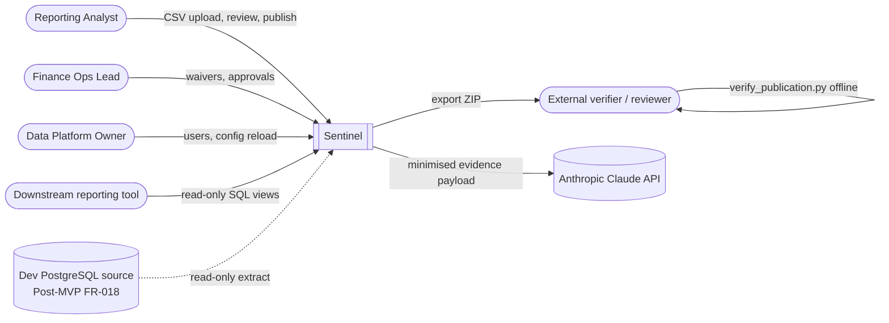
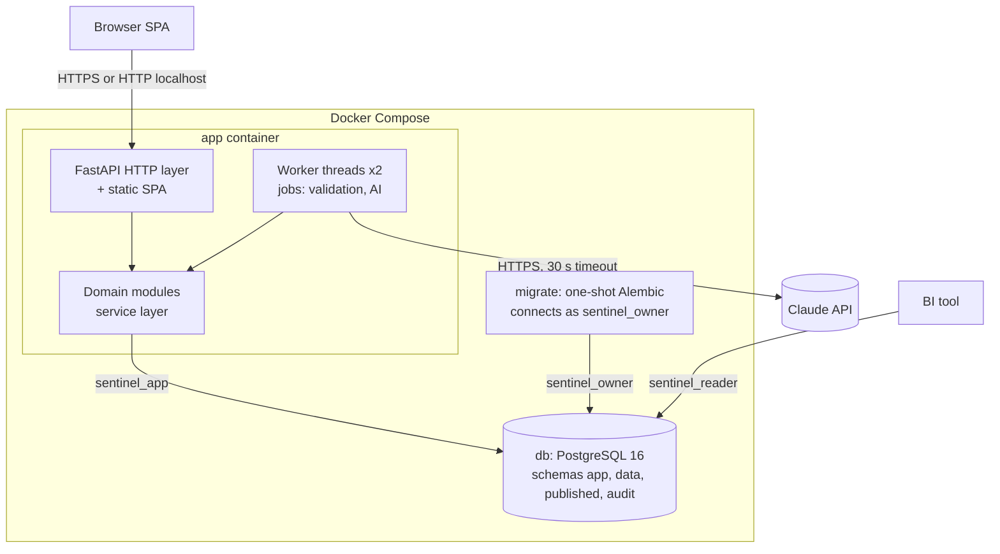
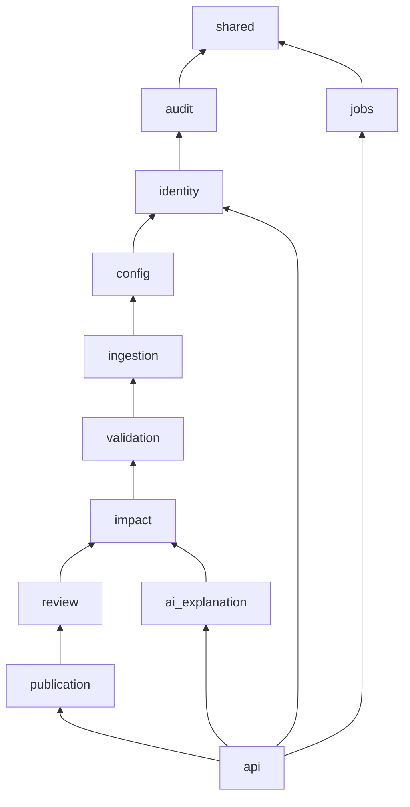
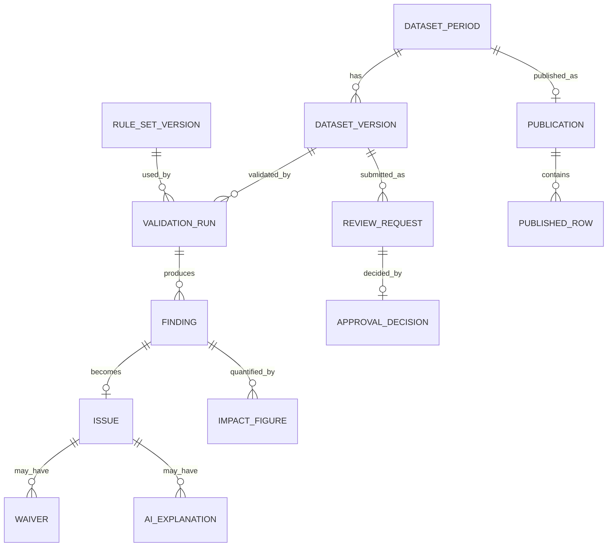
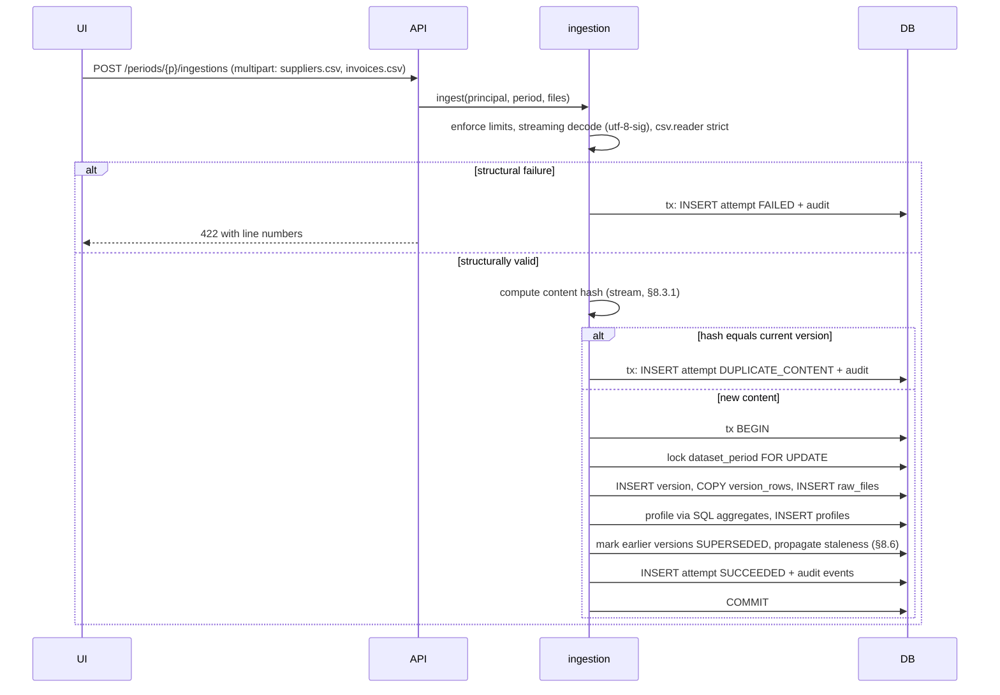
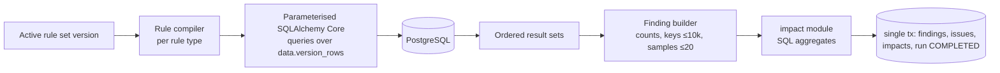
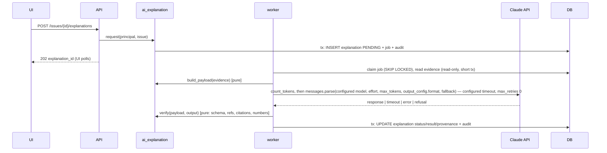

# Sentinel — Architecture Review Document (ARD)

| Field | Value |
|---|---|
| Document | 02 — Architecture Review |
| Version | 1.2 |
| Date | 2026-11-15 |
| Status | **Approved by product owner (v1.0 2026-11-15; CR-06 amendment 2026-11-15; PoC-1 outcome 2026-11-15)** |
| Primary input | [`docs/01-product-requirements.md`](01-product-requirements.md) v1.0 (approved), since amended to v1.1 by this document's CR-01 to CR-05 |
| Source brief | [`requirements/sentinel original brief.md`](../requirements/sentinel%20original%20brief.md) |
| Followed by | Data model, API specification, AI design and evaluation, test strategy (not yet started) |

> **Status note.** This document records architecture decisions and the reasons for them. **Nothing has been implemented.** It contains no application code. Where it shows interfaces, formats or SQL, they are specifications for the implementation to follow.

### Revision history

| Version | Date | Change |
|---|---|---|
| 0.1 | 2026-11-15 | First draft: 16 decisions and 5 PRD change requests. |
| 0.2 | 2026-11-15 | Incorporates the product owner's review:<br>(1) AI settings checked against the providers' published model constraints; every setting configurable and validated at runtime (§3.6.1–§3.6.3).<br>(2) Performance proof of concept PoC-1 at 100,000 invoices added (§10.1); ADR-006 made provisional.<br>(3) Database roles and privileges defined precisely, with seal-on-commit guards (§7.3, ADR-018).<br>(4) No model committed; the model is selected by evaluation (§3.6.4, ADR-017).<br>(5) Scope guard added (§1.1).<br>CR-01 to CR-05 recorded as approved in principle (§13). |
| 1.0 | 2026-11-15 | Approved by the product owner with no content changes to v0.2. The decisions in §12 are now Accepted, except ADR-006 (provisional until PoC-1) and ADR-005 (whose performance claim PoC-1 must confirm). This approval does not amend the PRD: CR-01 to CR-05 still need explicit approval of PRD v1.1 (TQ-06). |
| 1.1 | 2026-11-15 | CR-06 approved during implementation (M1 step 1). The permission policy (`Role`, `Permission`, the role → permission map, and `require`) moves from `identity` to `shared.authz`. The layer order puts `identity` above `audit`, because login must write audit events. No requirement, ADR decision or behaviour changes. |
| 1.2 | 2026-11-15 | PoC-1 evaluated and its outcome approved by the product owner (§10.1.1; report in [`poc-01-validation-performance.md`](poc-01-validation-performance.md)).<br>(1) ADR-006 moves from Provisional to **Accepted** as variant A. Verification in the PostgreSQL 16 reference environment remains outstanding (TQ-07).<br>(2) The validation transaction sets `SET LOCAL work_mem = '64MB'` (§8.4).<br>(3) Execution order is distinguished from presentation order: primary-key uniqueness is evaluated first so its result can be reused; findings are stored and shown in ascending rule-ID order (§8.4).<br>(4) Currency columns in `run_impact_totals` and `kpi_values` become `text` (Doc 4 §4.7).<br>No PRD requirement changes. |

> **Relationship to the PRD.** The PRD (v1.0) is baselined. This document never changes it silently. Where an architecture finding means a PRD requirement must change, the change is raised as a **PRD change request** in §13 (`CR-xx`), and the change takes effect only once it is approved.

---

## Table of Contents

1. [Purpose, Scope and Method](#1-purpose-scope-and-method)
2. [Architectural Drivers](#2-architectural-drivers)
3. [Technology Evaluation](#3-technology-evaluation)
4. [System Context](#4-system-context)
5. [Containers and Deployment](#5-containers-and-deployment)
6. [Module Architecture](#6-module-architecture)
7. [Data Architecture](#7-data-architecture)
8. [Key Mechanisms](#8-key-mechanisms)
9. [Security Architecture](#9-security-architecture)
10. [Testing and Quality Architecture](#10-testing-and-quality-architecture)
11. [Repository, CI and Developer Workflow](#11-repository-ci-and-developer-workflow)
12. [Architecture Decision Register](#12-architecture-decision-register)
13. [PRD Change Requests](#13-prd-change-requests)
14. [Architecture Risks and Open Technical Questions](#14-architecture-risks-and-open-technical-questions)
15. [Traceability: PRD → Architecture](#15-traceability-prd--architecture)

---

## 1. Purpose, Scope and Method

**Purpose.** This document defines Sentinel's structure: its containers, modules, data placement, the key runtime mechanisms and the security model. It also evaluates the technologies proposed in the brief (§4), which asks that they be evaluated "rather than blindly accepting them".

**In scope.** The architecture for the PRD's MVP (milestones M1–M3), plus enough foresight that the Post-MVP requirements (FR-018 to FR-022, AI-007, PUB-008 and PUB-009) need no redesign.

**Out of scope.** Full table definitions, which belong to the data model document. Endpoint-by-endpoint API detail, which belongs to the API specification. Prompt wording, which belongs to the AI design document.

**Method.** Each significant choice is recorded as a decision (`ADR-xxx`, §12). Every decision states:
- the options considered;
- the criteria used to compare them;
- the decision itself;
- its consequences.

The criteria are weighted toward the PRD's non-negotiable principles (NP-1 to NP-7) and toward constraint C-09, that a single developer builds Sentinel.

### 1.1 Scope guard

This architecture **adds no product capability** and does not expand the MVP. It implements the approved PRD baseline (v1.0, which has the same content as v0.2). Some items in this document might look like new scope. They are not:

| Item | Why it is not new scope |
|---|---|
| Model and setting comparison in the evaluation harness (§3.6.4) | A parameter of the existing AI-006 harness. No user-facing feature. |
| Runtime check of the model's capabilities (§3.6.3) | Enforces AI-006's configuration and AI-004's fail-closed behaviour |
| Performance proof of concept, PoC-1 (§10.1) | Engineering verification of NFR-001. Nothing is shipped. |
| Seal-on-commit guards, the publication backstop and the startup self-check (§7.3) | Enforce existing requirements: FR-004, FR-015, PUB-001, PUB-005 and BR-002 |
| Job table and worker threads (§3.7) | Implement NFR-001 and AI-004.3 without adding infrastructure |

The Post-MVP items (FR-018 to FR-022, AI-007, PUB-008 and PUB-009) are only checked for **compatibility** (§15). None of them is designed in.

---

## 2. Architectural Drivers

| ID | Driver | PRD source | Architectural consequence |
|---|---|---|---|
| D-1 | AI must never influence validation or eligibility | NP-1, AI-003, NFR-008 | AI isolated in one module with **no inbound imports**, except from the HTTP layer. An enforced import-boundary check. |
| D-2 | Publication enforced only by the backend | NP-2, PUB-001, PUB-002 | A single eligibility function and a single write path. A database role and triggers prevent writes from anywhere else. |
| D-3 | Decisions bound to exact version and run | NP-3, PUB-003 | A binding tuple stored on every decision. The gate **recomputes** staleness and never trusts a status flag alone (ADR-013). |
| D-4 | Immutable, independently verifiable snapshots | NP-4, PUB-005, PUB-006 | Fully specified canonical serialisation formats (§8.3). The manifest is stored as exact bytes. A verifier that uses only the standard library. |
| D-5 | Complete, tamper-resistant audit | NP-5, FR-015 | Audit writes in the same transaction as the change. `INSERT`/`SELECT`-only grants and triggers. |
| D-6 | Exact money and deterministic results | NP-6, FR-006, NFR-005 | Validation and impact computed in PostgreSQL `NUMERIC`. Python `Decimal` at the edges. No floats. No wall-clock time in rules. |
| D-7 | Fail closed everywhere | NFR-006 | Atomic transactions. Crash recovery marks in-flight work `ERROR`/`FAILED`. An AI failure is a terminal status, never a gate input. |
| D-8 | Security cannot be traded for scope | NP-7, NFR-002 to NFR-004 | Server-side sessions, CSRF, role checks in the service layer, least-privilege database roles, secret scanning. |
| D-9 | One developer; local Docker deployment | C-09, NFR-009 | Few moving parts: one database, one application container, no message broker, no cache server, no object store. |
| D-10 | Engineering depth must be demonstrable | Brief §6, NFR-007 | Boundaries a machine can check, property-based tests, a negative test matrix, an AI evaluation harness. |

---

## 3. Technology Evaluation

The brief proposes: Python, FastAPI, PostgreSQL, SQLAlchemy, Pydantic, Pandas, React, TypeScript, LLM API integration, Docker, and Git with GitHub. Each is evaluated below. **Verdicts:** *Adopt*, *Adopt with constraints*, or *Do not adopt*.

### 3.1 Summary

| Technology | Verdict | Decision |
|---|---|---|
| Python 3.12 | Adopt | ADR-002 |
| FastAPI | Adopt with constraints: synchronous endpoints; authentication built in-house on proven primitives | ADR-002, ADR-009 |
| PostgreSQL 16 | Adopt, and it becomes the **validation engine**, not only storage. Its performance is proven by PoC-1 before the rule library is built. | ADR-003, ADR-005, ADR-006 |
| SQLAlchemy 2 (+ Alembic, psycopg 3) | Adopt: Core for the rule compiler, ORM for workflow entities | ADR-004 |
| Pydantic 2 | Adopt: API schemas, configuration validation, AI output validation | ADR-002, ADR-014 |
| **Pandas** | **Do not adopt** in the runtime. Not needed elsewhere. | ADR-005 |
| React + TypeScript | Adopt with constraints: a small SPA served by the backend | ADR-010 |
| LLM API integration | Adopt: the Anthropic Claude API behind a provider interface. **The model is not committed.** It is configured and chosen by evaluation. | ADR-011, ADR-017 |
| Docker / Docker Compose | Adopt: three services (`db`, `migrate`, `app`) | ADR-015 |
| Git + GitHub (+ Actions) | Adopt | §11 |

### 3.2 Backend language and web framework

| Criterion | FastAPI | Django + DRF | Flask |
|---|---|---|---|
| OpenAPI generated from code (FR-016) | Native | Through an add-on | Through an add-on |
| Pydantic shared with configuration and AI validation | Native | Separate serializers | Through an add-on |
| Built-in sessions, CSRF and auth | No | **Yes** | Partial |
| Fits a service-layer modular monolith with import contracts | Good (unopinionated) | Fair (the app/ORM conventions pull toward an active-record style) | Good |
| Effort for a solo developer | Medium | Lowest for authentication, higher for the rest | Medium |

**Decision (ADR-002): Python 3.12 with FastAPI, using synchronous (`def`) endpoints.**

- **Why sync.** The workload is bound by database time and CPU, not by many concurrent connections. Synchronous SQLAlchemy sessions avoid async complexity, and FastAPI runs sync endpoints on a thread pool.
- **The trade-off.** Django's built-in authentication is real. Sessions, CSRF and login throttling must instead be built (ADR-009). This is accepted because the pieces are small and well understood, they use vetted primitives (`argon2-cffi`, `secrets`, `hmac.compare_digest`), and NFR-002 tests them explicitly.

### 3.3 Data processing: Pandas versus SQL in PostgreSQL

This is the most consequential evaluation in this document.

| Criterion | Pandas (in-memory) | Polars | **SQL in PostgreSQL** |
|---|---|---|---|
| Exact decimal money (NFR-005) | **Poor.** Decimals become `object` columns, which are slow, and the default float columns violate NP-6. | Has a Decimal type, but the precision semantics need care | **Native `NUMERIC`** |
| Set-based rules (duplicates, foreign keys, cross-table joins) | Good | Good | **Native** |
| Determinism (stable ordering) | Requires discipline | Requires discipline | `ORDER BY` on a stable key everywhere |
| Data movement | Load everything into the Python process | Same | **None:** the data is already in the database |
| Memory at the 200k-row limit | Acceptable, but the whole dataset is in RAM | Good | Bounded by the database |
| Additional dependency | Large | Large | None |
| Testability | Good | Good | Good, with real PostgreSQL in tests (§10) |

**Decision (ADR-005): Pandas is not adopted.**
- **Rules run in PostgreSQL.** Each rule type is compiled from its configuration into a parameterised SQLAlchemy Core query, executed in PostgreSQL over the stored version rows (§8.4). Impact and KPI calculations are also SQL aggregates over `NUMERIC`.
- **Python does the rest.** Python handles streaming CSV parsing, hashing, orchestration, and turning results into findings.
- **PRD effect.** This removes a brief-suggested dependency, which the brief explicitly allows. It is raised as CR-03.

### 3.4 Persistence libraries

**Decision (ADR-004): SQLAlchemy 2, Alembic and psycopg 3.**

| Component | Used for |
|---|---|
| SQLAlchemy **Core** | The validation rule compiler (§8.4). Compiling rules to typed expressions rather than string templates keeps them safe from injection. |
| SQLAlchemy **ORM** | Workflow entities: issues, waivers, reviews, publications. |
| **Alembic** | Schema migrations, **including the creation of database roles, grants and immutability triggers**, so the security posture is defined in versioned migration code. |
| **psycopg 3** | The driver. Its `COPY` support bulk-loads version rows during ingestion (NFR-001). |

### 3.5 Frontend

| Option | Effort | Fit for the brief's "full-stack development" objective | Notes |
|---|---|---|---|
| **React + TypeScript (Vite) SPA** | Medium | Strong | A typed client generated from OpenAPI keeps the frontend in step with the backend contract. |
| Server-rendered (Jinja and HTMX) | Low | Weaker | Fewer moving parts. Shows less of the full-stack skill set the brief asks for. |

**Decision (ADR-010): React + TypeScript built with Vite, under these constraints:**
- **Libraries.** TanStack Query for server state, React Router for routing, no global state library, and plain CSS modules.
- **Types.** API types are generated with `openapi-typescript`.
- **Serving.** The built SPA is **served by the FastAPI application** from the same origin. One origin means no CORS configuration, simple `SameSite` cookie handling and one fewer container.
- **No business logic.** The frontend computes no eligibility or impact. FR-016.3 requires the eligibility checklist to come from the dry-run API.

### 3.6 LLM provider and model

**Provider (ADR-011): the Anthropic Claude API, through the official `anthropic` Python SDK, behind the PRD's `ExplanationProvider` interface (AI-006).**

The provider was assessed against six criteria:
1. Native schema-constrained output.
2. An official Python SDK with typed errors and configurable timeouts and retries.
3. Defined behaviour when the model refuses or fails.
4. Cost at the PRD's payload sizes.
5. Data-handling terms acceptable for minimised data. These terms are **not** verified in this document (OQ-10, TQ-02).
6. Reversibility through the provider interface.

The MVP implements one production provider and one stub, as AI-006 specifies. A second vendor would be added behind the same interface. Building one is outside MVP scope.

> **Disclosure.** This document was drafted with an Anthropic model's assistance. The provider choice rests on the criteria above, and the interface keeps it reversible.

**Model (ADR-017): no model is committed.** The model is a configuration value. `claude-opus-5-5` is only the **initial development default**. The default model and settings for the release are chosen by the evaluation procedure in §3.6.4, recorded in the AI evaluation report, and approved by the product owner (TQ-01).

#### 3.6.1 Verified constraints of the candidate models

These constraints come from Anthropic's Claude API reference material (model tables cached 2026-11-03), checked on 2026-11-15. Sentinel re-checks them at runtime against the Models API (§3.6.3), so if the documentation is out of date, Sentinel disables AI rather than misbehaving.

| Constraint | `claude-opus-5-5` | `claude-sonnet-5-5` | `claude-haiku-5-5` |
|---|---|---|---|
| Context window | 1M tokens | 1M tokens | 1M tokens |
| Maximum `max_tokens` (output ceiling) | 128,000 | 128,000 | 128,000 |
| Structured outputs (`output_config.format`) | Supported | Supported | Supported |
| Sampling parameters (`temperature`, `top_p`, `top_k`) | Rejected (HTTP 400) | Non-default values rejected | Non-default values rejected |
| Thinking | Adaptive. **Cannot be disabled.** | Adaptive by default. Can be turned off (`between_tools`) only at effort ≤ `high`. | Adaptive by default. Can be disabled only at effort ≤ `high`. |
| Effort levels / default | `low`–`max` / `medium` | `low`–`max` / `high` | `low`–`max` / `medium` |
| `stop_reason: "refusal"` possible | Yes | Yes | Yes |
| Server-side refusal fallback | Available (beta, `fallbacks: "default"`) | Available (`"default"` form) | **Not available** |
| Price per million tokens, input / output | $4 / $20 | $2 / $10 | $0.10 / $0.50 (prompts ≤ 100K tokens) |
| Notes | — | Effort levels recalibrated relative to Sonnet 5 | Tokenizer counts the same text as about 30% more tokens than Haiku 4.5 |

**What these constraints mean for the configuration:**

- **`max_tokens` is a ceiling on everything the model generates, reasoning included.**
  - If the ceiling is reached, the response ends with `stop_reason: "max_tokens"` and is treated as `INVALID_OUTPUT` (CR-02).
  - The value must be ≤ the model's ceiling (128,000 for every candidate).
  - Sentinel sends non-streaming requests. The provider's guidance is to keep non-streaming `max_tokens` at about 16,000 or below to stay within SDK HTTP timeouts, so Sentinel enforces **≤ 16,000**.
  - **8,000 is a starting value to be measured, not a value assumed to be valid.** The evaluation reports how often each setting hits the ceiling (§3.6.4).
- **No sampling parameters are ever sent** (CR-01).
- **Effort is the only reasoning control Sentinel sends.** Sentinel never sends a `thinking` parameter, so every candidate runs its provider default (adaptive). This keeps the candidates comparable.
- Sentinel uses `output_config.format`, not forced `tool_choice`, which these models reject.

#### 3.6.2 Configuration (all values configurable; CR-01)

| Setting | Environment variable | Initial default | Validated at startup and on configuration reload |
|---|---|---|---|
| Enabled | `SENTINEL_AI_ENABLED` | `false` unless an API key is present | — |
| Model | `SENTINEL_AI_MODEL` | `claude-opus-5-5` (development only) | Must exist in the Models API and report `structured_outputs` as supported |
| Effort | `SENTINEL_AI_EFFORT` | `low` | Must be a level the model's `effort` capabilities report as supported |
| Maximum output tokens | `SENTINEL_AI_MAX_TOKENS` | 8,000 | 1,024 ≤ value ≤ min(16,000, the model's `max_tokens`) |
| Request timeout | `SENTINEL_AI_TIMEOUT_SECONDS` | 30 | 5–120 seconds |
| Input token budget | `SENTINEL_AI_INPUT_TOKEN_BUDGET` | 8,000 | ≤ the model's `max_input_tokens` |
| Refusal fallback | `SENTINEL_AI_FALLBACK` | `default` where the model supports it; `off` otherwise | `default` is rejected for a model without server-side fallback |
| SDK automatic retries | Fixed in code, not configurable | 0 | AI-004 forbids automatic retries |

**Provenance.** Every setting in effect is stored with each explanation (AI-005).

**Verification never changes.** No configuration value relaxes verification. The AI-002 verifier does not read provider configuration, and it is identical for every model and setting.

#### 3.6.3 Runtime verification of settings

When AI is enabled, Sentinel checks the model at startup and on every configuration reload:
1. It calls the Models API (`models.retrieve(<model>)`).
2. It compares the configuration in §3.6.2 against `max_tokens`, `max_input_tokens`, `capabilities["structured_outputs"]["supported"]` and `capabilities["effort"][<level>]["supported"]`.
3. If anything does not match, or the Models API cannot be reached, AI is set to `DISABLED` with the reason logged (AI-004).

This check never affects the deterministic workflow. Startup and the publication gate do not depend on it (AI-003).

**Input budget.** Before each provider call, Sentinel counts the payload's tokens with the token counting endpoint (`messages.count_tokens`). If the count exceeds the budget, sample values are dropped and the payload is counted again (AI-001). If it still exceeds the budget, no request is sent, and the explanation becomes `FAILED_PROVIDER` with reason `INPUT_BUDGET_EXCEEDED` (CR-02).

#### 3.6.4 Model and setting selection by evaluation (ADR-017)

The AI-006 evaluation harness takes a **configuration matrix** as a parameter. This is an option of the existing harness, not a product capability.

**Stage 1.** Models {`claude-opus-5-5`, `claude-sonnet-5-5`, `claude-haiku-5-5`} × effort {`low`, `medium`}, at `max_tokens` 8,000. Each configuration runs over every issue in the *defective* dataset, 3 times. That is 6 configurations × about 15 issues × 3 = about 270 calls.

**Stage 2.** For the two best Stage 1 configurations, repeat at `max_tokens` 4,000 and 16,000 to measure how often outputs are cut short, and how cost and latency change.

**Metrics per configuration:**

| Metric | Definition | Hard threshold |
|---|---|---|
| Schema validity | Share of outputs that pass the schema, after at most one retry | ≥ 98% (M-08) |
| Grounding acceptance | Share of outputs that reach `VALID` | ≥ 85% (M-09) |
| **Evidence accuracy** | Share of `VALID` explanations whose summary and consequence correctly describe the issue's defect, judged against the defect catalogue with the documented rubric | ≥ 95% |
| Fabricated claims | Claims in `VALID` explanations about defects or figures absent from the evidence | 0 (M-10) |
| **Unsupported-claim rejection** | (a) Deterministic: the verifier's detection rate on a fixed, seeded suite of deliberately ungrounded outputs (unknown references, uncited claims, altered numbers). (b) Live: the share of outputs `REJECTED_UNGROUNDED`, reported for each configuration. | (a) 100%. (b) Reported, and not a threshold, because rejection is the safe outcome. |
| Injection following | `VALID` explanations that follow injected instructions | 0 (M-11) |
| Truncation rate | Share of outputs that stop at `max_tokens` | ≤ 2% |
| Latency | p50 and p95 per request | p95 ≤ 80% of the configured timeout |
| Cost | Mean cost per request, and per `VALID` explanation, from the response's `usage` field | Reported |
| Refusals and fallbacks | The refusal rate, and the model that actually answered | Reported |

**Selection rule:**
1. Discard every configuration that misses any hard threshold.
2. Of those left, choose the configuration with the **lowest cost per `VALID` explanation**.
3. If two configurations are within 10% on cost, choose the one with higher grounding acceptance.

If no configuration passes, the answer is a change request, for example to the timeout. Verification is never relaxed.

**Spending.** The harness prints an estimated cost before it runs. For Stage 1 this is about $8 typical and about $27 worst case, using §3.6.5's per-request figures. A live run needs the product owner's approval, because it spends money.

#### 3.6.5 Cost envelope per explanation

These figures apply the §3.6.1 prices to the initial settings: input up to 8k tokens, and output (including reasoning) up to 8k tokens.

| Model | Typical (4k input / 2k output) | Worst case (8k / 8k) |
|---|---|---|
| `claude-opus-5-5` | ≈ $0.056 | ≈ $0.19 |
| `claude-sonnet-5-5` | ≈ $0.028 | ≈ $0.10 |
| `claude-haiku-5-5` | ≈ $0.0014 | ≈ $0.005 |

Actual token counts, especially reasoning tokens at each effort level, come from the evaluation, not from these estimates.

**Data handling.** The MVP sends only synthetic, minimised data (AI-001). Before any real supplier data is used, the product owner must confirm the provider's commercial data-usage and retention terms (OQ-10, TQ-02). This document makes no claim about those terms.

### 3.7 Background execution

The PRD allows up to 60 seconds for validation at load scale (NFR-001) and requires that AI calls never hold workflow locks (AI-004.3). Both rule out doing this work inside the HTTP request.

| Option | Extra infrastructure | Survives restart | Complexity |
|---|---|---|---|
| Celery + Redis | Redis container and a worker container | Yes | High |
| FastAPI `BackgroundTasks` | None | **No** (work is lost silently) | Low |
| **PostgreSQL job table + in-process worker threads** | None | Yes (job rows persist, and recovery fails closed) | Low–medium |

**Decision (ADR-008).**
- **Where jobs live.** A `jobs` table in the Sentinel database. Workers claim jobs with `SELECT … FOR UPDATE SKIP LOCKED`.
- **Who runs them.** A small pool of worker threads (default 2) inside the `app` process.
- **Recovery.** On startup, any job left `RUNNING` is marked `FAILED`, and its validation run is marked `ERROR`. Interrupted work therefore never appears to have passed (NFR-006).

### 3.8 Containers and source control

- **Containers (ADR-015).** Docker Compose runs three services: `db` (PostgreSQL 16), `migrate` (a one-shot Alembic run using the owner credential) and `app` (API, worker threads and the static SPA).
- **Source control.** Git and GitHub, with GitHub Actions for CI (§11). The project folder is not yet a Git repository. It should be initialised before implementation starts.

---

## 4. System Context



**Trust boundaries:**
1. Browser ↔ application, over HTTP with a session cookie.
2. Application ↔ LLM provider, over HTTPS carrying only the minimised payload.
3. Application ↔ database, where privileges differ by role (§7.3).
4. Export package ↔ external verifier, where nothing is trusted except the hashes.

---

## 5. Containers and Deployment



| Container | Image | Credential | Notes |
|---|---|---|---|
| `db` | `postgres:16` | Superuser credential, used only by the init script | A named volume holds the data. The port is not exposed to the host, except for `sentinel_reader` when PUB-007 is in use. |
| `migrate` | App image | `SENTINEL_OWNER_DATABASE_URL` | Runs `alembic upgrade head` and exits. The app waits until it completes successfully. |
| `app` | Multi-stage build: Node builds the SPA, a Python slim image runs it | `SENTINEL_APP_DATABASE_URL`, `SENTINEL_SESSION_SECRET`, `ANTHROPIC_API_KEY` (optional) | Runs as a non-root user. The owner credential is **never** passed to this container. |

**Process model.** A single Uvicorn process with FastAPI's sync thread pool, plus N worker threads started on application startup. A multi-process deployment would need the job claim mechanism already used (`SKIP LOCKED`), and no other change.

---

## 6. Module Architecture

### 6.1 Modules and responsibilities

| Module | Responsibility | Key PRD requirements |
|---|---|---|
| `shared` | Database engine and unit of work, error types, settings, the identifier and money value types, and `authz`, the permission policy: `Role`, `Permission`, the role → permission map, `Principal` and `require` (CR-06) | FR-001 |
| `identity` | Users, role assignments, password hashing, sessions, CSRF, login throttling. It uses `shared.authz` for permission checks and writes audit events (CR-06). | FR-001, NFR-002 |
| `audit` | `record(event)` within the caller's transaction; audit queries | FR-015 |
| `config` | Loading, validating and hashing contract and rule set files; the active-version pointer; the rule type registry | FR-002 |
| `ingestion` | CSV parsing, attempt records, version creation, content hashing, supersession, profiling | FR-003, FR-004, FR-005 |
| `validation` | Run lifecycle, the rule compiler and executor, findings, record drill-down | FR-006 to FR-009 |
| `impact` | Per-issue impact, KPI computation, classification | FR-011, FR-012 |
| `review` | Issues, notes, waivers, review requests, approvals, staleness propagation | FR-010, FR-013, FR-014, PUB-003 |
| `publication` | `evaluate_eligibility`, publish transaction, snapshot, manifest, export, verification | PUB-001 to PUB-007 |
| `ai_explanation` | Payload builder, provider interface and implementations, output verification, explanation records | AI-001 to AI-006 |
| `jobs` | Job table, worker threads, crash recovery | ADR-008 |
| `api` (layer, not a domain module) | HTTP routers, request and response schemas, session middleware, mapping of permissions to routes | FR-016 |

### 6.2 Dependency rules (enforced by import-linter in CI; NFR-008)



An arrow means "may import". Lower layers are reachable transitively: for example, `publication` may use `ingestion` and `config`.

**Contracts:**
1. **Layers:** `api` → `publication` → `review` → `impact` → `validation` → `ingestion` → `config` → `identity` → `audit` → `shared` (order amended by CR-06). `ai_explanation` sits beside this chain and below `api`. It may import `impact`, `validation`, `ingestion`, `config`, `identity`, `audit` and `shared`. It must **not** import `review` or `publication`, so it can read evidence but has no route to any decision.
2. **Forbidden:** `validation`, `impact`, `review` and `publication` must not import `ai_explanation`. This contract implements AI-003.1.
3. **Forbidden:** No domain module imports `api`.
4. **Independence:** `jobs` knows nothing about domain modules. Domain modules register job handlers with it at startup through the `api` composition root.

### 6.3 Service-layer conventions

- **Commands take the caller and a unit of work.** Every state-changing service function takes `(principal, uow, …)`.
- **Permission check first.** Each command calls `shared.authz.require(principal, Permission.X)` as its first statement (CR-06). Route-level checks may exist as well, but the service check is authoritative (NFR-006 / FR-001).
- **Commit once, with audit.** A command commits exactly once, through the unit of work. `audit.record` writes into the same session, so a failed audit write rolls the command back (FR-015.2).
- **Pure where possible.** Domain logic is pure where it can be (payload builder, canonical serialisers, verifiers, state machines), so it can be unit-tested without a database.

---

## 7. Data Architecture

### 7.1 Schemas

| Schema | Contents | Mutability |
|---|---|---|
| `app` | Users, roles, sessions, login attempts, config versions, dataset periods, ingestion attempts, versions (metadata), runs, findings, issues, notes, impacts, waivers, review requests, approvals, AI explanations, publications (records and manifests), publication attempts, jobs | Mixed. Immutable tables are listed in §7.3. |
| `data` | `version_rows` (the raw text cells of each version) and `raw_files` (the uploaded bytes) | **Immutable** |
| `published` | `suppliers` and `invoices` (typed snapshot rows), plus the `*_current` views (PUB-007) | **Immutable** (views excepted) |
| `audit` | `events` | **Append-only** |

### 7.2 Storage decisions

| Data | Decision | Rationale |
|---|---|---|
| Version rows | **ADR-006:** one generic table, `data.version_rows(version_id, table_name, row_num, cells JSONB)`, primary key `(version_id, table_name, row_num)`. Cells hold raw text only, and a missing column means its key is absent. | Raw text must hold invalid values (FR-003.4), so typed columns are impossible. JSONB keeps the storage driven by the contract, so a contract change needs no migration. Strings are stored exactly. **Accepted** as variant A after PoC-1 (§10.1.1, TQ-04 closed). Verification in the PostgreSQL 16 reference environment is outstanding (TQ-07). |
| Raw uploads | **ADR-007:** `data.raw_files(version_id, table_name, sha256, bytes BYTEA)` | At most 20 MB per file (NFR-001). Storing them in the database keeps them in the same transaction as the version, which FR-003.6 requires, keeps immutability enforced by grants, and avoids running an object store. |
| Published snapshot | Typed tables `published.suppliers` and `published.invoices`, with `publication_id` and contract-typed columns (`NUMERIC(18,2)`, `date`, `text`), created by migration | Downstream consumers need typed data (PUB-005, PUB-007). The contract is fixed per dataset in the MVP. |
| Manifest | `app.publications.manifest_bytes BYTEA`, holding canonical JSON (§8.3.3) and its `manifest_sha256` | **Never JSONB.** JSONB reorders keys and normalises whitespace, which would change the hashed bytes. |
| Findings' record keys | `app.finding_records(finding_id, ordinal, record_key)`, capped at 10,000 per finding (FR-009) | Lets drill-down and impact use joins instead of parsing arrays. |
| Money | `NUMERIC(18,2)` everywhere. `Decimal` in Python. | NFR-005 |
| Time | `timestamptz` (UTC) for timestamps. `date` for business dates. | NFR-005.3 |

### 7.3 Database roles and privileges (ADR-018)

The goal is that, **during normal operation, the application can append audit events, create versions, and create publication snapshots, but cannot change or remove anything already recorded**. It must also never need migration-level privileges. Four mechanisms combine to achieve this:

1. **Ownership is separated from use.** Every object is owned by `sentinel_owner`. The running application connects as `sentinel_app`, which owns nothing, so it cannot `ALTER`, `DROP`, disable triggers, or `GRANT`.
2. **Insert-only grants on history.** History tables grant `sentinel_app` only `SELECT` and `INSERT`. There is no `UPDATE`, `DELETE` or `TRUNCATE`, and sequences get `USAGE` only (allowing `nextval`, but not `setval`).
3. **Column-limited `UPDATE` on current-state fields.** Where a record has a lifecycle (an issue's state, a job's status), only the named state columns may be updated. Every change is audited in the same transaction (§8.10). Decisions themselves are separate insert-only records.
4. **Seal-on-commit guards.** A `BEFORE INSERT` trigger on each child table of a sealed parent (version rows, raw files, finding records, published rows) rejects the insert unless the parent row was created **in the current transaction**. The parent stores `creating_xact xid8 DEFAULT pg_current_xact_id()`, and the trigger compares it with `pg_current_xact_id()`. Once a version or publication commits, nobody, including `sentinel_app`, can add rows to it later.

On top of these, a `BEFORE UPDATE OR DELETE OR TRUNCATE` trigger on every history table raises an exception unless `current_user = 'sentinel_owner'`. This is a second, independent control: privileges are the first layer, triggers the second.

#### 7.3.1 Roles

| Role | Attributes | Owns | Used by | Credential reaches |
|---|---|---|---|---|
| `postgres` (bootstrap superuser) | Superuser | Cluster | The `db` container's one-time init script only. It creates the three roles below and the `sentinel` database, owned by `sentinel_owner`. | `db` container environment only |
| `sentinel_owner` | `LOGIN NOSUPERUSER NOCREATEDB NOCREATEROLE NOREPLICATION NOBYPASSRLS` | Database, schemas, tables, views, sequences, trigger functions | The `migrate` container (Alembic) and administrative maintenance | `migrate` container only. **Never** the `app` container. |
| `sentinel_app` | `LOGIN NOSUPERUSER NOCREATEDB NOCREATEROLE NOREPLICATION NOBYPASSRLS NOINHERIT CONNECTION LIMIT 20` | Nothing | The `app` container | `app` container |
| `sentinel_reader` | `LOGIN NOSUPERUSER NOCREATEDB NOCREATEROLE NOREPLICATION NOBYPASSRLS NOINHERIT CONNECTION LIMIT 5` | Nothing | Downstream reporting (PUB-007, Should Have) | Given to the BI tool's operator |

**Baseline revocations** (applied by migration):
- `REVOKE ALL ON DATABASE sentinel FROM PUBLIC`.
- `REVOKE ALL ON SCHEMA public FROM PUBLIC`. The `public` schema is unused.
- `REVOKE ALL` on every Sentinel schema from `PUBLIC`.
- `CONNECT` granted to `sentinel_app` and `sentinel_reader`.
- `USAGE` (not `CREATE`) on the schemas each role needs.
- `TEMPORARY` on the database is **not** granted. It would be granted only if the performance proof of concept selects the typed-projection variant (§10.1, variant C).

**Self-check at startup.** The `app` process checks its own connection: `SELECT rolsuper, rolcreaterole, rolcreatedb, rolbypassrls FROM pg_roles WHERE rolname = current_user`. It also checks whether the current user owns any object in a Sentinel schema. If any of these are true, it **refuses to start**, so an over-privileged deployment fails closed.

#### 7.3.2 Privilege matrix for `sentinel_app`

Table names are indicative. The data model document finalises them. The rules here bind regardless of the final names.

| Table | `SELECT` | `INSERT` | `UPDATE` (columns) | `DELETE` | Seal guard | Notes |
|---|:-:|:-:|---|:-:|:-:|---|
| `app.users` | ✓ | ✓ | `display_name`, `password_hash`, `is_active`, `updated_at` | – | – | Users are never deleted (FR-001) |
| `app.user_roles` | ✓ | ✓ | `revoked_at`, `revoked_by` | – | – | Removing a role is a revocation timestamp, not a deletion |
| `app.sessions` | ✓ | ✓ | `last_seen_at` | ✓ | – | Not history. Deleted on logout and expiry. |
| `app.login_attempts` | ✓ | ✓ | – | ✓ | – | Not history. Pruned after the throttle window. |
| `app.config_versions` | ✓ | ✓ | – | – | – | Immutable |
| `app.active_config` (single row) | ✓ | – | `config_version_id`, `activated_at` | – | – | Pointer only. The history is in `config_versions` and the audit log. |
| `app.dataset_periods` | ✓ | ✓ | `last_activity_at` | – | – | The `UPDATE` grant exists because `SELECT … FOR UPDATE` requires `UPDATE` privilege on at least one column (§8.2, §8.7) |
| `app.ingestion_attempts` | ✓ | ✓ | – | – | – | Immutable |
| `app.dataset_versions` | ✓ | ✓ | `status` (→ `SUPERSEDED` only) | – | – | Content hash and identity columns cannot be updated |
| `data.raw_files` | ✓ | ✓ | – | – | ✓ (version) | Immutable |
| `data.version_rows` | ✓ | ✓ | – | – | ✓ (version) | Immutable. Loaded with `COPY FROM STDIN`, which needs only `INSERT`. |
| `app.column_profiles` | ✓ | ✓ | – | – | ✓ (version) | Immutable |
| `app.validation_runs` | ✓ | ✓ | `status`, `finished_at`, `error_detail`, `finding_counts` | – | – | Written once, then a single status transition |
| `app.findings`, `app.finding_records` | ✓ | ✓ | – | – | ✓ (run) | Immutable |
| `app.impact_figures`, `app.kpi_impacts` | ✓ | ✓ | – | – | ✓ (run) | Immutable |
| `app.issues` | ✓ | ✓ | `state`, `state_changed_at` | – | – | Current state only. Each transition is audited. |
| `app.issue_notes` | ✓ | ✓ | – | – | – | Append-only (FR-010.3) |
| `app.waivers` | ✓ | ✓ | `status`, `stale_reason` | – | – | The request record |
| `app.waiver_decisions` | ✓ | ✓ | – | – | – | Insert-only decision record (grant or deny, by whom, comment) |
| `app.review_requests` | ✓ | ✓ | `status`, `stale_reason`, `closed_at` | – | – | |
| `app.approval_decisions` | ✓ | ✓ | – | – | – | Insert-only decision record |
| `app.ai_explanations` | ✓ | ✓ | `status`, `result`, `verification`, `provenance`, `finished_at` | – | – | One `PENDING` → terminal transition (§8.9) |
| `app.jobs` | ✓ | ✓ | `status`, `claimed_at`, `finished_at`, `error` | – | – | Not history |
| `app.publications` | ✓ | ✓ | – | – | – | Immutable in the MVP. PUB-008 (Post-MVP) would add `UPDATE (status)`. |
| `app.publication_attempts` | ✓ | ✓ | – | – | – | Immutable |
| `published.suppliers`, `published.invoices` | ✓ | ✓ | – | – | ✓ (publication) | Immutable snapshot |
| `published.*_current` (views) | ✓ | – | – | – | – | |
| `audit.events` | ✓ | ✓ | – | – | – | Append-only. Sequence `USAGE` only. |

`sentinel_reader` holds `USAGE` on schema `published` and `SELECT` on `published.*_current`, **and nothing else**.

#### 7.3.3 How each runtime operation fits these privileges

| Runtime operation | Statements `sentinel_app` executes | Privileges used |
|---|---|---|
| Record an audit event | `INSERT INTO audit.events` | `INSERT`, sequence `USAGE` |
| Create a dataset version | `INSERT` version → `COPY` rows → `INSERT` raw files and profiles → `UPDATE dataset_versions SET status='SUPERSEDED'` on earlier versions | `INSERT`; column `UPDATE (status)`. Seal guards pass because all of this happens in one transaction. |
| Run validation | `INSERT` run (commit) → `INSERT` findings, records, issues, impacts → `UPDATE validation_runs (status, …)` | `INSERT`; column `UPDATE` |
| Waivers, reviews and approvals | `INSERT` requests and decisions; `UPDATE` status columns; propagate staleness | `INSERT`; column `UPDATE` |
| Publish | `SELECT … FOR UPDATE` on the period → `INSERT` publication → `INSERT … SELECT` into `published.*` → `INSERT` attempt and audit event | `UPDATE (last_activity_at)` (for the lock); `INSERT`. The seal guard ties every snapshot row to the publication created in the same transaction. |
| Load or reload configuration | `INSERT` config version; `UPDATE active_config` | `INSERT`; column `UPDATE` |
| Crash recovery at startup | `UPDATE` job, run and explanation status columns | Column `UPDATE` |
| Session handling | `INSERT`, `UPDATE`, `DELETE` on `sessions` and `login_attempts` | As granted |

**No runtime operation needs DDL, ownership, `TRUNCATE`, `DELETE` on history, trigger control or `GRANT`.** Every schema change goes through the `migrate` container.

#### 7.3.4 Database-level backstop for publication

The publication gate is implemented in code (PUB-001, PUB-002). The database adds a small, independent backstop:
- A `BEFORE INSERT` trigger on `app.publications` rejects the insert unless an `APPROVE` record exists whose binding tuple equals the publication's tuple and whose approver is not the request's submitter.
- `UNIQUE (dataset, period)` (BR-002.3).

This duplicates only these two invariants. It is not a second eligibility engine.

#### 7.3.5 Verification

- **Grant-drift test.** A test reads `information_schema.role_table_grants`, `information_schema.column_privileges` and `pg_roles`. It compares the results with a committed expected-privileges file derived from §7.3.2, and fails on any difference.
- **Negative privilege tests.** These run as `sentinel_app`:
  - `UPDATE`, `DELETE` and `TRUNCATE` on every history table fail;
  - inserting rows into a committed version or publication fails (seal guard);
  - `ALTER TABLE` and `DROP TRIGGER` fail;
  - `setval` on the audit sequence fails.

  These tests extend FR-004.3, FR-015.3, PUB-005.3 and N-15/N-16.
- **Startup self-check test.** Starting the app with the owner credential must fail.

### 7.4 Entity overview



`WAIVER`, `REVIEW_REQUEST`, `APPROVAL_DECISION` and `PUBLICATION` each carry the **binding tuple** (`dataset_version_id`, `content_hash`, `validation_run_id`, `rule_set_version_id`), held as `NOT NULL` foreign keys. Full definitions belong to the data model document.

---

## 8. Key Mechanisms

### 8.1 Configuration loading (FR-002)

1. YAML files in `config/datasets/supplier_invoices/` (`contract.yaml`, `rules.yaml`) are parsed into Pydantic models with `extra="forbid"`.
2. Sentinel runs semantic validation: rule types exist in the registry, columns exist in the contract, KPI IDs exist, and parameters match each rule type's own parameter schema.
3. The canonical JSON of the validated model (§8.3.3 rules) is hashed. If the hash differs from the active version, Sentinel inserts a new version, moves the active pointer, propagates staleness for a rule set change (§8.6), and writes the audit event, all in **one transaction**.
4. This runs at startup and through `POST /api/v1/admin/config/reload` (`ADMIN`). A failure leaves the previous version active (FR-002.1).

### 8.2 Ingestion pipeline (FR-003, FR-004, FR-005)



- **Structural parsing.** Uses Python's `csv` module with `strict=True`. Header names are matched against the contract case-insensitively after trimming. Ragged rows are detected by comparing each row's column count with the header's. Up to 100 offending line numbers are collected, plus a total count.
- **Streaming.** Files are processed in a streaming pass while bytes are buffered for `raw_files`. The 20 MB limit bounds memory use.
- **Lock order.** Ingestion locks the same `dataset_period` row that publication locks, so a version cannot be superseded while it is being published.

### 8.3 Canonical serialisation and hashing (FR-004, PUB-005, PUB-006)

Each format is versioned. A version string is recorded with every hash, and golden-file tests freeze each format (§10).

#### 8.3.1 Dataset version content hash — `SENTINEL-CONTENT-V1`

SHA-256 over the UTF-8 bytes of the following, built line by line, with `\n` after every line:

```
SENTINEL-CONTENT-V1
contract:<contract_version_id>
table:<table_name>                       # tables in ascending name order
columns:<JSON array of column names>     # contract order of observed columns, then unexpected columns in header order
<JSON array of cell strings>             # one line per row, in file row order; missing column → JSON null
...
```

- **JSON encoding.** `json.dumps(value, ensure_ascii=False, separators=(",", ":"))`. Using JSON arrays avoids ambiguous escaping: commas, quotes and newlines inside values cannot collide with the structure.
- **Values.** Raw decoded text exactly as received. The BOM is removed, and nothing is trimmed.
- **Unexpected columns.** These are included so that *any* change to the content changes the hash → clarification **CR-05**.

#### 8.3.2 Published snapshot — `SENTINEL-SNAPSHOT-V1`

**Canonical CSV for each published table:**
- UTF-8 without a BOM, `\n` line endings.
- A header row of contract columns in contract order.
- Rows ordered by primary key, compared as byte-wise text (`COLLATE "C"`).
- Python `csv.writer(lineterminator="\n", quoting=csv.QUOTE_MINIMAL)`.
- Decimals rendered with exactly 2 decimal places and no exponent. Dates as `YYYY-MM-DD`. Null as an empty field.

**Hashes:**
- `table_sha256` = SHA-256 of the table's CSV bytes.
- `snapshot_hash` = SHA-256 of the lines `"<table>:<table_sha256>\n"`, sorted by table name.

**Generation.** Both the publish transaction and the export are produced by the **same** generator function, applied to the immutable typed rows. Exports are therefore regenerated deterministically and need no file storage.

#### 8.3.3 Manifest — `SENTINEL-MANIFEST-V1`

- **Serialisation.** Canonical JSON: `json.dumps(obj, ensure_ascii=False, sort_keys=True, separators=(",", ":"))` encoded as UTF-8. Decimals are serialised as **strings**, for example `"48200.00"`, so that number formatting cannot drift.
- **Storage and hash.** The bytes are stored once (`manifest_bytes`). `manifest_sha256` is the SHA-256 of those bytes. The export writes exactly those bytes as `manifest.json`.
- **Format fields.** The manifest includes `snapshot_format: "SENTINEL-SNAPSHOT-V1"` and `content_hash_algorithm: "SENTINEL-CONTENT-V1"`.

### 8.4 Validation engine (FR-006 to FR-009)



- **Rule type registry.** Each rule type is a class with three parts:
  - a Pydantic parameter schema;
  - `compile(params, contract, ctx) → Select`;
  - a message template.

  Registered types are `required_column`, `not_null`, `type_parse`, `allowed_values`, `range`, `column_comparison`, `arithmetic_check`, `date_window`, `duplicate_rows`, `unique`, `foreign_key` and `cross_table_condition`.
- **Accessing values safely.** A cell is read as `version_rows.cells ->> :column`, with the column name passed as a **bound parameter** after it has been validated against the contract. No identifier or value is ever interpolated into SQL text.
- **Safe typed casting.** A typed value is produced only through a guarded expression, and anything that fails the guard yields `NULL`:
  - **decimal:** `CASE WHEN v ~ '^-?[0-9]{1,16}(\.[0-9]{1,2})?$' THEN v::numeric(18,2) END`
  - **integer:** `^-?[0-9]{1,18}$`
  - **date:** `v ~ '^[0-9]{4}-[0-9]{2}-[0-9]{2}$' AND pg_input_is_valid(v, 'date')`, which uses a PostgreSQL 16 function.

  Using one guarded cast everywhere means a rule never raises an error on dirty data.
- **Determinism.**
  - Every query ends with `ORDER BY` on `row_num` or on the normalised key.
  - The reference date is passed as a parameter (FR-006). Neither `now()` nor `CURRENT_DATE` is ever used in rule SQL, and a test greps the compiler output to confirm this.
  - **Execution order and presentation order are separate.** The engine evaluates the primary-key `unique` rule of each table first, because every other rule reuses its result to decide the record-key fallback (FS §4.1). The remaining rules are evaluated in ascending rule-ID order. Findings are **stored and shown** in ascending rule-ID order whatever the execution order, so the output is identical to a strict rule-ID evaluation.
- **Dependency handling.** If `required_column` fails, any rule that references the missing column produces a `NOT_EVALUATED` status entry on the run and creates no finding.
- **Transactions.**
  1. A job is claimed and the run is inserted as `RUNNING`, then committed.
  2. All findings, issues and impacts are written and the run is marked `COMPLETED` in **one** transaction.
  3. On an exception, that transaction rolls back, and a separate transaction marks the run `ERROR` with its diagnostics (FR-006.4).
- **Concurrency.** A partial unique index on `runs(version_id) WHERE status = 'RUNNING'` enforces one run in progress per version (NFR-001).
- **Sort memory.** The completion transaction begins with `SET LOCAL work_mem = '64MB'`. PoC-1 showed that the set-level rules and the KPI aggregate spill sorts to disk at the 4 MB default and do not at 64 MB (§10.1.1). The setting is scoped to that transaction: it is not a Compose-wide or role-wide change, and no other query is affected. The value is a constant in the `validation` module, not user input.

### 8.5 Impact computation (FR-011, FR-012)

- **Where it runs.** All arithmetic is SQL over guarded `NUMERIC` casts, grouped by `currency`. Results come back as `Decimal`.
- **Per-issue figures.** Each figure joins `finding_records` to `version_rows`. Its stored evidence (formula ID, contributing key set and inputs) is enough for FR-011.5 to re-sum it.
- **Overlap handling.** For each category, the version-level total is a `SUM` over `SELECT DISTINCT record_key` across that category's findings. Confirmed takes precedence: keys already counted as confirmed are excluded from potential (FR-011.4).
- **KPIs.** Each KPI is a parameterised SQL function of an exclusion set:
  - an empty set gives the as-reported value;
  - one issue's keys give that issue's adjusted value;
  - the union of all confirmed non-canonical keys gives the fully adjusted value.

  Direction and delta are computed in Python with `Decimal`, and percentages use `ROUND_HALF_EVEN` (BR-008).

### 8.6 Workflow state, binding and staleness (FR-010, FR-013, FR-014, PUB-003)

**ADR-013: staleness is recomputed at the gate.** Stored `STALE` statuses exist for display and audit, but `evaluate_eligibility` never relies on them. It compares each decision's binding tuple with the **current** tuple, computed fresh from:
- the latest version;
- its latest run;
- the active rule set version.

A bug in status propagation therefore cannot authorise publication. At worst it misleads the UI, and tests also check the stored statuses.

**Propagation.** In the same transaction as the triggering event, decisions are marked `STALE` and an audit event is written:

| Trigger | Transaction | Decisions marked `STALE` |
|---|---|---|
| A new version is created for a period | Ingestion | Every open or granted decision on earlier versions of the period |
| A new run is created for a version | Run creation | Decisions bound to earlier runs of that version |
| A new rule set version is activated | Configuration load | Decisions bound to an older rule set version |

Issues tied to runs that are no longer current move to `CLOSED_NOT_CURRENT` in the same transaction.

**State machines** for issues, waivers and review requests are pure functions of the form `transition(state, event) → state | error`. Each is unit-tested exhaustively against the PRD's transition tables. A transition that is not allowed returns `409` together with the transitions that are allowed (FR-010.2).

### 8.7 Publication transaction (PUB-001 to PUB-005)

```mermaid
sequenceDiagram
    participant API
    participant PUB as publication
    participant DB
    API->>PUB: publish(principal, version_id)
    PUB->>DB: BEGIN
    PUB->>DB: SELECT dataset_period ... FOR UPDATE (lock; NOWAIT → CONCURRENT_PUBLICATION)
    PUB->>PUB: evaluate_eligibility(version, principal)  [E1–E7, recomputes hash & tuples]
    alt any check fails
        PUB->>DB: ROLLBACK
        PUB->>DB: tx2: INSERT publication_attempt FAILED + audit (all codes)
        API-->>PUB: 409 with check results
    else all pass
        PUB->>DB: INSERT ... SELECT typed rows into published.* (guarded casts)
        PUB->>PUB: stream canonical CSV per table → table hashes, snapshot_hash
        PUB->>PUB: build manifest → canonical bytes → manifest_sha256
        PUB->>DB: INSERT publication (CURRENT), attempt SUCCEEDED, audit
        PUB->>DB: COMMIT
        API-->>PUB: 201 publication_ref
    end
```

- **One function, two callers.** `evaluate_eligibility` is a single function. The dry run calls it inside a read-only transaction without taking the lock, and publish calls it under the lock (PUB-001.1, PUB-001.2).
- **Concurrent attempts (PUB-004.2).**
  - The lock uses `NOWAIT`. An attempt that finds the row already locked gets `CONCURRENT_PUBLICATION`.
  - An attempt that waits on a different code path and arrives after a commit gets `PERIOD_ALREADY_PUBLISHED`. That case is checked by E7 and backed by the `UNIQUE(dataset, period)` constraint (BR-002.3).
- **Single write path.** Only the publication service inserts into `published.*`. A CI static check (PUB-001.3) asserts that no other module references those tables.

### 8.8 Export and independent verification (PUB-006)

- **Export.** `GET /api/v1/publications/{ref}/export` streams `<ref>.zip`. The ZIP holds `manifest.json` (the stored bytes) and the canonical `suppliers.csv` and `invoices.csv`, each regenerated by the §8.3.2 generator. Entries are written in a fixed order with fixed timestamps, so the ZIP itself is reproducible.
- **Standalone check.** `scripts/verify_publication.py` uses only the Python standard library (`zipfile`, `hashlib`, `json`, `csv`, `argparse`). It:
  1. reads the manifest;
  2. hashes each CSV;
  3. recomputes `snapshot_hash`;
  4. counts rows with `csv.reader`;
  5. compares the results with the manifest;
  6. optionally compares `--expected-manifest-sha256`;
  7. prints `VERIFIED` or `FAILED`, with a reason for each table. The exit codes are 0 for verified, 1 for failed and 2 for usage errors.
- **In-app check.** `POST /api/v1/publications/{ref}/verify` performs the same comparison from the stored rows and records an audit event.

### 8.9 AI explanation pipeline (AI-001 to AI-006)



- **No locks across the provider call.** The network call happens after the evidence read has committed and before the result is written. No database transaction is open during the call (AI-004 iv, AI-004.3).
- **Pure core.** `build_payload` and `verify` are pure functions. The stub provider (AI-006) returns scripted outputs, which makes every verification branch testable without network access.
- **Number verification (AI-002 d).**
  - **Extraction.** A regex-based extractor normalises currency symbols, thousands separators and `%`. It compares numbers using the display rounding rules (2 decimal places for money, 2 for percentages).
  - **Allowed values.** The set of permitted numbers is every numeric value in the evidence items cited by the claim, plus pairwise percentages of those values.
  - **Known limit.** Numbers written out in words are not detected. This limit is listed in the AI design document and measured by the evaluation harness (R-03).
- **Status mapping.**

  | Outcome | Status |
  |---|---|
  | SDK `APITimeoutError` | `FAILED_TIMEOUT` |
  | `APIConnectionError`, `RateLimitError` or `APIStatusError` (5xx, authentication, permission) | `FAILED_PROVIDER` |
  | `stop_reason == "refusal"`, still refused after fallback | `FAILED_PROVIDER` with reason `REFUSAL` (CR-02) |
  | Payload still over the input budget after samples are dropped, or the token count fails | `FAILED_PROVIDER` with reason `INPUT_BUDGET_EXCEEDED` (CR-02), without calling the model |
  | `stop_reason == "max_tokens"` | `INVALID_OUTPUT`, after one retry, which is treated as the schema retry |
  | Schema failure | One retry with the validation error, then `INVALID_OUTPUT` |
  | Reference, citation or number failure | `REJECTED_UNGROUNDED` |
  | No API key, or AI disabled | `DISABLED`, without calling the provider |

- **Provenance (AI-005).** The provenance record stores `response.model` (the model that actually answered, which may be a fallback model), the requested model, effort, `max_tokens`, usage (input and output tokens), the payload and its hash, and the raw and validated output.

### 8.10 Audit (FR-015)

- **The call.** `audit.record(uow, actor, event_type, entity, payload)` adds a row to the current session. It is called from inside every command, so it commits or rolls back with that command.
- **Coverage.** A registry maps each state-changing route to its expected event types. The FR-015.1 coverage test calls every route and checks the registry, and CI fails if a route has no mapping (NFR-007.4).
- **Payload hygiene.** Audit payloads never contain cell values from datasets. They contain identifiers, counts and check results. AI payloads and outputs live in the explanation record, not in the audit log.

### 8.11 Jobs and crash recovery (ADR-008)

- **The table.** `app.jobs(id, kind, payload JSONB, status, attempts, claimed_at, finished_at, error)`, holding the job kinds `VALIDATION_RUN` and `AI_EXPLANATION`.
- **Workers.** Worker threads poll every 500 ms using `FOR UPDATE SKIP LOCKED`. There is no automatic retry. Failures are terminal, which matches the PRD's fail-closed rules and AI-004's "no automatic retry".
- **Startup recovery.** In one transaction, every job left `RUNNING` becomes `FAILED`, its validation run becomes `ERROR`, its explanation becomes `FAILED_PROVIDER` with reason `INTERRUPTED`, and an audit event is written.

---

## 9. Security Architecture

### 9.1 Identity and sessions (ADR-009)

| Control | Design |
|---|---|
| Password storage | Argon2id via `argon2-cffi`, using its default parameters. Hashes are re-checked against the parameters on login. |
| Sessions | **Server-side.** An opaque 256-bit random token sits in the `sentinel_session` cookie. Only its SHA-256 is stored in `app.sessions`, together with the user, `created_at`, `last_seen_at` and the CSRF secret. Sessions expire after 8 hours idle (NFR-002) and can be revoked by deleting the row. |
| Cookie flags | `HttpOnly`, `SameSite=Lax`, `Path=/`, plus `Secure` when `SENTINEL_HTTPS=true`. |
| CSRF | Synchronizer token. `GET /api/v1/session` returns the per-session CSRF token, and every unsafe method must send it in `X-CSRF-Token`. It is compared with `hmac.compare_digest`. |
| Login throttling | `app.login_attempts`. Ten failures within 15 minutes lock the account for 15 minutes. The response is the same whether or not the user exists. |
| Authorisation | The `Permission` enum and the role → permission map are the single source of truth. They live in `shared.authz` (CR-06). Both `require` in services and the route metadata use them. The FR-001.2 matrix test is generated from that map. |

### 9.2 Threat model (STRIDE, MVP scope)

| Threat | Example | Mitigation |
|---|---|---|
| **S**poofing | Stolen session cookie | `HttpOnly`, `SameSite`, idle expiry, server-side revocation. Local deployment only (A-07). |
| **T**ampering — data | Editing a stored version or published row | `sentinel_app` grants and triggers (§7.3). Hash recomputation at the gate (E3). Export verification. |
| **T**ampering — process | Calling publish directly while bypassing the UI | Service-layer authorisation. A single eligibility function. The negative matrix (§18.2 of the PRD). |
| **R**epudiation | "I never approved that" | Audit written in the same transaction, with actor and timestamp. Append-only. Approver ≠ submitter. |
| **I**nformation disclosure | Data leaking to the LLM or into logs | Minimised payload, `SENSITIVE` columns excluded (AI-001). Log scrubbing test (NFR-003.3). No cell values in audit payloads. |
| **I**nformation disclosure | Secrets in the repository | Environment-only secrets. gitleaks in CI. The owner credential is kept out of the `app` container. |
| **D**enial of service | Very large or malformed CSV | Size and row limits checked before parsing. Streaming parse. Statement timeouts on validation queries (default 120 s). |
| **E**levation of privilege | `ADMIN` approving or publishing | Role map (BR-005). Tests N-11 and FR-001.2. |
| Injection — SQL | Malicious cell values or column names | Bound parameters only. Identifiers validated against the contract. SQLAlchemy Core (§8.4). |
| Injection — prompt | `description` containing instructions | Delimited untrusted data section. Verification of every claim. Isolation, so output can never act (AI-001, AI-002, AI-003). |
| Injection — CSV/formula | `=HYPERLINK` in exports | Neutralised in viewing exports. The verification export carries a README warning (NFR-004, R-09). |
| XSS | `<script>` in data | React escapes output by default. `dangerouslySetInnerHTML` is banned by a lint rule. A Content-Security-Policy header with `default-src 'self'`. |

### 9.3 Trust boundary statement

A PostgreSQL superuser, or anyone holding `sentinel_owner`, can bypass the immutability controls. Sentinel **detects** this kind of tampering, through E3 and through export verification. It does not **prevent** it. The hash chain (FR-021) and signed manifests (§19 of the PRD) are the Post-MVP answers (R-08).

---

## 10. Testing and Quality Architecture

| Level | Tooling | Database | Covers |
|---|---|---|---|
| Unit | pytest, Hypothesis | None | Canonical serialisers (property tests and golden files), state machines, payload builder, AI verifier, number extractor, Decimal and KPI direction logic, rule parameter schemas |
| Integration | pytest | Real PostgreSQL 16 (the CI service container locally via Compose). The schema is created by migrations run as `sentinel_owner`, and **tests connect as `sentinel_app`**. | Rule compiler against the reference datasets (defect catalogue as the test oracle), impact values, grants and triggers (FR-004.3, FR-015.3, PUB-005.3), jobs and recovery, concurrency (PUB-004.2) |
| API | pytest with an HTTPX test client | As above | Permission matrix (generated), audit coverage, error codes, the PRD §18.2 negative matrix, OpenAPI validation |
| End-to-end | pytest at API level, plus a Playwright browser smoke test against Compose | As above | The PRD §6.1 workflow, J2–J6 |
| Frontend | Vitest and Testing Library | None | Rendering of labels, non-colour severity, explanation panel labels |
| AI evaluation | `eval/run_eval.py` with the live provider (manual, needs a key and an approved budget) | Ephemeral | M-08 to M-11, latency, cost |
| Performance | `scripts/benchmark.py` | Compose | NFR-001 timings at demo and load scale |

**Test isolation.**
- **Most tests** run inside a transaction that is rolled back.
- **Tests that need real commits** (concurrency, jobs, triggers) instead run on a per-test schema reset, performed through the owner role between tests.

**Determinism checks.**
- FR-006.3 runs the same validation ten times.
- The generator determinism test (FR-017.3) runs the reference data generator twice.
- A test fails if `now(`, `CURRENT_DATE` or `random` appears in the compiled rule SQL.

**Quality gates in CI:**
- `ruff` for lint and formatting;
- `mypy --strict` on the domain modules;
- `import-linter`;
- coverage thresholds (NFR-007.1), measured per module with `coverage report --include`;
- `gitleaks`;
- `eslint` and `tsc --noEmit` for the frontend.

---

### 10.1 Performance proof of concept (PoC-1) — required before the full rule library

**Why it exists.** ADR-005 (validation in PostgreSQL) and ADR-006 (JSONB row storage) are design choices that NFR-001 must hold for. PostgreSQL is **not assumed** to meet NFR-001. PoC-1 measures it, and ADR-006 stays *provisional* until PoC-1 passes.

**When.** Step 2 of the implementation order (§11.3), right after the walking skeleton and before more than three rule types are built. This is the first piece of engineering work. It is not product scope.

**Data.** The reference data generator (FR-017) at **load scale**: 5,000 suppliers and 100,000 invoices, with defects injected in the same proportions as the defect catalogue. This gives about 6,000 defective invoice rows across D-01 to D-12. Rows are loaded through the real ingestion path (`COPY` into `data.version_rows`). Two extra versions of the same data are also loaded, so that queries must filter by `version_id` within a realistically sized table.

**Environment.** The reference environment from PRD §8: Docker Compose, 4 vCPU, 8 GB RAM, SSD, and the `postgres:16` image with default settings. The PoC report records every non-default setting, `work_mem` and `shared_buffers` included. Defaults are the baseline.

**Representative workloads measured:**

| # | Workload | Type | Rule types and features exercised |
|---|---|---|---|
| W1 | Typed parse and range on `gross_amount`, by `document_type` | Record-level | Guarded decimal cast (regex), conditional `range` |
| W2 | Date validity and reporting-period window on `invoice_date` | Record-level | Regex plus `pg_input_is_valid`, `date_window` with a bound reference date |
| W3 | Arithmetic check `net + tax = gross` | Record-level | Three guarded casts per row |
| W4 | Business-key uniqueness (`supplier_id`, normalised `supplier_invoice_number`) | Set-level | `GROUP BY` on expressions, `HAVING count > 1`, ordered group membership |
| W5 | Exact duplicate rows | Set-level | `GROUP BY` over all contract cells (or a cell-hash expression) |
| W6 | Referential integrity `invoices.supplier_id` → `suppliers` | Cross-table | Anti-join within one version |
| W7 | Supplier status and active-window consistency | Cross-table | Join plus guarded date casts |
| W8 | Per-category impact, de-duplicated, per currency | Aggregate | Sums over the distinct set of affected record keys (via the finding-record join) |
| W9 | KPI-02 spend by supplier, as reported vs. adjusted | Aggregate | Grouped sums with an exclusion set |
| W10 | Ingestion of 100k + 5k rows, with content hashing | Load | `COPY`, streaming hash (§8.3.1) |
| W11 | Publication snapshot `INSERT … SELECT` plus canonical CSV hashing | Publish | Typed casts, ordered export, seal guard |

**Measurements for each workload:**
- **Wall-clock time.** One warm-up run, then 5 measured runs. The median and the maximum are reported. One cold-cache run (after restarting the `db` container) is also reported separately.
- **Query plans.** `EXPLAIN (ANALYZE, BUFFERS, FORMAT JSON)` is captured and committed with the report, and read for:
  - sequential scan versus index scan on `version_rows`;
  - whether sorts or hashes spill to disk (`external merge`, `Batches > 1`);
  - rows estimated versus rows actual;
  - shared buffers hit versus read.
- **Correctness.** The defects found must match the defect catalogue exactly, so speed is never traded for wrong answers.
- **Storage.** The size of `data.version_rows` and its indexes for one load-scale version.

**Variants, tried in order:**
- **A — Baseline.** JSONB `version_rows` with the primary key index only.
- **B — Expression indexes.** A plus indexes on `(version_id, table_name, (cells ->> 'supplier_id'))` and on the normalised invoice business key.
- **C — Typed projection.** At the start of each run, the run's version is projected into a temporary typed table using the guarded casts, and the rules read from it. This needs `TEMPORARY` privilege for `sentinel_app` (§7.3.1). It changes only where rules read data. Storage and hashing stay the same.

**Pass criteria. Every one must hold:**
1. A full validation run, W1–W9 together, takes **≤ 60 s** at load scale (NFR-001), with a target of **≤ 30 s** to leave headroom for rules not in the PoC.
2. No single workload takes more than 10 s, as a median.
3. W10 takes ≤ 60 s, and W11 takes ≤ 30 s (NFR-001).
4. No sort or hash spills to disk at default settings, **or** the report names a setting change and the Compose file applies it.
5. Results match the catalogue 100%.

**Decision rule.**
- Adopt the first variant, in the order A → B → C, that passes.
- If none passes, stop and raise a CR. Possible remedies are raising the limits, changing ADR-005, or reducing load scale with product owner agreement.
- The outcome updates ADR-006 from *Provisional* to *Accepted* (or replaces it) and closes TQ-04.

**Deliverables.**
- `docs/poc-01-validation-performance.md`: method, environment, results table, plan excerpts, chosen variant.
- The PoC scripts and captured plans under `poc/01-validation/`.
- `scripts/benchmark.py` is then built from the PoC scripts, so NFR-001 keeps being measured afterwards.

#### 10.1.1 Outcome (2026-11-15, approved by the product owner)

The full report is [`poc-01-validation-performance.md`](poc-01-validation-performance.md).

- **Variant A is adopted.** W1–W9 took 3.04 s (median) against the 60 s limit; W10 took 3.70 s and W11 3.64 s. Findings, impact totals and KPI-02 matched the defect catalogue exactly in every run. Variants B and C were not built, and `TEMPORARY` stays ungranted.
- **Pass criterion 4 is met by a setting change.** Four sorts spill at the default `work_mem`. The validation transaction therefore sets `SET LOCAL work_mem = '64MB'` (§8.4). This replaces the Compose-wide change that criterion 4 anticipated, because a transaction-scoped setting is narrower.
- **Outstanding verification (TQ-07).** The measurements were taken on PostgreSQL 18.4 running natively on an 8-core Apple M1, not in the reference environment. The reference-environment run is still required, and ADR-006 would be reopened if it failed.
- **Two specification clarifications** came out of the PoC: primary-key uniqueness is evaluated first (§8.4, FS §4.1), and currency columns in the impact tables are `text` (Doc 4 §4.7).

---

## 11. Repository, CI and Developer Workflow

### 11.1 Repository layout (proposed)

```
Sentinel/
├── requirements/sentinel original brief.md   # preserved unchanged
├── docs/                                      # PRD, ARD, later docs, ADR register
├── config/datasets/supplier_invoices/
│   ├── contract.yaml
│   └── rules.yaml
├── backend/
│   ├── pyproject.toml
│   ├── src/sentinel/{shared,identity,audit,config,ingestion,validation,impact,review,publication,ai_explanation,jobs,api}/
│   ├── migrations/                            # Alembic: schemas, roles, grants, triggers
│   └── tests/{unit,integration,api,e2e}/
├── frontend/                                  # Vite + React + TS
├── scripts/
│   ├── generate_reference_data.py             # deterministic generator + defect catalogue (FR-017)
│   ├── seed_demo.py                           # refuses unless SENTINEL_ENV=demo
│   ├── verify_publication.py                  # stdlib-only (PUB-006)
│   └── benchmark.py
├── eval/                                      # AI evaluation harness and reports
├── Dockerfile                                 # multi-stage
├── docker-compose.yml                         # db, migrate, app
├── .env.example                               # placeholders only
└── .gitignore                                 # includes .env, .demo-credentials
```

### 11.2 CI pipeline (GitHub Actions)

1. **lint**: ruff, mypy, import-linter, eslint, tsc, gitleaks.
2. **test-backend**: a PostgreSQL 16 service container, migrations as owner, then unit, integration and API tests with coverage gates.
3. **test-frontend**: Vitest.
4. **e2e**: build the image, `docker compose up`, seed, then run the API end-to-end test and the Playwright smoke test.
5. **No network access to the LLM.** CI never has `ANTHROPIC_API_KEY`, and the stub provider is enforced (AI-006.1).

### 11.3 Implementation order

This order follows PRD §6.2 and makes the risky parts concrete first.

1. **Walking skeleton.** Compose setup, migrations (roles, grants, triggers), authentication and sessions, audit, one empty endpoint per module, and CI green.
2. **Performance proof of concept, PoC-1 (§10.1).** Measure W1–W11 at 100,000 invoices, with timings and query plans, and choose a storage variant. **No further rule types are built until PoC-1 passes.**
3. **Core engine.** Ingestion, hashing, validation and impact against the defect catalogue.
4. **Governance.** Issues, waivers, review and staleness.
5. **Publication.** The gate, the transaction, the export, the verifier, and the negative matrix. **This completes M1.**
6. **AI.** The stub first, then the live provider and the evaluation harness. **This completes M2.**
7. **Should Haves.** Profiling UI polish and the PUB-007 views. **This completes M3.**

---

## 12. Architecture Decision Register

Each decision is recorded in full in the section indicated. The register will move to `docs/adr/` once implementation starts.

| ID | Decision | Status | Section |
|---|---|---|---|
| ADR-001 | Modular monolith with import-linter-enforced boundaries; `ai_explanation` imported only by the HTTP layer and cannot import `review` or `publication` | Accepted | §6 |
| ADR-002 | Python 3.12 + FastAPI, synchronous endpoints; Pydantic 2 for schemas | Accepted | §3.2 |
| ADR-003 | Single PostgreSQL 16 database; schemas `app`, `data`, `published`, `audit` | Accepted | §7.1 |
| ADR-004 | SQLAlchemy 2 (Core for rules, ORM for workflow) + Alembic (including grants, triggers) + psycopg 3 | Accepted | §3.4 |
| ADR-005 | Validation and impact computed in PostgreSQL via a rule compiler; **Pandas not adopted** | Accepted (performance to be confirmed by PoC-1) | §3.3, §8.4 |
| ADR-006 | Version rows stored as raw-text JSONB cells in one generic table, primary key index only (**variant A**). Variants B and C were not needed. | **Accepted** (PoC-1, 2026-11-15). PostgreSQL 16 reference-environment verification outstanding (TQ-07). | §7.2, §10.1, §10.1.1 |
| ADR-007 | Raw uploads stored as `BYTEA` in the same transaction as the version | Accepted | §7.2 |
| ADR-008 | PostgreSQL job table + in-process worker threads; fail-closed recovery; no automatic retry | Accepted | §3.7, §8.11 |
| ADR-009 | Server-side sessions, synchronizer CSRF token, Argon2id, database-backed login throttling | Accepted | §9.1 |
| ADR-010 | React + TypeScript (Vite) SPA served by FastAPI from the same origin; OpenAPI-generated types | Accepted | §3.5 |
| ADR-011 | Anthropic Claude API via the official Python SDK behind `ExplanationProvider`; structured outputs; no sampling parameters; `max_retries=0`; server-side refusal fallback where supported | Accepted | §3.6 |
| ADR-012 | Versioned canonical formats `SENTINEL-CONTENT-V1`, `SENTINEL-SNAPSHOT-V1`, `SENTINEL-MANIFEST-V1`; manifest stored as exact bytes | Accepted | §8.3 |
| ADR-013 | Gate recomputes staleness from binding tuples; stored `STALE` statuses are informational | Accepted | §8.6 |
| ADR-014 | Configuration as YAML validated by Pydantic (`extra="forbid"`), hashed over canonical JSON | Accepted | §8.1 |
| ADR-015 | Docker Compose with `db`, one-shot `migrate` (owner credential), `app` (no owner credential) | Accepted | §5 |
| ADR-016 | Test stack: pytest, Hypothesis, real PostgreSQL, tests run as `sentinel_app`, Playwright, Vitest; stub AI provider in CI | Accepted | §10 |
| ADR-017 | **No committed model.** Model, effort, `max_tokens`, timeout and input budget are configuration, validated at runtime against the Models API. The release default is chosen by the §3.6.4 evaluation procedure and approved by the product owner. `claude-opus-5-5` is the development default only. | Accepted | §3.6.2–§3.6.4 |
| ADR-018 | Database privilege model: ownership separated from use; insert-only history; column-limited updates on state fields; seal-on-commit guards; owner-only update/delete triggers; publication backstop trigger; startup self-check; grant-drift test | Accepted | §7.3 |

## 13. PRD Change Requests

**Status: CR-01 to CR-05 are approved, and they were applied to the PRD as v1.1 on 2026-11-15.** The wording below is the version applied.

The PRD revision history records the amendment. No requirement ID was added, removed or renumbered.

| ID | PRD item | Status | Current text (summary) | Clarified change | Reason |
|---|---|---|---|---|---|
| **CR-01** | AI-006 (Description: configuration) | Approved; applied in PRD v1.1 | "temperature 0 … output limit of 1.5k tokens" | Replace with: "Model, effort, `max_tokens`, request timeout and input token budget are configuration values. At startup they are validated against the provider's published capabilities for the configured model. If they are invalid, AI is `DISABLED`. Initial defaults: effort `low`, `max_tokens` 8,000 (reasoning included; at most 16,000, and never more than the model's ceiling), timeout 30 s, input budget 8,000 tokens. No sampling parameters are sent. SDK automatic retries are disabled. Release defaults are selected by the evaluation harness. Verification (AI-002) is independent of these settings." | Current Claude models reject sampling parameters. Reasoning tokens count against `max_tokens`. The product owner requires every setting to be configurable and verified rather than assumed. (§3.6.1–§3.6.3) |
| **CR-02** | AI-004 (failure table); AI-005 (provenance) | Approved; applied in PRD v1.1 | The table has no rows for refusal, truncation or input over budget. Provenance records "provider and model ID". | Add three rows: "Provider refusal, after any server-side fallback → `FAILED_PROVIDER`, reason `REFUSAL`"; "`stop_reason = max_tokens` → `INVALID_OUTPUT`"; "Input over budget after samples are dropped, or token counting fails → `FAILED_PROVIDER`, reason `INPUT_BUDGET_EXCEEDED`, no model call". AI-005 records the requested model, the model that actually answered, and every setting in effect. | These are real provider outcomes the table does not cover. A fallback can change which model answers. (§3.6.3, §8.9) |
| **CR-03** | DEP-02 | Approved; applied in PRD v1.1 | "Python 3.12, FastAPI, SQLAlchemy 2, Pydantic 2, Pandas" | Remove Pandas. Add Alembic and psycopg 3. | ADR-005. PostgreSQL performance is proven by PoC-1, not assumed. (§3.3, §10.1) |
| **CR-04** | NFR-008 (module list) | Approved; applied in PRD v1.1 | Lists nine modules | Add `shared` and `jobs` as supporting modules. State that `api` is the HTTP composition layer and the only importer of `ai_explanation`, and that `ai_explanation` must not import `review` or `publication`. | A clarification that makes the import contracts complete. (§6) |
| **CR-05** | FR-004 (content hash) | Approved; applied in PRD v1.1 | "Columns follow contract order" | Append: "Unexpected extra columns are included after the contract columns, in header order, so that any content change changes the hash." | A clarification. (§8.3.1) |

**CR-06** was raised during implementation (M1 step 1) and approved on 2026-11-15. It amends this document only; the PRD is unaffected.

| ID | Item | Status | Previous design | Change | Reason |
|---|---|---|---|---|---|
| **CR-06** | ARD §6.1, §6.2, §6.3, §9.1 (module layering) | Approved and applied (ARD v1.1) | Layers `… config → audit → identity → shared`. Permission checks in `identity`. | Layers `… config → identity → audit → shared`. The permission policy (`Role`, `Permission`, the role map, `Principal`, `require`) lives in `shared.authz`. | The previous order made login impossible to build without a cycle. Login must write audit events (`identity` → `audit`), while `audit` needed `identity`'s permission check. Moving the pure policy into `shared` removes the cycle. Behaviour is unchanged, and import-linter enforces the new order. |

None of these change requests adds a product capability (§1.1).

## 14. Architecture Risks and Open Technical Questions

### 14.1 Risks

| ID | Risk | L | I | Mitigation |
|---|---|:-:|:-:|---|
| AR-01 | PostgreSQL validation over JSONB `version_rows` misses NFR-001 at 100k invoices | M | M | PoC-1 (§10.1) measures timings and query plans before the rule library is built. Variants B (expression indexes) and C (typed projection) are fallbacks. If none passes, a CR is raised. |
| AR-02 | Rule compiler complexity grows | M | M | Fixed list of 12 rule types, each with its own tests. The defect catalogue serves as the test oracle. Arbitrary SQL is never allowed (PRD FR-002). |
| AR-03 | The configured timeout or `max_tokens` is too tight for some model and effort combinations | M | M | Both are configurable and validated (§3.6.2). The §3.6.4 evaluation eliminates combinations with p95 latency above 80% of the timeout or more than 2% truncation. A default change outside the validated ranges needs a CR. Verification is never relaxed. |
| AR-04 | Defects in the hand-built authentication | L | H | Vetted primitives, explicit tests for NFR-002, a small surface, local deployment. |
| AR-05 | The in-process worker dies during work | L | M | Job rows persist, and startup recovery fails closed (§8.11). |
| AR-06 | Canonical format drift between versions of Sentinel | L | H | Versioned format identifiers. Golden-file tests. The verifier reads the format version from the manifest. |
| AR-07 | Provider lock-in, price or model changes | M | L | The `ExplanationProvider` interface. The model is a configuration value (ADR-017). The runtime capability check catches changes in model limits. The evaluation harness re-baselines after a change. |
| AR-09 | Database privileges drift from the intended model as migrations accumulate | M | H | Grant-drift test against a committed expected-privileges file. Negative privilege tests. Startup self-check (§7.3.5). |
| AR-10 | Seal-on-commit guards depend on `pg_current_xact_id()` semantics | L | M | Covered by tests: inserting into a committed version or publication must fail. The guard is pinned to PostgreSQL 16 (DEP-01). |
| AR-08 | `pg_input_is_valid` ties Sentinel to PostgreSQL 16+ | L | L | Pinned in Compose. Documented as a dependency (DEP-01 already names version 16). |

### 14.2 Open technical questions

| ID | Question | Owner | How it is resolved | Needed by |
|---|---|---|---|---|
| TQ-01 | Which model and settings are the release default? | Product owner, on the evaluation evidence | §3.6.4 procedure: hard thresholds, then lowest cost per `VALID` explanation | M2 sign-off |
| TQ-02 | Are the provider's data-usage and retention terms acceptable, even for synthetic data? (PRD OQ-10) | Product owner | Review of the provider's commercial terms | Before the first live AI call (including the evaluation run) |
| TQ-03 | Approval of the evaluation spend (about $8 typical, about $27 worst case, for Stage 1) | Product owner | Explicit approval before the live harness runs | Before Stage 1 |
| TQ-04 | Which storage variant (A, B or C) meets NFR-001? | Developer (measured) | **Closed 2026-11-15: variant A** (§10.1.1) | — |
| TQ-07 | Does variant A also pass PoC-1 in the reference environment (`postgres:16`, Docker Compose, 4 vCPU)? | Developer (measured) | **Measured 2026-11-18** on `postgres:16`, 4 CPUs, 4 GB (not 8 GB). Passes once the engine sets `jit = off` and `enable_nestloop = off` in the validation transaction. One unexplained ingestion outlier remains ([report](poc-01-validation-performance.md)). Closing it is the product owner's call. | Before M1 is declared complete |
| TQ-05 | Are PRD OQ-01 (contract columns) and OQ-04 (KPIs) final? | Product owner | Confirmation before the typed `published` table migrations are written | Data model document |
| TQ-06 | ~~Approval of the PRD amendment for CR-01 to CR-05~~ **Resolved 2026-11-15:** PRD v1.1 approved and applied | Product owner | — | — |

---

## 15. Traceability: PRD → Architecture

| PRD requirement(s) | Architectural element |
|---|---|
| FR-001, NFR-002 | `identity` module; ADR-009; §9.1 |
| FR-002 | `config` module; ADR-014; §8.1 |
| FR-003, FR-004, FR-005 | `ingestion` module; ADR-006, ADR-007, ADR-012; §8.2, §8.3.1 |
| FR-006 to FR-009 | `validation` module; ADR-005; §8.4 |
| FR-010, FR-013, FR-014, PUB-003 | `review` module; ADR-013; §8.6 |
| FR-011, FR-012, BR-007, BR-008 | `impact` module; §8.5 |
| FR-015, NFR-007.4 | `audit` module; §7.3 triggers; §8.10 |
| FR-016 | `api` layer; ADR-010; OpenAPI |
| FR-017 | `scripts/generate_reference_data.py`, `scripts/seed_demo.py`; §11.1 |
| AI-001 to AI-006 | `ai_explanation` module; ADR-011, ADR-017; §3.6; §8.9; CR-01, CR-02 |
| AI-003, NFR-008 | ADR-001; §6.2 import contracts |
| PUB-001, PUB-002, PUB-004 | `publication` module; §8.7 |
| PUB-005, PUB-006 | ADR-012; §8.3.2, §8.3.3, §8.8 |
| PUB-007 | `published.*_current` views; `sentinel_reader` (§7.3) |
| NFR-001 | ADR-005, ADR-006, ADR-008; PoC-1 (§10.1); §8.4 concurrency index; `scripts/benchmark.py` |
| NFR-003, NFR-004 | §9.2; ADR-015 credential separation |
| NFR-005 | §7.2 (`NUMERIC`, `timestamptz`) |
| NFR-006 | §8.4 transactions; §8.7; §8.11 recovery |
| NFR-007 | §10; §11.2 |
| NFR-009 | ADR-015; §11 |
| BR-001 to BR-006 | §7.3 immutability and privileges (ADR-018); §8.6; §8.7 (E1–E7) |
| FR-018 (Post-MVP) | Fits without redesign: a new ingestion adapter that writes the same `version_rows` |
| FR-021 (Post-MVP) | Fits: an `audit.events.chain_hash` column plus a verify command |
| PUB-008, PUB-009 (Post-MVP) | Fit: the publication status column and the `UNIQUE` constraint relaxed to a partial one on `CURRENT`; a policy version added to the binding tuple |

---

*End of document. Status: Approved, version 1.0 (2026-11-15).*
